# Thiết kế cơ sở dữ liệu — App Oxy (MySQL 8)

Migration: `source_code/backend/src/main/resources/db/migration` (Flyway)
- `V1__create_initial_schema.sql` — 57 bảng, khoá, CHECK, index.
- `V2__default_data.sql` — dữ liệu cần cho mọi môi trường: 30 chức năng, 6 nhóm quyền mặc định + quyền, 11 tham số, kho hệ thống "Chuyển thẳng", 10 loại chi phí. **Không có tài khoản / mật khẩu.**
- `db/dev/V2_1__dev_seed.sql` — dữ liệu mẫu chỉ nạp ở hồ sơ `dev` (9 tài khoản demo, 404 KH, 22 NCC, 107 mã hàng, 28 HĐ bán, 30 HĐ mua, 13 HĐ Phú Tài, 70 phiếu thu chi…), sinh tự động từ `frontend/src/app/core/seed.ts` bằng `backend/scripts/gen-seed-sql.ts`.

Hibernate `ddl-auto: none` — schema chỉ do Flyway quản lý; `clean` bị tắt trừ hồ sơ dev.

## 1. Nguyên tắc thiết kế

| Chủ đề | Quyết định |
|---|---|
| Khoá chính | `VARCHAR` — giữ đúng mã nghiệp vụ / mã frontend (`KH0001`, `HDB…`, `KC-NO-8L`); bảng nhật ký dùng `BIGINT AUTO_INCREMENT` |
| Bảng con có thứ tự | Khoá `(cha_id, thu_tu)` (đợt thanh toán, dòng phiếu kho, lịch sử duyệt…); dòng được tham chiếu từ nơi khác có khoá riêng (`hdb_dong_hang.id`, `hdm_dong_hang.id`, `de_nghi_vat_tu_dong.id`, `cham_soc_kh.id`) |
| Giá trị liệt kê | `VARCHAR` lưu đúng nhãn tiếng Việt frontend dùng + `CHECK` |
| Tiền | `BIGINT` VNĐ nguyên |
| SL / tỷ lệ / tỷ giá / đơn giá ngoại tệ | `DOUBLE` — cùng kiểu số với JavaScript để công thức client và server cho cùng kết quả (đơn giá ngoại tệ có thể lẻ) |
| Thời gian | `DATE` cho ngày nghiệp vụ; `DATETIME(3)` UTC cho mốc thời gian |
| Kiểm vết | `created_at/updated_at/created_by/updated_by` ở bảng nghiệp vụ chính (tài khoản, KH, NCC, phiếu thu chi, chi phí HĐ, HĐ bán / mua / Phú Tài, phiếu kho); `audit_log` mỗi lệnh ghi 1 dòng (kèm ảnh JSON bản ghi bị xoá) |
| Xoá | Xoá cứng sau khi **Duyệt xoá** (NT-11), ảnh bản ghi lưu ở `audit_log.du_lieu`; phiếu kho không xoá mà chuyển `Đã huỷ` |
| Toàn vẹn | Khoá ngoại ở mọi tham chiếu chắc chắn; `ON UPDATE CASCADE` cho mã hàng (đổi mã); `ON DELETE CASCADE` cho bảng con. **Tham chiếu mềm** (không FK) chỉ khi: dữ liệu import ghi nhãn thay vì id (`nguoi_de_nghi = "(Chưa xác định)"`, `nguoi = "Import"`), tham chiếu đa hình (`phieu_kho.hd_id`, `ho_so.chu_id`), hoặc tham chiếu lịch sử có thể trỏ bản ghi đã đổi (`dong_hdm_id`, `dnvt_id`, `kiem_ke_id`) |
| Đồng thời | Mọi lệnh ghi khoá dòng `app_state` (`SELECT … FOR UPDATE`) → tuần tự hoá; `app_state.phien_ban` tăng sau mỗi lệnh để client / instance khác biết dữ liệu đã đổi |
| Bảo mật | Mật khẩu BCrypt; phiên chỉ lưu SHA-256 của token |
| Bộ ký tự | `utf8mb4_unicode_ci` |

## 2. ERD

```mermaid
erDiagram
  NHOM_QUYEN ||--o{ NHOM_QUYEN_CHUC_NANG : "quyền"
  CHUC_NANG ||--o{ NHOM_QUYEN_CHUC_NANG : ""
  TAI_KHOAN ||--o{ TAI_KHOAN_NHOM : ""
  NHOM_QUYEN ||--o{ TAI_KHOAN_NHOM : ""
  TAI_KHOAN ||--o{ PHIEN_DANG_NHAP : "phiên"
  TAI_KHOAN |o--o{ KHACH_HANG : "phụ trách"
  KHACH_HANG ||--o{ CHAM_SOC_KH : "nhật ký"
  KHACH_HANG ||--o{ HOP_DONG_BAN : ""
  KHACH_HANG ||--o{ HOP_DONG_PHU_TAI : "KH cuối"
  TAI_KHOAN |o--o{ HOP_DONG_BAN : "sale"
  HOP_DONG_BAN ||--o{ HDB_DOT_TT : "đợt TT"
  HOP_DONG_BAN ||--o{ HDB_DONG_HANG : "dòng hàng"
  PHIEU_THU_CHI |o--o{ HDB_DOT_TT : "phiếu thu"
  HOP_DONG_BAN ||--o{ CHI_PHI_HD : ""
  HOP_DONG_BAN ||--o{ DE_NGHI_VAT_TU : ""
  DE_NGHI_VAT_TU ||--o{ DE_NGHI_VAT_TU_DONG : ""
  HOP_DONG_BAN |o--o{ HOP_DONG_MUA : "phục vụ"
  HOP_DONG_BAN |o--o{ VIEC_GIAO : ""
  NHA_CUNG_CAP ||--o{ HOP_DONG_MUA : ""
  HOP_DONG_MUA ||--o{ HDM_DONG_HANG : ""
  HOP_DONG_MUA ||--o{ HDM_DOT_TT : ""
  HOP_DONG_MUA ||--o{ HDM_CHECKLIST : ""
  PHIEU_THU_CHI |o--o{ HDM_DOT_TT : "phiếu chi"
  HOP_DONG_PHU_TAI ||--o{ HDPT_HOP_DONG_MUA : ""
  HOP_DONG_MUA ||--o| HDPT_HOP_DONG_MUA : "tối đa 1 HĐ PT"
  HOP_DONG_PHU_TAI ||--o{ HDPT_CHI_PHI : ""
  HOP_DONG_PHU_TAI ||--o{ HDPT_DOT_KH : ""
  HOP_DONG_PHU_TAI ||--o{ HDPT_DOT_TRA_NCC : ""
  HOP_DONG_PHU_TAI ||--o{ HDPT_DOI_CHIEU : ""
  HOP_DONG_PHU_TAI ||--o{ HDPT_TY_LE_LOG : ""
  HOP_DONG_PHU_TAI |o--o{ DONG_TIEN_PT : "quỹ ảo"
  NGUON_TIEN ||--o{ PHIEU_THU_CHI : "nguồn / nguồn đến"
  LOAI_CHI_PHI |o--o{ PHIEU_THU_CHI : ""
  PHIEU_THU_CHI |o--o{ PHIEU_THU_CHI : "tạm ứng gốc"
  PHIEU_THU_CHI ||--o{ PHIEU_THU_CHI_LICH_SU : ""
  PHIEU_THU_CHI ||--o{ PHIEU_THU_CHI_TEP : ""
  CHI_PHI_HD ||--o{ CHI_PHI_HD_LICH_SU : ""
  CHI_PHI_HD ||--o{ CHI_PHI_HD_TEP : ""
  NGUON_TIEN ||--o{ CHI_PHI_HD : ""
  LOAI_CHI_PHI ||--o{ CHI_PHI_HD : ""
  KHO ||--o{ PHIEU_KHO : ""
  KHO ||--o{ KIEM_KE : ""
  PHIEU_KHO ||--o{ PHIEU_KHO_DONG : "lô"
  LOAI_HANG ||--o{ PHIEU_KHO_DONG : ""
  LOAI_HANG ||--o{ HDM_DONG_HANG : ""
  LOAI_HANG |o--o{ HDB_DONG_HANG : ""
  LOAI_HANG ||--o{ LOAI_HANG_THUOC_TINH : ""
  LOAI_HANG ||--o{ LOAI_HANG_BIET_DANH : ""
  LOAI_HANG |o--o{ ANH_XA_TEN : ""
  KIEM_KE ||--o{ KIEM_KE_DONG : ""
  KIEM_KE ||--o{ KIEM_KE_PHIEU_DC : ""
  HO_SO ||--o{ HO_SO_TEP : ""
  TEP_TIN ||--o{ HO_SO_TEP : ""
  TEP_TIN |o--o{ HOA_DON : ""
  TEP_TIN ||--o{ PHIEU_THU_CHI_TEP : ""
  TEP_TIN ||--o{ CHI_PHI_HD_TEP : ""
```

Bảng độc lập: `app_state`, `cau_hinh`, `cau_hinh_log`, `bo_dem`, `yeu_cau_xoa`, `audit_log`.

## 3. Mô tả bảng

### Hệ thống
| Bảng | Mục đích | Trường quan trọng |
|---|---|---|
| `app_state` | 1 dòng — khoá ghi toàn cục + phiên bản dữ liệu | `phien_ban` |
| `chuc_nang` | Danh mục mã chức năng phân quyền (khớp `Perm.java` / `perm.ts`) | `ma`, `muc_cho_phep` |
| `nhom_quyen` / `nhom_quyen_chuc_nang` | Nhóm quyền và mức quyền theo chức năng | `toan_quyen`, `trang_thai`, `he_thong` (nhóm khởi tạo, không xoá); UNIQUE `ma` |
| `tai_khoan` / `tai_khoan_nhom` | Tài khoản (n–n nhóm) | `email` UNIQUE, `mat_khau_bam` (BCrypt), `bat_doi_mk`, `so_lan_sai`, `khoa_den` |
| `phien_dang_nhap` | Phiên Bearer | `token_hash` (SHA-256), `het_han` (trượt 12 giờ) — index `tai_khoan_id`, `het_han` |
| `cau_hinh` / `cau_hinh_log` | Tham số NT-14 + lịch sử sửa | `khoa`, `gia_tri` |
| `bo_dem` | Bộ đếm số chứng từ theo tiền tố + năm (`TC26` → 61) | không tái dùng số |
| `yeu_cau_xoa` | Yêu cầu xoá | index `(loai, ma_doi_tuong, trang_thai)` — tra "đang chờ xoá" |
| `audit_log` | Nhật ký thao tác | `hanh_dong`, `doi_tuong`, `ma_doi_tuong`, `du_lieu` (JSON) — index theo thời gian, đối tượng, người |

### Tệp & hồ sơ
| Bảng | Mục đích |
|---|---|
| `tep_tin` | Siêu dữ liệu tệp đã tải lên (nội dung ở `app.storage.dir`, khoá `duong_dan` = `yyyy/MM/<id>`) |
| `ho_so` / `ho_so_tep` | Hồ sơ theo loại của HĐ (`chu` = HDB/HDM/HDPT); UNIQUE `(chu, chu_id, loai)` |
| `hoa_don` | Hoá đơn của HĐ (số, ngày, giá trị sau VAT, tệp) |

### Danh mục
`nguon_tien`, `loai_chi_phi`, `khach_hang` (+ `cham_soc_kh`), `nha_cung_cap`, `kho`, `loai_hang` (+ `loai_hang_thuoc_tinh`, `loai_hang_biet_danh`), `anh_xa_ten`.
Index tìm kiếm: `khach_hang(mst)`, `khach_hang(ten)`, `khach_hang(phu_trach)`, `nha_cung_cap(mst, ten)`.

### Kế toán
| Bảng | Ghi chú |
|---|---|
| `phieu_thu_chi` | 5 loại; `so_phieu` UNIQUE; `ps_loai/ps_hd_id/ps_dot` = nguồn phát sinh (đợt TT HĐ bán / mua); CHECK tiền ≥ 0; index `trang_thai`, `ngay_lap`, `(ps_loai, ps_hd_id)` |
| `phieu_thu_chi_lich_su`, `phieu_thu_chi_tep` | Lịch sử duyệt (giữ lý do từ chối cũ), tệp đính kèm |
| `chi_phi_hd` (+ lịch sử, tệp) | Chi phí thực hiện HĐ; `ma_cp` UNIQUE; FK HĐ bán |

### Kinh doanh
| Bảng | Ghi chú |
|---|---|
| `hop_dong_ban` | `so_hd` UNIQUE (NULL khi Báo giá chưa số); tham số thuế lưu theo HĐ (`ts_*`); index `ma_kh`, `sale`, `trang_thai`, `ngay_ky` |
| `hdb_dot_tt`, `hdb_dong_hang` | Đợt thanh toán (FK phiếu thu), dòng hàng (FK mã hàng) |
| `de_nghi_vat_tu`, `de_nghi_vat_tu_dong` | Đề nghị cấp vật tư |
| `hop_dong_mua` | `so_hd` UNIQUE; `thuoc_phu_tai`; FK NCC, HĐ bán |
| `hdm_dong_hang`, `hdm_dot_tt`, `hdm_checklist` | Dòng hàng (ngoại tệ + tỷ giá), đợt trả NCC (FK phiếu chi), checklist tiến độ |
| `viec_giao` (+ người nhận, phản hồi) | Việc được giao |

### Kho
| Bảng | Ghi chú |
|---|---|
| `phieu_kho` | Nhập / Xuất; nguồn gốc; `so_phieu` UNIQUE; trạng thái Hiệu lực / Đã huỷ |
| `phieu_kho_dong` | Mỗi dòng nhập = 1 lô (`lo`, `don_gia`); dòng xuất trừ đúng 1 lô (`lo`, `don_gia_goc`); index `lo`, `loai_hang` |
| `kiem_ke`, `kiem_ke_dong`, `kiem_ke_phieu_dc` | Kiểm kê và phiếu điều chỉnh đã sinh |

Tồn kho / giá trị tồn là **số tự tính** từ `phieu_kho_dong` (không lưu bảng tồn để tránh lệch).

### Phú Tài
`hop_dong_phu_tai` (+ `hdpt_hop_dong_mua` UNIQUE `hdm_id`, `hdpt_chi_phi`, `hdpt_dot_kh`, `hdpt_dot_tra_ncc`, `hdpt_doi_chieu`, `hdpt_ty_le_log`), `dong_tien_pt` (quỹ ảo, CHECK số tiền > 0).

## 4. Dữ liệu phục vụ báo cáo

Các chỉ số (đã thu, còn phải thu, giá vốn, lợi nhuận, số dư nguồn, tồn kho, công nợ, chia lợi nhuận Phú Tài) **không lưu** —
tính từ bảng giao dịch theo cùng công thức ở `Calc.java` (port `calc.ts`), tránh dữ liệu tổng hợp lệch với chứng từ.
Index theo ngày / trạng thái phục vụ lọc báo cáo.

## 5. Kiểm tra đáp ứng chức năng

| Nhóm chức năng | Bảng đáp ứng | Đã kiểm thử |
|---|---|---|
| Đăng nhập, phiên, khoá sai mật khẩu | `tai_khoan`, `phien_dang_nhap` | ApiIntegrationTest (đăng nhập sai, token sai, bắt đổi mật khẩu) |
| Phân quyền nhóm × chức năng | `nhom_quyen*`, `tai_khoan_nhom`, `chuc_nang` | NghiepVuTest (mất quản trị), ApiIntegrationTest (chỉ xem → 403, Sale chỉ thấy HĐ mình) |
| Sổ quỹ, duyệt, số dư | `phieu_thu_chi*`, `nguon_tien` | CalcTest, NghiepVuTest, ApiIntegrationTest |
| HĐ bán → thực thu → phiếu thu | `hop_dong_ban`, `hdb_dot_tt`, `phieu_thu_chi` | ApiIntegrationTest (FK đợt → phiếu) |
| HĐ mua → nhập kho → lô → trả NCC | `hop_dong_mua*`, `phieu_kho*` | NghiepVuTest |
| Xuất kho theo lô, chặn quá tồn, đổi mã hàng cascade | `phieu_kho_dong`, FK `ON UPDATE CASCADE` | ApiIntegrationTest |
| Hồ sơ, tệp, duyệt xoá, nhật ký | `tep_tin`, `ho_so*`, `yeu_cau_xoa`, `audit_log` | ApiIntegrationTest |
| Phú Tài, quỹ ảo | `hop_dong_phu_tai*`, `dong_tien_pt` | CalcTest, NghiepVuTest |
