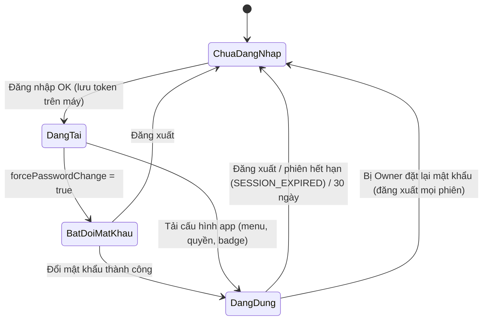
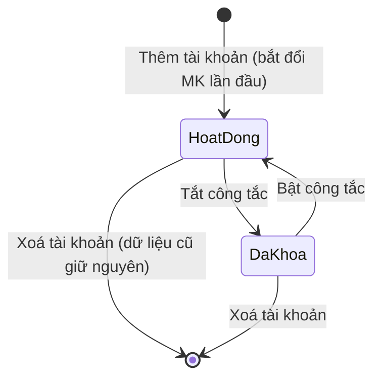
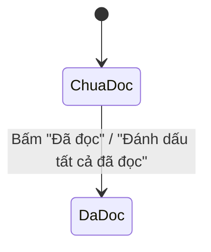
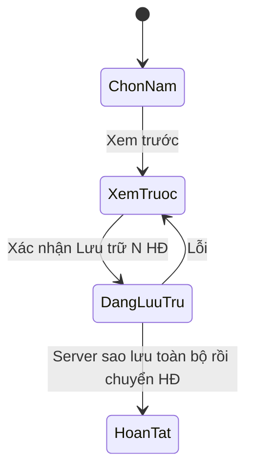

# 00 — Nền tảng & Phân quyền (App Oxy / Oxy Mecie)

> Nguồn phân tích: mã giao diện đã tải về — `shell.html` (khung app), `taikhoan.html` (Quản lý tài khoản), thư viện JS/CSS dùng chung (giống hệt nhau ở mọi trang), phần nhật ký/hồ sơ trong `hdban.html`. Ví dụ trong tài liệu là giả định, không phải dữ liệu thật.
> Quy ước: điều không thấy trực tiếp trong code được gắn nhãn **[Suy luận]**.

---

## 1. Mục đích & phạm vi

| Khối | Nội dung |
|---|---|
| Xác thực | Đăng nhập bằng Tên đăng nhập + Mật khẩu, nhớ phiên trên máy, bắt buộc đổi mật khẩu lần đầu, tự đổi mật khẩu, đăng xuất |
| Khung app (shell) | Thanh menu trên cùng, mỗi màn là 1 iframe giữ sống (không nạp lại), nạp trước các màn còn lại, cảnh báo rời trang khi có thay đổi chưa lưu, nút Làm mới, kiểm tra dữ liệu mới định kỳ |
| Thông báo | Chuông thông báo 2 nhóm: *Việc cần làm* và *Thông tin*, điều hướng thẳng tới chỗ cần xử lý |
| Quản lý tài khoản | 4 tab: Theo tài khoản · Bảng tổng hợp · Cài đặt thông báo · Thông số & Sao lưu |
| Phân quyền | 7 vai trò mẫu, 34 khóa quyền, mỗi khóa có Xem / Sửa / Phạm vi (Của mình / Tất cả) |
| Thông số hệ thống | Bảng tham số (số nguyên, %, danh sách %) có giá trị mặc định |
| Sao lưu & Lưu trữ | Sao lưu tự động hằng đêm + sao lưu tay; lưu trữ HĐ đã kết thúc theo năm sang file riêng |
| Nhật ký | Nhật ký tự động + ghi tay trên từng hợp đồng; sửa/xoá dòng ghi tay |
| Tiện ích dùng chung | Upload hồ sơ, tra cứu MST, ô ngày dd/mm/yyyy, ô tiền, lưu ngầm có hàng đợi, phân trang "Xem thêm", bộ nhớ đệm phía trình duyệt |

---

## 2. Vai trò & quyền liên quan

### 2.1 Vai trò mẫu (`roleKeys`)

| Khóa | Nhãn | Phòng/Ban mặc định (`rolePhong`) | Ghi chú |
|---|---|---|---|
| `owner` | Owner | Ban Giám đốc | Không có mẫu quyền — toàn quyền |
| `giamdoc` | Giám đốc | Ban Giám đốc | Giao diện coi như Owner: "có toàn quyền trên mọi chức năng, không cấu hình theo bảng quyền" |
| `admin` | Admin | Phòng Kinh doanh | |
| `sale` | Sale | Phòng Kinh doanh | Vai trò mặc định được tích sẵn khi tạo tài khoản mới |
| `ketoan` | Kế toán | Phòng Kế toán | |
| `kho` | Kho | Phòng Vật tư | |
| `muahang` | Mua hàng | Phòng Vật tư | |

Danh sách Phòng/Ban (`phongBan`): Ban Giám đốc · Phòng Kinh doanh · Phòng Kế toán · Phòng Vật tư.

**1 tài khoản có thể giữ nhiều vai trò.** Quyền mẫu được tính bằng cách gộp các mẫu (hàm `tplFor`):
- `v` (Xem) = OR các mẫu; `e` (Sửa) = OR các mẫu;
- Phạm vi: `all` thắng `own`.

### 2.2 Cấu trúc 1 ô quyền

`perm[khóa] = { v: Xem (bool), e: Sửa (bool), sc: 'own' | 'all' | null }` — `sc` chỉ có nghĩa với các khóa có cột *Phạm vi* (`funcHasScope = true`).

Client dùng 2 hàm: `can(khóa, edit?)` và `scopeOf(khóa)`.

### 2.3 Danh sách đầy đủ khóa quyền & ma trận mặc định theo vai trò

Ký hiệu: **Sửa** = Xem + Sửa · **Xem** = chỉ xem · ✗ = không có quyền · (Tất cả)/(Của mình) = phạm vi. Owner và Giám đốc có toàn quyền (cột Giám đốc dưới đây là mẫu do server trả về, cũng là toàn quyền).
Nguồn: `getQuanLyTaiKhoan().config.groups / roleTemplates` tại thời điểm lấy mã.

| Nhóm | Khóa | Chức năng | Có Phạm vi? | Giám đốc | Admin | Sale | Kế toán | Kho | Mua hàng |
|---|---|---|---|---|---|---|---|---|---|
| Danh mục | `khachhang` | Khách hàng | Có | Sửa (Tất cả) | Sửa (Tất cả) | Sửa (Của mình) | Xem (Tất cả) | ✗ | ✗ |
| Danh mục | `ncc` | Nhà cung cấp | — | Sửa | Sửa | Xem | Sửa | ✗ | Sửa |
| Danh mục | `hanghoa` | Hàng hoá (tạo mã mới) | — | Sửa | Sửa | Xem | Xem | Sửa | Sửa |
| Hợp đồng bán | `hdb_xem` | Xem Hợp đồng bán (nội dung, không giá) | Có | Sửa (Tất cả) | Sửa (Tất cả) | Xem (Của mình) | Xem (Tất cả) | Xem (Tất cả) | Xem (Tất cả) |
| Hợp đồng bán | `hdb_tao` | Tạo, sửa Báo giá / Hợp đồng | Có | Sửa (Tất cả) | Sửa (Tất cả) | Sửa (Của mình) | ✗ | ✗ | ✗ |
| Hợp đồng bán | `hdb_dongia` | Đơn giá, giá trị, Phương án KD | Có | Sửa (Tất cả) | Sửa (Tất cả) | Sửa (Của mình) | Xem (Tất cả) | ✗ | ✗ |
| Hợp đồng bán | `hdb_chot` | Chuyển giai đoạn | Có | Sửa (Tất cả) | Sửa (Tất cả) | Sửa (Của mình) | ✗ | ✗ | ✗ |
| Hợp đồng bán | `hdb_mokhoa` | Mở lại HĐ đã Kết thúc | — | Sửa | Sửa | ✗ | ✗ | ✗ | ✗ |
| Hợp đồng bán | `hdb_hoso` | Hồ sơ lưu (tải / xoá file) | Có | Sửa (Tất cả) | Sửa (Tất cả) | Sửa (Của mình) | Sửa (Tất cả) | Sửa (Tất cả) | ✗ |
| Hợp đồng bán | `hdb_tt` | Ghi nhận Khách đã thanh toán (Ngày, Số tiền khách trả) | Có | Sửa (Tất cả) | Sửa (Tất cả) | Xem (Của mình) | Sửa (Tất cả) | ✗ | ✗ |
| Hợp đồng bán | `hdb_hoadon` | Xuất hoá đơn | Có | Sửa (Tất cả) | Sửa (Tất cả) | Xem (Của mình) | Sửa (Tất cả) | ✗ | ✗ |
| Hợp đồng bán | `hdb_giaohang` | Cấp hàng / Giao hàng / Chi phí giao hàng | Có | Sửa (Tất cả) | Sửa (Tất cả) | Sửa (Của mình) | Xem (Tất cả) | Sửa (Tất cả) | ✗ |
| Hợp đồng bán | `hdb_cpkd` | Xử lý Chi phí KD (trả khách, Phí QL) | Có | Sửa (Tất cả) | Sửa (Tất cả) | Xem (Của mình) | Sửa (Tất cả) | ✗ | ✗ |
| Hợp đồng mua | `hdm_xem` | Xem Hợp đồng mua | — | Sửa | Sửa | Xem | Xem | Xem | Xem |
| Hợp đồng mua | `hdm_sua` | Tạo, sửa Hợp đồng mua / Chi phí phát sinh | — | Sửa | Sửa | ✗ | ✗ | ✗ | Sửa |
| Hợp đồng mua | `hdm_thanhtoan` | Thanh toán NCC | — | Sửa | Sửa | ✗ | Sửa | ✗ | ✗ |
| Kho | `kho_xem` | Xem tồn kho | — | Sửa | Sửa | Xem | Xem | Sửa | Xem |
| Kho | `kho_phieu` | Lập phiếu nhập / xuất kho | — | Sửa | Sửa | ✗ | ✗ | Sửa | ✗ |
| Kế toán | `kt_xem` | Xem nguồn tiền, phiếu thu / chi, công nợ | — | Sửa | Sửa | ✗ | Xem | ✗ | ✗ |
| Kế toán | `kt_xacnhan` | Xác nhận & lập phiếu thu / chi | — | Sửa | Sửa | ✗ | Sửa | ✗ | ✗ |
| Kế toán | `kt_nguontien` | Quản lý nguồn tiền | — | Sửa | Sửa | ✗ | Sửa | ✗ | ✗ |
| Kế toán | `kt_dieuchinh` | Lập Phiếu điều chỉnh số dư | — | Sửa | Sửa | ✗ | Sửa | ✗ | ✗ |
| Kế toán | `kt_duyetdc` | Duyệt Phiếu điều chỉnh số dư | — | Sửa | ✗ | ✗ | ✗ | ✗ | ✗ |
| Phú Tài | `pt_xem` | Xem Hợp đồng Phú Tài | — | Sửa | Sửa | ✗ | Xem | ✗ | ✗ |
| Phú Tài | `pt_sua` | Tạo, sửa Hợp đồng Phú Tài | — | Sửa | Sửa | ✗ | Sửa | ✗ | ✗ |
| Báo cáo | `bc_doanhthu` | Doanh thu (Thực hiện / Tiềm năng) | Có | Sửa (Tất cả) | Sửa (Tất cả) | Xem (Của mình) | Xem (Tất cả) | ✗ | ✗ |
| Báo cáo | `bc_loinhuan` | Lợi nhuận Hợp đồng | — | Sửa | Sửa | ✗ | Xem | ✗ | ✗ |
| Báo cáo | `bc_tdtt` | Tiến độ thanh toán | Có | Sửa (Tất cả) | Sửa (Tất cả) | Xem (Của mình) | Xem (Tất cả) | ✗ | ✗ |
| Báo cáo | `bc_giaohang` | Tiến độ giao hàng | Có | Sửa (Tất cả) | Sửa (Tất cả) | Xem (Của mình) | Xem (Tất cả) | Xem (Tất cả) | Xem (Tất cả) |
| ToDoList | `todo` | Xem việc cần làm / Đặt lịch | Có | Sửa (Tất cả) | Sửa (Tất cả) | Sửa (Của mình) | Sửa (Tất cả) | Sửa (Tất cả) | Sửa (Tất cả) |
| Hệ thống | `hethong_duyetxoa` | Duyệt xoá | — | Sửa | Sửa | ✗ | ✗ | ✗ | ✗ |
| Hệ thống | `nhatky_sua` | Sửa / xoá nhật ký ghi tay của mọi người | — | Sửa | Sửa | ✗ | ✗ | ✗ | ✗ |
| Hệ thống | `hethong_taikhoan` | Quản lý tài khoản | — | Sửa | ✗ | ✗ | ✗ | ✗ | ✗ |
| Hệ thống | `hethong_thongbao` | Cài đặt thông báo | — | Sửa | ✗ | ✗ | ✗ | ✗ | ✗ |

Ghi chú:
- Mẫu quyền đến từ server (`roleTemplates`). [Suy luận] Mẫu là cấu hình phía server; giao diện không có màn sửa mẫu, chỉ sửa quyền từng tài khoản.
- Quyền thực tế của 1 người có thể khác mẫu; ô khác mẫu được tô vàng và đếm "N ô khác mẫu".
- Menu chỉ hiện các màn người dùng được phép (`getAppInit().menu`). Mở màn không có trong menu → toast "Bạn không có quyền mở màn này." [Suy luận] Server lọc menu theo khóa `*_xem`/`v`.
- Footer chuông "⚙️ Cài đặt thông báo" chỉ hiện với `isOwner`. Tên người phụ trách trong chuông chỉ hiện với Owner / Admin / Giám đốc.

---

## 3. Danh sách màn hình / tab

### 3.1 Màn Đăng nhập (`#viewLogin`)
- Logo chữ "OX", tiêu đề "Oxy Mecie", phụ đề "Quản lý nội bộ · Oxy Mecie".
- Trường: Tên đăng nhập, Mật khẩu (nút 👁 hiện/ẩn). Nút **Đăng nhập** (đổi thành "Đang đăng nhập..." khi chờ).
- Dòng lỗi màu đỏ. Gợi ý: "Đăng nhập được ghi nhớ trên máy này tới khi Đăng xuất hoặc hết phiên (30 ngày)."
- Màn chờ (splash) có spinner "Đang tải dữ liệu...".

### 3.2 Popup Đổi mật khẩu (`#pwOverlay`)
| Chế độ | Tiêu đề | Hành vi |
|---|---|---|
| Bắt buộc (`forcePasswordChange`) | "Cần đổi mật khẩu" + nhãn "Bắt buộc" | Không có nút ✕, không đóng được; ghi chú "Không thể đóng hộp này tới khi đổi xong." + link **Đăng xuất** |
| Tự nguyện (menu tài khoản) | "Đổi mật khẩu" | Đóng được (✕, bấm nền, Esc) |

Danh sách quy tắc hiện trực tiếp (○ → ✓ màu xanh khi đạt): Tối thiểu 6 ký tự · Hai lần nhập khớp nhau · Khác mật khẩu hiện tại.

### 3.3 Khung app (topbar)
| Vùng | Thành phần |
|---|---|
| Trái | Nút ☰ (chỉ hiện khi màn ≤ 900px), huy hiệu "OX" + "Oxy Mecie" |
| Giữa | Menu dạng nút bo tròn, có biểu tượng + số đếm (badge cam) + chấm đỏ "Có thay đổi chưa lưu" |
| Phải | 🔄 Làm mới · 🔔 Chuông (badge đỏ, tối đa "99+") · Nút tài khoản (avatar chữ cái cuối của họ tên, avatar màu cam nếu Owner; tên ẩn khi ≤ 1180px) |

Menu (thứ tự quan sát được): 📝 ToDoList · 📄 Hợp đồng bán · 🛒 Hợp đồng mua · 📦 Kho · 💰 Kế toán · 🤝 Phú Tài · 📊 Báo cáo · 👥 Khách hàng / NCC · 🗑️ Duyệt xoá · 👤 Quản lý tài khoản.

Popup tài khoản: avatar, họ tên, `@tên đăng nhập`, nhãn vai trò, 🏢 phòng ban; nút 🔑 Đổi mật khẩu, ↩ Đăng xuất (màu cảnh báo).

Màn mở đầu: **Hợp đồng bán** nếu có quyền, nếu không thì mục đầu tiên của menu. Không có mục nào → "🔒 Tài khoản chưa được cấp quyền màn nào. Vui lòng liên hệ Owner."

### 3.4 Popup Có thay đổi chưa lưu (`#leaveOverlay`)
Icon ⚠️, tiêu đề "Có thay đổi chưa lưu", nội dung nêu màn đang dở; nút **Ở lại** / **Thoát không lưu** (đỏ). Xuất hiện khi chuyển màn hoặc đăng xuất lúc có màn đang "dirty".

### 3.5 Chuông thông báo (popup rộng 420px)
- Đầu: "THÔNG BÁO" + (ở nhóm Thông tin) link "Đánh dấu tất cả đã đọc".
- 2 nút chuyển: **Việc cần làm N** · **Thông tin N**.
- Mỗi dòng: `Số HĐ · Tên khách` (chữ nhỏ) · tiêu đề (chấm xanh nếu chưa đọc) · số tiền · nhãn loại (+ người phụ trách) · ngày `dd/mm` kèm chữ "hạn" / "quá hạn" (đỏ nhấp nháy) / "ngày" · nút **Xử lý →** (việc) hoặc **Đã đọc** (thông tin).
- Rỗng: "🎉 Không còn việc nào cần làm." / "📭 Không có thông tin mới."
- Chân: 📝 Xem ToDoList (nếu có quyền) · ⚙️ Cài đặt thông báo (chỉ Owner → mở Quản lý tài khoản, tab Cài đặt thông báo).
- Sắp xếp: Việc → ngày tăng dần (không ngày xuống cuối). Thông tin → chưa đọc trước, rồi ngày mới nhất.

Loại thông báo (`TB_LABELS` trong shell):

| Khóa | Nhãn | Khóa | Nhãn |
|---|---|---|---|
| `hd_cho_chuyen` | Chờ chuyển giai đoạn | `kt_cho_xu_ly` | Chờ kế toán |
| `tt_du_kien` | Hạn khách thanh toán | `dat_lich` | Giao việc / lịch hẹn |
| `kh_da_tt` | Khách đã thanh toán | `giao_viec_ph` | Phản hồi việc giao |
| `han_giao` | Hạn giao hàng | `bao_hang_ve` | Hàng về chờ nhập |
| `cho_cap_hang` | Chờ cấp hàng | `tt_ncc` | Hạn trả NCC |
| `xuat_hoa_don` | Xuất hoá đơn | `kh_thieu_mst` | KH thiếu MST |
| `cpkd_cho_chi` | Chi phí KD | `hang_sap_ve` | Hàng sắp về |
| `de_nghi_mua` | Đề nghị mua | `ma_hang_moi` | Mở mã hàng |
| | | `nong_do_lech` | Nồng độ lệch |

(ToDoList còn thêm nhóm "Bổ sung: …" — xem 09_ToDoList.md.)

### 3.6 Quản lý tài khoản — 4 tab
Thanh tab dính trên cùng: **Theo tài khoản** · **Bảng tổng hợp** · **Cài đặt thông báo** · **⚙ Thông số & Sao lưu**. Mở thẳng tab qua tham số `tab=thongbao` hoặc `tab=thongso`.

#### Tab A — Theo tài khoản (bố cục 2 cột 280px | còn lại; ≤ 900px xếp 1 cột)
Cột trái:
- Ô tìm "Tìm tên / tên đăng nhập".
- Danh sách tài khoản: avatar (cam = Owner, xám = đã khoá), họ tên, `@username`, "N ô khác mẫu" (cam), "Đã khoá" (cam đỏ), nhãn vai trò.
- Nút **+ Thêm tài khoản**.

Cột phải (panel tài khoản đang chọn):
1. Tiêu đề: họ tên + pill "✓ Đang hoạt động"/"🔒 Đã khoá" + pill "Bạn" (nếu là chính mình) + công tắc Khoá/Mở (ẩn với chính mình).
2. Thông tin: Họ tên · Tên đăng nhập (khóa) · Phòng/Ban → nút **💾 Lưu họ tên / phòng**.
3. Khối **🔑 Đặt lại mật khẩu**: Mật khẩu mới · Nhập lại · công tắc "Bắt đổi ở lần đăng nhập tới" (mặc định bật) → **Đặt lại mật khẩu**; ghi chú "Người đó bị đăng xuất khỏi mọi thiết bị."
4. **Mẫu vai trò**: 7 ô tích (chọn nhiều).
5. **Bảng phân quyền chi tiết** (ẩn nếu có vai trò Owner/Giám đốc): cột Chức năng | Xem | Sửa | Phạm vi (radio Của mình / Tất cả hoặc "—"); dòng nhóm in hoa; dòng khác mẫu nền vàng; pill "N ô khác mẫu".
6. Chân: **Xoá tài khoản** (đỏ, ẩn với chính mình) · **↺ Về đúng mẫu** (ẩn với Owner/GĐ) · **Lưu quyền** (chính).

#### Popup Thêm tài khoản (cỡ md)
Xem bảng form 4.3.

#### Tab B — Bảng tổng hợp (ma trận)
- Hàng: các chức năng theo nhóm; Cột: mỗi tài khoản (tên là link → chuyển sang tab A tài khoản đó, dưới tên là nhãn vai trò).
- Ô: "Sửa" (xanh, đậm) / "Xem" / "—" (mờ) + dòng phụ "Tất cả"/"Của mình"; ô khác mẫu nền vàng.

#### Tab C — Cài đặt thông báo
- Bảng: cột "Loại thông báo" + 1 cột cho mỗi vai trò (danh sách vai trò do server trả).
- Mỗi dòng: tên loại (đậm) + pill "Thông tin" (xanh) hoặc "Việc cần làm" (cam) + mô tả phụ; ô tích theo vai trò.
- Nút **Lưu cài đặt thông báo**; ghi chú: "Việc gắn với 1 hợp đồng chỉ tới người phụ trách hợp đồng đó (khi phạm vi là "Của mình"). Owner luôn thấy hết."

#### Tab D — Thông số & Sao lưu
1. **Bảng thông số**: Thông số | Giá trị đang dùng | Ghi chú. Dòng nhóm theo `nhom`; dưới tên có "Sửa lần cuối: người · thời gian"; ô nhập căn phải (90px, danh sách % 150px) + hậu tố `%` với kiểu %; cột ghi chú "Mặc định: …" + pill "đã đổi" khi khác mặc định. Chỉ sửa được khi server trả `sua = true`. Nút **Lưu thông số** + ghi chú "Tỷ lệ nhập theo %, ví dụ 25 = 25%. Thay đổi áp dụng cho lần tính tiếp theo (HĐ đã lưu không tự tính lại cho tới khi được lưu lại)." Danh sách thông số cụ thể do `getCaiDatThongSo` trả về — **không có trong dữ liệu đã tải**.
2. **💾 Sao lưu dữ liệu**:
   - Đã bật hẹn giờ: "✅ Tự sao lưu mỗi đêm (1–2 giờ sáng), giữ N bản mới nhất."
   - Chưa bật: banner cảnh báo hướng dẫn chạy hàm `caiHenGioSaoLuu` 1 lần trong trình soạn Apps Script.
   - Lần gần nhất: thời gian + link "mở bản sao" + "thư mục sao lưu" (số bản); hoặc "Chưa có bản sao lưu nào."; lỗi lần trước hiển thị hộp đỏ.
   - Nút **💾 Sao lưu ngay** (đổi "⏳ Đang sao lưu…"). Ghi chú cách khôi phục: mở bản sao → chép lại sheet; bản cũ hơn N bản vào Thùng rác Drive (lấy lại được 30 ngày).
3. **🗄 Lưu trữ dữ liệu cũ theo năm**:
   - Mô tả: chuyển HĐ bán / HĐ mua **đã Kết thúc** của năm cũ (kèm chi tiết, hồ sơ, nhật ký) sang file Google Sheet riêng mỗi năm. Phiếu thu chi, phiếu kho, KH, NCC, hàng hoá giữ nguyên. HĐ còn việc mở (chờ Kế toán, Phú Tài còn nợ, HĐ liên kết chưa kết thúc) tự giữ lại. App tự sao lưu toàn bộ trước khi chuyển.
   - Danh sách năm đã lưu trữ: "📁 Năm YYYY: x HĐ bán, y HĐ mua — mở file lưu trữ".
   - "Lưu trữ tới hết năm [chọn năm: năm nay − 1 … 2020]" + **Xem trước**.
   - Kết quả xem trước (banner): số HĐ bán/mua + số dòng dữ liệu + chia theo năm; cảnh báo sau khi lưu trữ HĐ không còn trong danh sách/báo cáo/công nợ; mục thu gọn "Giữ lại N HĐ vì còn liên quan" (liệt kê lý do); nút **🗄 Lưu trữ N HĐ** (đỏ) → hộp xác nhận ("Có thể mất 1–2 phút") → nút đổi "⏳ Đang lưu trữ… (đừng đóng trang)".

### 3.7 Nhật ký (khối "📜 Nhật ký" trong chi tiết HĐ bán / HĐ mua)
- Ô nhập "Ghi chú tiến độ, trao đổi với khách..." + nút **Thêm**.
- Danh sách cuộn (tối đa 300px): cột trái thời gian + người; cột phải nhãn mục + nội dung + "(sửa thời gian)" + link **Sửa** / **Xoá** (chỉ dòng ghi tay).
- Nhãn mục (`MUC_LABEL`) — HĐ bán: giaidoan = Giai đoạn · thongtin = Thông tin · thanhtoan = Thanh toán · giaohang = Giao hàng · cpkd = Chi phí KD · hoso = Hồ sơ · xoa = Xoá · chung = Ghi chú. HĐ mua: thay giaohang/cpkd bằng nhanhang = Nhận hàng · chiphi = Chi phí.
- Dòng tự động (loại ≠ `tay`) hiển thị mờ, chữ nhỏ.

---

## 4. Chi tiết form

### 4.1 Đăng nhập
| Trường | Kiểu nhập | Bắt buộc | Tự tính/nguồn | Ghi chú |
|---|---|---|---|---|
| Tên đăng nhập | text (không tự viết hoa, không kiểm chính tả) | Có | — | Bỏ khoảng trắng 2 đầu |
| Mật khẩu | password + nút 👁 | Có | — | Thiếu 1 trong 2 → "Vui lòng nhập Tên đăng nhập và Mật khẩu." |

### 4.2 Đổi mật khẩu
| Trường | Kiểu nhập | Bắt buộc | Tự tính/nguồn | Ghi chú |
|---|---|---|---|---|
| Mật khẩu hiện tại | password | Có | — | Thiếu → "Vui lòng nhập mật khẩu hiện tại." |
| Mật khẩu mới | password | Có | — | ≥ 6 ký tự, khác mật khẩu hiện tại |
| Nhập lại mật khẩu mới | password | Có | — | Phải khớp; chưa đạt đủ → "Mật khẩu mới chưa đạt đủ 3 điều kiện bên trên." |

### 4.3 Thêm tài khoản
| Trường | Kiểu nhập | Bắt buộc | Tự tính/nguồn | Ghi chú |
|---|---|---|---|---|
| Họ tên | text | [Suy luận] Có (kiểm ở server) | — | Khi rời ô, nếu Tên đăng nhập trống → gọi `goiYTenDangNhap` để điền gợi ý |
| Tên đăng nhập | text | [Suy luận] Có | Gợi ý tự động theo họ tên | Placeholder "tự gợi ý theo họ tên". Ví dụ: "Nguyễn Văn An" → `vanan` [Suy luận về quy tắc gợi ý] |
| Mật khẩu ban đầu | text (hiện rõ) | [Suy luận] Có | Điền sẵn 1 giá trị mặc định theo mẫu cố định + năm hiện tại | Người mới luôn bị bắt đổi mật khẩu lần đầu (`batDoiMatKhau: true`) |
| Phòng/Ban | select | Không | Lựa chọn đầu "Theo vai trò" (= `rolePhong`) | 4 phòng ban |
| Vai trò | ô tích nhiều | [Suy luận] ≥ 1 | Mặc định tích **Sale** | 7 vai trò |

Lỗi server hiển thị trong vùng lỗi của popup. Thành công → chọn ngay tài khoản mới, toast "Đã tạo tài khoản <username>".

### 4.4 Panel tài khoản
| Trường | Kiểu nhập | Bắt buộc | Tự tính/nguồn | Ghi chú |
|---|---|---|---|---|
| Họ tên | text | — | — | Lưu bằng nút "Lưu họ tên / phòng" |
| Tên đăng nhập | text khóa | — | — | Không sửa được |
| Phòng/Ban | select | — | `config.phongBan` | |
| Trạng thái | công tắc | — | — | Đổi là gọi server ngay (`setKhoaTaiKhoan`); lỗi thì trả công tắc về cũ |
| Mật khẩu mới / Nhập lại | password | Có khi đặt lại | — | ≥ 6 ký tự, khớp nhau (kiểm ở client bằng toast) |
| Bắt đổi ở lần đăng nhập tới | công tắc | — | Mặc định bật | |
| Mẫu vai trò | ô tích nhiều | — | — | Đổi vai trò → quyền **đặt lại toàn bộ theo mẫu gộp** |
| Xem / Sửa | ô tích mỗi chức năng | — | Mẫu vai trò | Xem bỏ → Sửa và Phạm vi bị xoá; Sửa bật → tự bật Xem |
| Phạm vi | radio Của mình / Tất cả | — | Mặc định "Của mình" khi bật Xem/Sửa | Khóa khi chưa có quyền Xem; chỉ có ở khóa có phạm vi |

### 4.5 Thông số
| Trường | Kiểu nhập | Bắt buộc | Tự tính/nguồn | Ghi chú |
|---|---|---|---|---|
| Giá trị (`int`) | text số | Có | `getCaiDatThongSo().ds[].giaTri` | Không phải số → "Nhập số" |
| Giá trị (`pct`) | text số, đơn vị % | Có | Hiển thị = giá trị × 100, dấu phẩy thập phân | Lưu = nhập / 100 (làm tròn 4 số lẻ) |
| Giá trị (`pctList`) | danh sách % cách nhau bởi `,` `;` hoặc khoảng trắng | Có | | Ví dụ "10, 20, 25" |

### 4.6 Lưu trữ theo năm
| Trường | Kiểu nhập | Bắt buộc | Tự tính/nguồn | Ghi chú |
|---|---|---|---|---|
| Lưu trữ tới hết năm | select | Có | Năm hiện tại − 1 → 2020 | Chỉ hiện khi `sua = true` |

---

## 5. Luồng trạng thái

### 5.1 Phiên đăng nhập

### 5.2 Tài khoản

### 5.3 Thông báo loại "Thông tin"

Thông báo loại "Việc cần làm" không có nút đóng — [Suy luận] tự biến mất khi việc gốc được xử lý (server tính lại).

### 5.4 Lưu trữ năm

---

## 6. Công thức / quy tắc sinh mã

| Đối tượng | Quy tắc |
|---|---|
| Quyền mẫu khi nhiều vai trò | `v = OR`, `e = OR`, `sc = 'all'` nếu có mẫu nào `all`, ngược lại `own` |
| "Ô khác mẫu" | So sánh `v`, `e`, `sc` của quyền thực tế với quyền mẫu; khác ở bất kỳ thuộc tính nào → tính 1 ô |
| Badge chuông | `countTodo + countUnread`; > 99 hiển thị "99+"; = 0 ẩn |
| Quá hạn (chuông) | Chỉ với việc: `ngày < hôm nay` |
| Tên đăng nhập | Do server gợi ý từ họ tên (`goiYTenDangNhap`) — quy tắc chi tiết không có ở client |
| Avatar | Chữ cái đầu của **từ cuối** trong họ tên, viết hoa |
| Định dạng tiền | Làm tròn số nguyên, phân cách hàng nghìn bằng dấu chấm, hậu tố " đ"; rỗng → "—" |
| Định dạng % | × 100, dấu phẩy thập phân |
| Ngày | Hiển thị `dd/mm/yyyy` (bảng ngắn `dd.mm.yy`); gõ được `04/10/2026`, `4-10-26`, `041026`, `04102026`; năm 2 số + 2000 |

---

## 7. Quy tắc nghiệp vụ & ràng buộc

**Xác thực**
1. Phiên lưu trong trình duyệt tới khi Đăng xuất hoặc hết phiên 30 ngày.
2. Lỗi `SESSION_EXPIRED` từ bất kỳ màn nào → quay về Đăng nhập với thông báo "Phiên đăng nhập đã hết hạn. Vui lòng đăng nhập lại."
3. Đăng xuất xoá toàn bộ bộ nhớ đệm phía trình duyệt; nếu có màn chưa lưu → hỏi xác nhận trước.
4. Tài khoản bị bắt đổi mật khẩu không vào app được tới khi đổi xong (chỉ có thể Đăng xuất).

**Quản lý tài khoản**
5. Không tự khoá / tự xoá chính mình (nút ẩn).
6. Đặt lại mật khẩu: đăng xuất người đó khỏi mọi phiên; toast báo số phiên bị đăng xuất.
7. Owner/Giám đốc: không có bảng quyền; luôn toàn quyền.
8. Đổi vai trò → quyền về theo mẫu mới (server báo `resetToTpl`).
9. Xoá tài khoản không xoá dữ liệu nghiệp vụ người đó đã tạo.
10. Chuyển sang tài khoản khác khi đang sửa dở → hỏi "Bỏ thay đổi chưa lưu?".

**Khung app & đồng bộ**
11. Mỗi màn là 1 iframe sống; chuyển màn không nạp lại. Sau khi màn đầu sẵn sàng, các màn còn lại được nạp trước lần lượt (cách nhau 0,8s; tối đa chờ 30s/màn).
12. Khi 1 màn ghi dữ liệu → các màn khác bị đánh dấu "cũ" và tự làm mới khi được mở lại (nếu không có thay đổi chưa lưu); chuông và cấu hình app làm mới sau 1,5s.
13. Mỗi 60 giây (khi tab đang hiện) và khi quay lại cửa sổ (cách nhau ≥ 15s), app hỏi phiên bản dữ liệu (`getPhienBan`). Nếu người khác vừa đổi → màn hiện tại hiện banner vàng "Có dữ liệu mới do người khác vừa cập nhật" + nút **🔄 Cập nhật**; nếu đang sửa dở thì từ chối cập nhật và nhắc lưu trước.
14. Sang ngày mới → tải lại chuông.
15. Lưu ngầm (`luuNgam`): thao tác ghi được đưa vào hàng đợi theo khóa, hiện huy hiệu góc phải dưới "⏳ Đang lưu lên máy chủ…" → "✓ Đã lưu lên máy chủ" / "⚠ Chưa lưu được…"; bản nháp lưu trong IndexedDB để khôi phục; đóng trang khi đang lưu → trình duyệt cảnh báo.
16. Xung đột ghi (`XUNG_DOT:`) → banner "Có người khác vừa sửa hợp đồng này" với lựa chọn "Vẫn lưu bản của tôi" / "Khôi phục bản của tôi" / "Tải bản mới (bỏ thay đổi của tôi)".

**Upload hồ sơ (dùng chung)**
17. Mỗi file ≤ 20MB (lớn hơn bị bỏ qua kèm toast).
18. Ảnh JPEG/PNG/WebP/BMP > 1MB được thu nhỏ cạnh dài ≤ 2000px, chuyển JPEG chất lượng 0,82 (chỉ dùng bản nén nếu nhỏ hơn).
19. Gửi file đầu tiên trước, sau đó 3 luồng song song; báo lỗi từng file.

**Nhật ký**
20. Thêm nhật ký: nội dung không được rỗng.
21. Sửa/xoá: chỉ dòng ghi tay; người viết sửa được dòng của mình; người có `nhatky_sua` sửa/xoá dòng của mọi người. Dòng đã sửa hiện "(sửa thời gian)".

**Thông số / sao lưu / lưu trữ**
22. Thông số đổi chỉ áp dụng cho lần tính tiếp theo; HĐ đã lưu không tự tính lại.
23. Sao lưu tự động chỉ chạy sau khi kích hoạt hẹn giờ 1 lần trong trình soạn Apps Script.
24. Lưu trữ năm chỉ chuyển HĐ đã Kết thúc và không còn ràng buộc mở; luôn sao lưu toàn bộ trước.

**Cài đặt thông báo**
25. Bật/tắt từng loại thông báo theo vai trò; việc gắn HĐ chỉ tới người phụ trách HĐ khi phạm vi "Của mình"; Owner thấy tất cả.

---

## 8. Liên kết module khác

| Từ | Tới | Cách liên kết |
|---|---|---|
| Chuông / ToDoList | Mọi màn nghiệp vụ | `target {page, id, tab, focus}` → mở màn, mở bản ghi, chuyển tab, cuộn tới ô và nhấp nháy vàng (`flashFocus`) |
| Mọi màn | Duyệt xoá | Nút xoá gọi `yeuCauXoa` (xem 08_DuyetXoa.md) |
| HĐ bán / HĐ mua | Nhật ký | `themNhatKy('hdb'|'hdm', id, muc, nội dung)`, `suaNhatKy` |
| Cài đặt thông báo | Chuông, ToDoList | Quyết định vai trò nào nhận loại nào |
| Thông số | HĐ bán, Kế toán, Phú Tài… | [Suy luận] tham số tỷ lệ % dùng khi tính toán trong HĐ |
| Lưu trữ năm | HĐ bán, HĐ mua, Báo cáo, Công nợ | HĐ đã lưu trữ biến mất khỏi danh sách/báo cáo |
| Quyền | Mọi màn | `can()`/`scopeOf()` ẩn/khóa nút, lọc dữ liệu |

---

## 9. Hàm server → mục đích

| Hàm | Mục đích (theo cách client gọi) |
|---|---|
| `login(user, pw)` | Đăng nhập → `{ok, token, message}` |
| `checkSession` | Kiểm tra phiên — [Suy luận] không thấy client gọi trực tiếp |
| `logout(token)` | Huỷ phiên trên server |
| `changeOwnPassword(cũ, mới)` | Tự đổi mật khẩu → `{ok, message}` |
| `getAppInit` | Thông tin người dùng (họ tên, vai trò, phòng ban, `isOwner`, `forcePasswordChange`, `perm`), menu, badge, danh sách dữ liệu nạp trước |
| `getPhienBan` | Số phiên bản dữ liệu để phát hiện thay đổi của người khác |
| `taiNeuDoi(fn, args, dấu)` | Bộ nhớ đệm có điều kiện: chỉ trả dữ liệu khi khác "dấu" đã có (`khongDoi`) |
| `dongBoChiTiet` | Đồng bộ dần chi tiết HĐ vào bộ nhớ đệm trình duyệt |
| `hamNongDuLieu`, `hamNongTheoGio` | Hâm nóng dữ liệu (gọi ngay khi mở trang đăng nhập / [Suy luận] theo hẹn giờ) |
| `getPermConfig` | [Suy luận] Lấy cấu hình quyền — không thấy client gọi |
| `getQuanLyTaiKhoan` | `{config, accounts[], me}` cho màn Quản lý tài khoản |
| `goiYTenDangNhap(họ tên)` | Gợi ý tên đăng nhập |
| `saveThongTinTaiKhoan(user, {hoTen, phongBan})` | Lưu họ tên/phòng ban |
| `setKhoaTaiKhoan(user, khoá)` | Khoá/mở tài khoản |
| `datLaiMatKhau(user, mk, batDoi)` | Đặt lại mật khẩu → `soPhienDangXuat` |
| `themTaiKhoan({...})` | Tạo tài khoản |
| `xoaTaiKhoan(user)` | Xoá tài khoản |
| `luuQuyenTaiKhoan(user, {roles, perm, phongBan})` | Lưu quyền → `resetToTpl` |
| `veDungMauQuyen(user)` | Đưa quyền về đúng mẫu |
| `getCaiDatThongBao` / `saveCaiDatThongBao` | Ma trận loại thông báo × vai trò |
| `getThongBao` | `{items[], countTodo, countUnread}` cho chuông |
| `markThongBaoDaDoc(ids)` | Đánh dấu đã đọc |
| `getCaiDatThongSo` / `luuCaiDatThongSo` | Bảng thông số + trạng thái sao lưu + lưu trữ; quyền `sua` |
| `saoLuuNgay` | Sao lưu tay → trạng thái sao lưu mới |
| `saoLuuDuLieu` | [Suy luận] Hàm sao lưu chạy theo hẹn giờ |
| `caiHenGioSaoLuu` | Cài hẹn giờ sao lưu hằng đêm — chạy tay 1 lần trong trình soạn Apps Script |
| `xemTruocLuuTru(năm)` / `thucHienLuuTru(năm)` | Xem trước / chạy lưu trữ năm |
| `themNhatKy` / `suaNhatKy(id, nội dung, xoá)` | Ghi / sửa / xoá nhật ký |
| `uploadHoSo(base64, tên, mime, meta)` | Tải file hồ sơ lên |
| `chiaSeHoSoCu` | [Suy luận] Chia sẻ quyền truy cập file hồ sơ cũ — không thấy client gọi |
| `xoaBoNhoDem` | [Suy luận] Xoá bộ nhớ đệm phía server — không thấy client gọi |
| `caiDatLanDau`, `chuyenDuLieuTuAppCu` | [Suy luận] Khởi tạo hệ thống / chuyển dữ liệu từ app cũ — chạy tay phía server, không có nút trên giao diện |
| `traCuuMST` | Tra MST (dùng ở Danh mục) |

---

## 10. Khác biệt so với spec rev.md

| Chủ đề | Spec rev.md | App thực tế |
|---|---|---|
| Đăng nhập | Email + mật khẩu băm | **Tên đăng nhập** (gợi ý từ họ tên) + mật khẩu; phiên 30 ngày; bắt đổi mật khẩu lần đầu |
| Vai trò | Sales, Admin, Kế toán, Giám đốc (chỉ nêu quyền XEM) | 7 vai trò (thêm Owner, Kho, Mua hàng), nhiều vai trò/người, 34 khóa quyền × Xem/Sửa/Phạm vi, sửa quyền từng người, ma trận tổng hợp |
| Phòng ban | Không có | 4 phòng ban, gắn mặc định theo vai trò |
| Menu & Dashboard | Có dashboard trang chủ | **Không có dashboard**; vào thẳng Hợp đồng bán; chuông + ToDoList đóng vai trò danh sách việc |
| Duyệt xoá | Request → Approve, không xoá thẳng | Người có quyền Duyệt xoá xoá ngay; người khác gửi yêu cầu |
| Font | Times New Roman | Be Vietnam Pro |
| Bộ lọc | Free-text + Năm/Quý/Tháng + multi-select | Các màn thuộc phần này chỉ có ô tìm + select đơn |
| Thông báo, ToDoList, Thông số, Sao lưu, Lưu trữ năm, Nhật ký | Không có trong spec | Có đầy đủ |
| Bảng rộng | Freeze cột đầu + cuộn ngang | Tiêu đề bảng dính (sticky header), cuộn trong khung; không thấy freeze cột đầu ở các màn này |
| Hồ sơ | Thumbnail, nén ảnh, tải zip | Có nén ảnh, giới hạn 20MB/file; không thấy tải zip ở phần này |

---

## 11. Ghi chú thiết kế UI (quy ước chung — CSS dùng chung)

**Màu (biến CSS, có chế độ tối `data-theme="dark"`)**

| Biến | Sáng | Dùng cho |
|---|---|---|
| `--bg` | #f4f6f8 | Nền trang |
| `--surface` / `--surface-2` | #ffffff / #f8f9fb | Thẻ / ô nhập |
| `--border` / `--border-soft` | #e2e5ea / #edeff2 | Viền |
| `--text` / `--text-soft` / `--text-faint` | #1a2230 / #5b6472 / #8993a3 | Chữ |
| `--accent` / `--accent-soft` / `--accent-dark` | #0891b2 / #e6f6fa / #066b82 | Màu chủ đạo (cyan) |
| `--done` | #16a34a | Hoàn thành, công tắc bật |
| `--warn` | #c2410c | Cảnh báo, nút xoá |
| `--amber` | #b45309 | Badge đếm, Owner, khác mẫu |
| `--violet` | #6d28d9 | Nhấn phụ |
| `--danger` | #cf222e | Lỗi, quá hạn, badge chuông |
| `--zebra`, `--th-bg` | #f1f3f6, #e8ebf0 | Sọc bảng, nền tiêu đề bảng |

**Font**: Be Vietnam Pro (400–800), cỡ thân 14.5px, số dạng tabular.
**Bo góc**: 16 / 12 / 9px; nút, tab, pill bo tròn hoàn toàn.

**Thành phần**
- *Topbar*: thanh trắng bo 12px, cao ~40px, menu cuộn ngang ẩn thanh cuộn; ≤ 900px thành nút ☰ mở panel dọc.
- *Tab cấp 2* (`.tabs` trong `.tier2` dính trên): nút bo tròn 32px, đang chọn nền accent chữ trắng. *Tab phụ* (`.subtab`) gạch chân.
- *Thẻ* (`.card`): tiêu đề in hoa 12.5px màu accent-dark; thu gọn được thành 1 dòng tóm tắt.
- *Nút*: `.btn` (xám), `.btn-primary` (accent), `.btn-danger` (nền cam nhạt chữ cam), `.btn-sm`, `.link-btn` (gạch chân).
- *Pill*: accent / done / warn / amber / violet.
- *Công tắc*: 36×20px, bật màu xanh lá, nhãn trạng thái bên cạnh.
- *Form*: lưới 4 cột (`fgrid`), 3 cột (`g3`), 2 cột (`g2`); nhãn in hoa 11px; ô khóa nền xám viền gạch.
- *Bảng* (`table.xl`): tiêu đề dính, chữ 10px in hoa, sọc ngựa vằn, dòng bấm được nổi accent-soft khi rê; dòng nhóm in hoa nền xám; dòng khác biệt nền vàng; chân bảng dính nền accent-soft; phân trang 50 dòng "⬇ Xem thêm 50 dòng (còn N)" + "Hiện hết", tự nạp khi cuộn gần.
- *Ô tìm*: bo tròn, cao 32px, rộng 180–340px.
- *Modal*: nền tối 55%, hộp 420px (md 680px, lg 1180px), icon vuông 42px nền vàng nhạt, tiêu đề 16px đậm, vùng lỗi đỏ, nút căn phải. Có 3 dạng: xác nhận (Huỷ/Đồng ý), lựa chọn nhiều nút, nhập văn bản.
- *Toast*: viên thuốc tối giữa đáy màn hình, hiện ~2,6s.
- *Banner*: accent / done / warn / violet.
- *Loading*: spinner tròn + chữ; *rỗng*: chữ mờ căn giữa; *lỗi*: hộp cam nhạt.
- *Hiệu ứng tìm tới*: nhấp nháy vàng 5 lần quanh ô/dòng đích.
- *Ô ngày*: hiển thị dd/mm/yyyy + biểu tượng 📅 mở lịch gốc.
- *Ô tiền*: tự chèn dấu chấm hàng nghìn khi gõ, căn phải; ô số tự bôi đen khi focus.
- *Responsive*: ≤ 900px lưới form 2 cột; ≤ 560px 1 cột, giảm padding.
