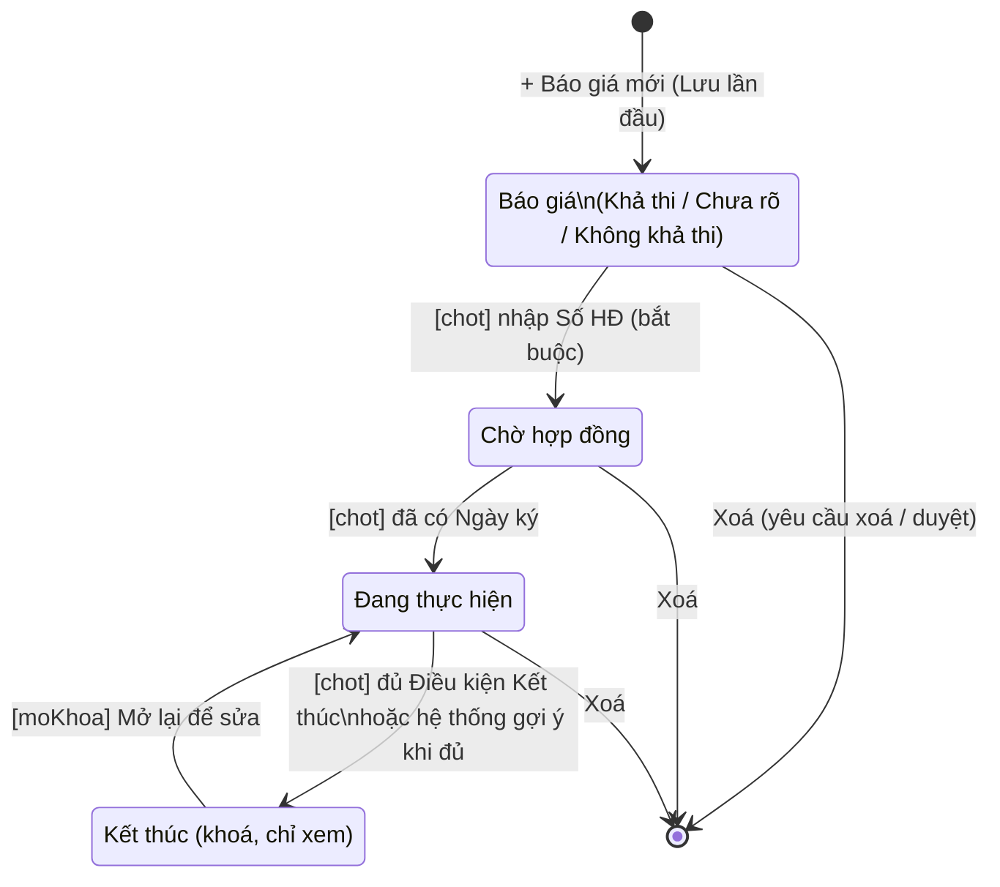

# 01 — Hợp đồng bán (module `hdban`)

> Nguồn phân tích: mã nguồn giao diện (HTML + JS client) đã tải về của web app "Oxy Mecie" (Google Apps Script), phần script của màn Hợp đồng bán và thư viện dùng chung đi kèm. Chỉ ghi điều thấy trong code. Điều suy luận gắn nhãn **[Suy luận]**. Logic phía server (Apps Script `.gs`) **không có trong tài liệu nguồn** → mọi quy tắc server chỉ được ghi khi client thể hiện rõ (thông báo, điều kiện hiển thị, tham số gọi hàm).
> Ví dụ trong tài liệu là giả định (VD: "Công ty TNHH ABC", "HĐ 01/2026"), không phải dữ liệu thật.

---

## 1. Mục đích & phạm vi

Quản lý vòng đời một đơn bán hàng, từ **Báo giá** → **Chờ hợp đồng** → **Đang thực hiện** → **Kết thúc**, trên cùng một bản ghi `HopDongBan`. Phạm vi gồm:

- Thông tin khách hàng (gắn danh mục Khách hàng, tra MST), thông tin giao nhận, người liên hệ.
- Bảng **Giá chi tiết** (dòng hàng: mã, nồng độ, SL, 3 loại đơn giá) → Giá thực hiện, Giá HĐ, VAT, Chênh lệch, **Phí Quản lý**, **Thưởng KD / Chi phí KD**.
- Đợt thanh toán của khách (đề nghị + thực trả, tự gửi phiếu thu sang Kế toán), các lần xuất hoá đơn.
- Kiểm tra tồn kho theo dòng hàng → **Đề nghị cấp hàng** (sang Kho) / **Đề nghị mua** (sang Mua hàng); Kho lập phiếu xuất từ đợt cấp hàng; ghi nhận ngày giao thành công.
- Chi phí giao hàng / phát sinh → tạo phiếu chi gửi Kế toán.
- Phân bổ Thưởng KD / CPKD cho nhiều người nhận → tạo phiếu chi gửi Kế toán; ghi nhận sổ Phí quản lý.
- Hồ sơ lưu (upload file) theo nhóm giai đoạn; Đặt lịch / Giao việc; Nhật ký.
- Kênh bán **Oxy** (trực tiếp) hoặc **Phú Tài** (HĐ ký qua Phú Tài — hành vi khác biệt, xem §7.8).

Ngoài phạm vi màn này: lập phiếu thu/chi thực tế (Kế toán), lập HĐ mua (Mua hàng), chia lợi nhuận kênh Phú Tài (màn Phú Tài).

---

## 2. Vai trò & quyền liên quan

### 2.1. Khoá quyền chức năng (nhãn lấy từ cấu hình màn Quản lý tài khoản)

Mỗi khoá có cờ `v` (xem), `e` (sửa) và `sc` (phạm vi: `own` = của mình / `all` = tất cả; `null` = không áp dụng phạm vi).

| Khoá | Nhãn trong app | Có phạm vi |
|---|---|---|
| `hdb_xem` | Xem Hợp đồng bán (nội dung, không giá) | Có |
| `hdb_tao` | Tạo, sửa Báo giá / Hợp đồng | Có |
| `hdb_dongia` | Đơn giá, giá trị, Phương án KD | Có |
| `hdb_chot` | Chuyển giai đoạn | Có |
| `hdb_mokhoa` | Mở lại HĐ đã Kết thúc | Không |
| `hdb_hoso` | Hồ sơ lưu (tải / xoá file) | Có |
| `hdb_tt` | Ghi nhận Khách đã thanh toán (Ngày, Số tiền khách trả) | Có |
| `hdb_hoadon` | Xuất hoá đơn | Có |
| `hdb_giaohang` | Cấp hàng / Giao hàng / Chi phí giao hàng | Có |
| `hdb_cpkd` | Xử lý Chi phí KD (trả khách, Phí QL) | Có |
| `kho_phieu` | (module Kho) — dùng ở HĐB để hiện nút "Lập phiếu xuất" | Không |
| `hethong_duyetxoa` | Duyệt xoá — người có quyền xoá ngay, người khác gửi yêu cầu | Không |
| `nhatky_sua` | Sửa/xoá nhật ký của người khác | Không |
| `todo` | Giao việc / Đặt lịch cho HĐ | Có |

### 2.2. Cờ quyền trên từng HĐ (`perms` do server trả về trong `getHopDongBan`)

| Cờ client | Tác dụng trên UI | Khoá tương ứng |
|---|---|---|
| `tao` | Sửa thông tin KH/HĐ, giá chi tiết (cột hàng), đợt TT (phần đề nghị), người liên hệ, nút xoá HĐ, mở khoá ô ✏️, Khả thi | [Suy luận] `hdb_tao` |
| `gia` | Thấy mọi số tiền (giá, đợt TT, hoá đơn, chi phí, CPKD); thấy nhóm hồ sơ có `coGia` | [Suy luận] `hdb_dongia` (v) |
| `giaSua` | Sửa Giá TH/HĐ, VAT, đơn giá, Phí QL nhập tay | [Suy luận] `hdb_dongia` (e) |
| `chot` | Nút chuyển giai đoạn trên thanh tiến độ | [Suy luận] `hdb_chot` |
| `moKhoa` | Nút "🔓 Mở lại để sửa" khi Kết thúc | [Suy luận] `hdb_mokhoa` |
| `hoso` | Tải / xoá file ở mọi nhóm hồ sơ | [Suy luận] `hdb_hoso` |
| `tt` | Nhập Ngày KH trả, Số tiền KH trả; upload hồ sơ thanh toán | [Suy luận] `hdb_tt` |
| `hoadon` | Thêm/sửa/xoá lần xuất hoá đơn; upload hồ sơ thanh toán | [Suy luận] `hdb_hoadon` |
| `giaohang` | Cột "Cấp lần này", nút Cấp hàng, huỷ đợt, ngày giao TC, chi phí giao hàng | [Suy luận] `hdb_giaohang` |
| `muaHang` | Cột "Mua thêm", nút "+ Mua hàng" | [Suy luận] quyền Mua hàng (`hdm_sua`) — không xác định được |
| `khoPhieu` | Nút "Lập phiếu xuất" trên đợt cấp hàng; thấy bảng chi phí giao hàng | [Suy luận] `kho_phieu` |
| `cpkd` | Phân bổ Thưởng KD, tạo phiếu chi, ghi nhận Phí QL; upload hồ sơ CPKD | [Suy luận] `hdb_cpkd` |

Danh sách: biến `canTao` (server trả về cùng `listHopDongBan`) quyết định nút "+ Báo giá mới"; biến `canGia` (từ `hdbKhoiDong`) quyết định quyền giá khi tạo mới.

### 2.3. Mẫu quyền mặc định theo vai trò (thấy trong dữ liệu màn Quản lý tài khoản)

V = xem, E = sửa, `:own/:all` = phạm vi.

| Khoá | Giám đốc / Admin | Kế toán | Kho | Mua hàng | Sale |
|---|---|---|---|---|---|
| hdb_xem | VE:all | V:all | V:all | V:all | V:own |
| hdb_tao | VE:all | — | — | — | VE:own |
| hdb_dongia | VE:all | V:all | — | — | VE:own |
| hdb_chot | VE:all | — | — | — | VE:own |
| hdb_mokhoa | VE | — | — | — | — |
| hdb_hoso | VE:all | VE:all | VE:all | — | VE:own |
| hdb_tt | VE:all | VE:all | — | — | V:own |
| hdb_hoadon | VE:all | VE:all | — | — | V:own |
| hdb_giaohang | VE:all | V:all | VE:all | — | VE:own |
| hdb_cpkd | VE:all | VE:all | — | — | V:own |

Vai trò có trong hệ thống: Owner, Giám đốc, Admin, Sale, Kế toán, Kho, Mua hàng. Phòng ban: Ban Giám đốc, Phòng Kinh doanh, Phòng Kế toán, Phòng Vật tư.

---

## 3. Danh sách màn hình

### 3.1. Màn Danh sách Hợp đồng bán (`viewList`)

**Mục đích**: tra cứu, lọc toàn bộ báo giá/hợp đồng; mở chi tiết; tạo báo giá mới.

**Bộ lọc** (lọc phía client, tức thì):

| Bộ lọc | Kiểu | Quy tắc |
|---|---|---|
| Ô tìm kiếm | text + nút × xoá | Khớp chuỗi con (không phân biệt hoa thường) trên Số HĐ, Tên KH, Viết tắt, danh sách mã hàng |
| Giai đoạn | select | Mọi giai đoạn / Báo giá / Chờ hợp đồng / Đang thực hiện / Kết thúc |
| Kênh | select | Mọi kênh / Oxy / Phú Tài (HĐ không có kênh coi là Oxy) |
| Sale | select | Danh sách Sale tách từ cột Sale phụ trách (nhiều người, cách nhau dấu phẩy) |
| Phạm vi | nút bật/tắt "Của mình" / "Tất cả" | "Của mình" = Sale phụ trách chứa họ tên người đăng nhập. Nút "Tất cả" bị khoá nếu phạm vi `hdb_xem` = own và không phải Owner |

Bộ đếm: `<số khớp> / <tổng> hợp đồng`.

**Cột bảng**:

| Cột | Nội dung |
|---|---|
| STT | Số thứ tự trong kết quả lọc |
| Số HĐ · Khách hàng | Số HĐ (hoặc "Chưa cấp số"), Tên KH, dòng phụ: Viết tắt · Sale phụ trách, nhãn tím "Phú Tài" nếu kênh Phú Tài |
| Hàng hoá | Tối đa 2 dòng "mã hàng × SL", còn lại "+N mã khác" |
| Ngày ký | dd.mm.yy; nếu Đang thực hiện và giao chưa đủ: dòng phụ "hạn giao …", **nhấp nháy** khi còn ≤ 15 ngày |
| Giá trước VAT | Giá HĐ, dòng phụ "thực hiện <giá TH>"; không có quyền giá → "•••" |
| Thanh toán | Báo giá → "—"; đã TT ≥ 99,9% → nhãn xanh "Đã thanh toán đủ"; còn lại thanh phân đoạn theo từng đợt (độ rộng = tỉ lệ đợt, xanh = đã trả) + % |
| Giao hàng | Báo giá → "—"; còn lại % đã giao + thanh mini |
| Giai đoạn | Nhãn màu; ở Báo giá kèm mức khả thi ("Báo giá · Khả thi") |

**Phân trang**: hiển thị 50 dòng, nút "⬇ Xem thêm 50 dòng (còn N)" / "Hiện hết"; tự tải thêm khi cuộn tới.
**Trạng thái rỗng**: "Không có hợp đồng nào khớp bộ lọc."
**Nút hành động**: "+ Báo giá mới" (khi `canTao`); bấm 1 dòng → mở chi tiết.
**Tối ưu**: sau khi tải danh sách, app tải ngầm chi tiết (ưu tiên HĐ Đang thực hiện / Chờ hợp đồng) vào bộ nhớ đệm trình duyệt để mở nhanh.

### 3.2. Màn Chi tiết Hợp đồng (`viewDetail`)

**Thanh đầu (header cố định)**: nút "← DS" · Số HĐ (hoặc "Báo giá mới"/"Chưa cấp số") · Tên KH · nhãn giai đoạn · nhãn "Phú Tài" · (chỉ khi Đang thực hiện) 2 tab "💰 Tiến độ thanh toán" / "📦 Kho & Giao hàng" · vùng hành động: chấm "● Chưa lưu", nút 🗑️ Xoá (có `tao`, chưa Kết thúc, không phải HĐ mới), nút "💾 Lưu" (khi chưa Kết thúc và có một trong `tao/giaSua/tt/hoadon`) hoặc "🔓 Mở lại để sửa" (Kết thúc + `moKhoa`).

**Cột phải — "Tiến độ Hợp đồng"**: stepper dọc 4 bước; nút chuyển bước kế tiếp; ở Báo giá có 3 nút chọn Khả thi; ở Đang thực hiện hiện "TT x% · Giao y%" và tối đa 4 việc đang mở (quá hạn có ⚠).

**Nội dung chính theo giai đoạn**:

| Giai đoạn | Các khối hiển thị (thứ tự) |
|---|---|
| Báo giá (mới/đang soạn) | Thông tin khách hàng → Thông tin thực hiện → Giá trị Báo giá (hoặc "Hàng hoá Báo giá" nếu không có quyền giá) → Hồ sơ lưu — Báo giá → (Đặt lịch nếu đã có việc) → Nhật ký |
| Chờ hợp đồng | Thông tin Hợp đồng → Thông tin khách hàng (thu gọn) → Thông tin thực hiện (thu gọn) → Giá trị Hợp đồng → Hồ sơ lưu — Chờ hợp đồng → Đặt lịch / Giao việc → Nhật ký |
| Đang thực hiện – tab Tiến độ TT | Nhóm "Thông tin Hợp đồng" (+ chip: Thông tin khách hàng, Thông tin thực hiện) → Nhóm "Giá trị Hợp đồng" (+ chip: Thưởng KD / Chi phí KD, Hồ sơ Báo giá, Hồ sơ Hợp đồng) → Nhóm "Tiến độ thanh toán" (+ chip: Các đợt thanh toán, Hoá đơn, Hồ sơ lưu) → Đặt lịch → Nhật ký |
| Đang thực hiện – tab Kho & Giao hàng | 2 nhóm đầu như trên → Kiểm tra kho (+ HĐ mua liên kết) → Các đợt cấp hàng / giao hàng → Chi phí giao hàng / phát sinh → Hồ sơ lưu — Giao hàng → Đặt lịch → Nhật ký |
| Kết thúc | Banner khoá + Điều kiện Kết thúc → 2 nhóm đầu → "Thanh toán & Hoá đơn" (chỉ xem, thu gọn) → "Kho & Giao hàng" (chỉ xem, thu gọn, kèm hồ sơ giao hàng) → Đặt lịch → Nhật ký |

Khối có thể **thu gọn** (bấm tiêu đề) và hiện dòng tóm tắt khi thu gọn. "Chip" là nút con trên tiêu đề nhóm: bấm mở khối phụ ngay dưới, bấm lần nữa để đóng; chip có huy hiệu (số file, số đợt quá hạn, "!" cảnh báo).

### 3.3. Popup / hộp thoại

| Popup | Mở từ | Nội dung |
|---|---|---|
| Giá chi tiết | Nút "📋 Xem/nhập giá chi tiết" | Bảng dòng hàng (xem §4.5), nút + Thêm dòng, dán Excel, Đóng / Áp dụng |
| Mở mã hàng mới | Nút "＋ Mở mã mới" trên dòng có mã chưa có trong danh mục | Mã hàng, Loại SP, ĐV, Mô tả/tên, Nồng độ → "Tạo mã" hoặc "Gửi Kho mở mã" |
| Chuyển sang Chờ hợp đồng | Nút chuyển ở Báo giá | Ô nhập Số HĐ (bắt buộc, gợi ý sẵn) |
| Chuyển sang Đang thực hiện | Nút chuyển ở Chờ hợp đồng | Xác nhận |
| Chuyển Kết thúc | Nút chuyển / tự hỏi khi đủ điều kiện | Xác nhận; hoặc lựa chọn "Giữ Đang thực hiện" / "Chuyển Kết thúc" |
| Mở lại Hợp đồng | Nút 🔓 | Xác nhận → về Đang thực hiện |
| Xoá hợp đồng / Xoá dòng / Xoá file | Nút 🗑️ / ✕ | Xác nhận (nguy hiểm) |
| Gửi đề nghị cấp hàng | Nút "+ Cấp hàng" | Liệt kê "mã (nồng độ) × SL" → "Gửi Kho" |
| Đề nghị mua hàng | Nút "+ Mua hàng" | Liệt kê dòng + ô ghi chú cho Mua hàng (tuỳ chọn) |
| Lập phiếu xuất kho | Nút "Lập phiếu xuất" trên đợt | Kho xuất (select), Ngày xuất (mặc định hôm nay) |
| Huỷ đề nghị cấp hàng | ✕ trên đợt Chờ cấp hàng | Xác nhận |
| Tạo phiếu chi (thưởng) | "Tạo phiếu chi" trên dòng phân bổ | "Gửi <số tiền> (<loại> — <người nhận>, <TM/CK>) sang Kế toán" |
| Khách hàng đã có trong danh mục | "Tra MST" khi trùng | "✅ Đúng là KH này" / "➕ Đây là khách hàng khác" / Huỷ |
| Có thay đổi chưa lưu | Rời màn khi đang sửa | "Bỏ thay đổi" |
| Sửa nhật ký | "Sửa" trên dòng nhật ký | Textarea |

---

## 4. Chi tiết form / khối

Quy ước cột "Bắt buộc": chỉ ghi "Có" khi client kiểm tra. Khoá theo giai đoạn: ô khoá có nút ✏️ (người có `tao`) để mở khoá từng ô.

### 4.1. Thông tin Hợp đồng (hiện từ Chờ hợp đồng)

| Trường | Kiểu nhập | Bắt buộc | Tự tính/nguồn | Ghi chú |
|---|---|---|---|---|
| Số Hợp đồng `soHD` | text + nút "Gợi ý" | Có khi chuyển Chờ hợp đồng | `goiYSoHD(id, ngàyKý‖hôm nay, viếtTắt)` | Khoá từ Đang thực hiện |
| Ngày ký `ngayKy` | date | Có khi chuyển Đang thực hiện | — | Khoá từ Đang thực hiện |
| Ngày hiệu lực tạm ứng `ngayHieuLucTU` | date | — | — | Khoá từ Đang thực hiện |
| Hạn giao hàng `hanGiaoHang` | date | — | — | Người có `tao` vẫn sửa được sau khi khoá |
| Phương án thanh toán `phuongAnTT` | text (toàn dòng) + chip 20%…100% | — | Chip điền câu mẫu | Xem §6.4 |

Tóm tắt khi thu gọn: "Số HĐ · ký dd.mm.yy · hạn giao dd.mm.yy".

### 4.2. Thông tin khách hàng

| Trường | Kiểu nhập | Bắt buộc | Tự tính/nguồn | Ghi chú |
|---|---|---|---|---|
| Tên khách hàng `tenKhachHang` | text + gợi ý thả xuống | **Có** (khi Lưu, nếu có `tao`) | Gợi ý từ danh mục KH (≥ 2 ký tự, tối đa 12 kết quả, khớp tên/viết tắt/MST) | Chọn gợi ý → gán `khachHangId` và điền Viết tắt, MST, Địa chỉ, Email HĐ. Gõ tay → bỏ liên kết; hiện "+ Khách hàng mới — tự thêm vào danh mục khi lưu" |
| Viết tắt KH `vietTat` | text | — | Từ danh mục | Dùng để gợi ý Số HĐ / Số phiếu trình |
| Mã số thuế `mst` | text + nút "Tra MST" | — | Tự tra khi đủ 10 hoặc 13 chữ số (trễ 450 ms) | Kết quả: điền Tên nếu trống; điền Địa chỉ nếu đang trống/"rác"; gợi ý "Dùng tên này", "Dùng địa chỉ theo MST", "Chọn KH này" khi trùng danh mục |
| Địa chỉ công ty `diaChi` | text (2 cột) | — | Từ danh mục / MST | |
| Email xuất hoá đơn `emailHoaDon` | text | — | Từ danh mục | |
| Kênh `kenh` | select: "Oxy trực tiếp" (Oxy) / "Phú Tài" | — | Mặc định Oxy | Ảnh hưởng lớn — §7.8 |

Toàn khối khoá từ Chờ hợp đồng. Chip "Thông tin khách hàng" có huy hiệu "!" khi tên theo MST khác tên trên HĐ, hoặc chưa có MST (trừ kênh Phú Tài).

### 4.3. Thông tin thực hiện

| Trường | Kiểu nhập | Bắt buộc | Tự tính/nguồn | Ghi chú |
|---|---|---|---|---|
| Địa chỉ giao hàng `diaChiGiao` | text + nút "= Giống địa chỉ công ty" | — | Sao chép từ Địa chỉ công ty | |
| Người nhận hàng `nguoiNhanHang` | text | — | — | |
| SĐT nhận hàng `sdtNhanHang` | text | — | — | |
| Sale phụ trách `salePhuTrach` | text + datalist (Sale + nhân viên) | — | Mặc định = người tạo nếu có vai trò Sale | Nhiều người cách nhau dấu phẩy; người có `tao` luôn sửa được |
| Ngày dự kiến ký `ngayDuKienKy` | date | — | — | Chỉ ở Báo giá |
| Hạn giao hàng `hanGiaoHang` | date | — | — | Ở Báo giá hiện tại đây |
| Người liên hệ (bảng) | Họ tên · Chức vụ · Điện thoại · Email | — | — | **Tối đa 3 người**; trống: "Chưa có người liên hệ" |

### 4.4. Giá trị Báo giá / Hợp đồng (cần quyền giá)

| Trường | Kiểu nhập | Bắt buộc | Tự tính/nguồn | Ghi chú |
|---|---|---|---|---|
| Giá thực hiện (trước VAT) `giaThucHien` | tiền | — | = Σ SL × ĐG thực hiện nếu bảng giá chi tiết có đơn giá | Nhập tay chỉ khi bảng chưa có đơn giá |
| Giá Hợp đồng (trước VAT) `giaHopDong` | tiền | — | = Σ SL × ĐG hợp đồng (tương tự) | |
| VAT `vatPct` | select 0% / 8% / 10% | — | Mặc định 8% khi tạo mới | Giá trị lạ trong dữ liệu cũ vẫn được thêm vào danh sách |
| Giá HĐ (sau VAT) | chỉ xem | — | §6.1 | |
| Khối tính (từ Chờ HĐ) | chỉ xem | — | Giá HĐ, Giá TH, Chênh lệch (+%), Phí QL (+% / chênh lệch), Thưởng KD/CPKD | Kênh Phú Tài: thay bằng banner |
| Đã hiệu chỉnh Phí QL `daHieuChinh` | công tắc | — | Bật → Phí QL = giá đang tính, cho sửa | `phiQL` nhập tay |
| Ngày trình `ngayTrinh` | date | — | — | Mục "Phương án kinh doanh"; khoá từ Đang thực hiện |
| Số Phiếu trình `soPhieuTrinh` | text + "Tự sinh" (ở Chờ HĐ) | — | `goiYSoPhieuTrinh(id, ngàyTrình‖hôm nay, viếtTắt, khachHangId)` | |

Không có quyền giá: khối chỉ còn nút "📋 Xem/nhập giá chi tiết" + số dòng hàng.

### 4.5. Popup Giá chi tiết (`gct`)

| Cột | Kiểu nhập | Quyền sửa | Tự tính/nguồn | Ghi chú |
|---|---|---|---|---|
| STT | — | — | — | |
| Mã hàng hoá `maHang` | text + datalist danh mục hàng hoá | `tao` & chưa Kết thúc | Chọn mã → điền Tên (mô tả), ĐV, Nồng độ nếu đang trống | Mã chưa có → nút "＋ Mở mã mới" |
| Nồng độ `nongDo` | text (VD "30ppm") | như trên | Từ danh mục | Sửa theo lô thực tế |
| Tên hàng hoá `tenHang` | text | như trên | Từ danh mục | |
| ĐV `dvt` | text + gợi ý Bình/Cái/Chai/Bộ | như trên | | |
| SL `sl` | số | như trên | | |
| ĐG niêm yết / ĐG thực hiện / ĐG hợp đồng | tiền | `giaSua` & chưa Kết thúc | | Chỉ hiện khi có quyền giá |
| Thành tiền niêm yết / thực hiện / HĐ | chỉ xem | — | SL × đơn giá | Dòng "Tổng" ở chân bảng |

- **Dán từ Excel**: đặt con trỏ ở ô Mã hàng, Ctrl+V; thứ tự cột: Mã · Nồng độ · Tên · ĐV · SL · (ĐG niêm yết · ĐG thực hiện · ĐG HĐ). Dán đè từ dòng đang đứng, tự thêm dòng.
- **Áp dụng**: bỏ dòng không có cả Mã lẫn Tên; ghi vào form, cần bấm 💾 Lưu.

### 4.6. Tiến độ thanh toán (Đang thực hiện)

**Ô tiến độ**: "Đã thanh toán x%" (+ "Đã thu … · còn phải thu …" nếu có quyền giá); "Hoá đơn còn phải xuất <số tiền>" (không quyền giá: hiện %). Kênh Phú Tài: ô hoá đơn ghi "Phú Tài xuất".

**Bảng Các đợt thanh toán** (`tt`, không giới hạn số đợt):

| Cột | Kiểu nhập | Quyền sửa | Tự tính/nguồn | Ghi chú |
|---|---|---|---|---|
| Đợt | — | — | Đ1, Đ2… | |
| Ngày ĐNTT `ngayDNTT` | date | `tao` | | |
| Số tiền đề nghị `soTienDeNghi` | tiền | `tao` | Gợi ý từ % | Cần quyền giá |
| Tỉ lệ | số % | `tao` | Gõ % → tự tính số tiền và ngược lại (§6.3) | |
| Hạn TT `hanTT` | date | `tao` | | Quá hạn khi < hôm nay và chưa có Ngày KH trả |
| Ngày KH trả `ngayTT` | date | `tt` | | |
| Số tiền KH trả `soTienTT` | tiền | `tt` | Placeholder = số tiền đề nghị | |
| Phiếu thu | trạng thái | — | "Dữ liệu cũ" / "Khách trả Phú Tài" / "Chờ kế toán" / trạng thái phiếu / "Lưu để gửi" / "—" | |
| ✕ | xoá | `tao` hoặc `tt` | | Không cho xoá khi phiếu thu đã được KT xử lý hoặc dữ liệu cũ |

Nút: "+ Thêm đợt thanh toán", "⚡ Chia đợt theo phương án (a% · b%)" (khi phương án TT có các mức % cộng đủ 100%). Ghi chú cố định: *"Sale nhập ngày + số tiền đề nghị; Kế toán / Admin nhập ngày và số tiền khách trả (tự gửi 1 phiếu thu sang Kế toán)"*. Trống: "Chưa có đợt thanh toán".

**Bảng Hoá đơn đã xuất** (`hdon`, ẩn với kênh Phú Tài):

| Cột | Kiểu nhập | Quyền sửa | Ghi chú |
|---|---|---|---|
| Lần | — | — | L1, L2… |
| Ngày xuất `ngayXuat` | date | `hoadon` | |
| Số hoá đơn `soHoaDon` | text | `hoadon` | |
| Giá trị `giaTri` | tiền | `hoadon` | Cần quyền giá |

Trống: "Chưa xuất hoá đơn". Nút "+ Thêm lần xuất hoá đơn".

### 4.7. Kho & Giao hàng (Đang thực hiện)

**Kiểm tra kho** (gọi `kiemTraKhoHdb` khi mở tab; nút "🔍 Kiểm tra lại"):

| Cột | Nguồn | Ghi chú |
|---|---|---|
| Mã hàng (+ tên) | Giá chi tiết | |
| Nồng độ | Giá chi tiết | |
| SL cần | server | |
| Đã đề nghị cấp | server | |
| Còn thiếu | server | Tô màu cảnh báo khi > 0 |
| Tồn khả dụng (kênh Phú Tài: "Tồn kho tạm PT") | server | Dòng phụ "giữ chỗ HĐ khác N", "sổ kho âm N" |
| Đang về (HĐ mua) | server | Link mở HĐ mua × SL |
| Cấp lần này | nhập số (mặc định `capDuoc`; khoá nếu = 0) | Quyền `giaohang` |
| Mua thêm | nhập số (mặc định `canMua`) | Quyền `muaHang` |

Trống: "Giá chi tiết chưa có mã hàng nào để kiểm tra." Dưới bảng: danh sách **Hợp đồng mua liên kết** (nhãn: số HĐ · NCC · giai đoạn; bấm mở HĐ mua; "Chưa có").

**Các đợt cấp hàng / giao hàng** (`dg`):

| Cột | Nội dung |
|---|---|
| Đợt | Đ1, Đ2… |
| Đề nghị | Ngày đề nghị + người đề nghị |
| Trạng thái | Chờ cấp hàng (cam) / Đã xuất kho (xanh dương) / Đã giao (xanh lá) |
| Phiếu xuất kho | Số phiếu; hoặc nút "Lập phiếu xuất" (quyền `khoPhieu`, đợt Chờ cấp hàng); hoặc "Chờ Kho" |
| Mã hàng (nồng độ × SL) | Danh sách dòng |
| Ngày giao thành công | date — sửa khi có `giaohang` và đợt ≠ Chờ cấp hàng; lưu ngay (`capNhatDotGiao`) |
| ✕ | Huỷ đề nghị — chỉ khi Chờ cấp hàng và có `giaohang` |

Chân bảng: "Đã giao x% số lượng theo Giá chi tiết." Trống: "Chưa có đợt cấp hàng nào."

**Chi phí giao hàng / phát sinh** (`cp`; hiện khi có quyền giá hoặc `khoPhieu`; sửa khi `giaohang`):

| Cột | Kiểu nhập | Ghi chú |
|---|---|---|
| Loại chi phí `loai` | text (VD "Vận chuyển giao hàng") | |
| Đợt `dotGiaoId` | select Đ1… / — | Gắn với đợt giao |
| Số tiền `soTien` | tiền | |
| Ngày `ngay` | date | |
| Có hoá đơn `coHoaDon` | công tắc Có/Không | |
| Hình thức `hinhThuc` | Tiền mặt (TM, mặc định) / Chuyển khoản (CK) | |
| Người nhận `nguoiNhan` | text | |
| Phiếu chi | nút "Tạo phiếu chi" (dòng đã lưu) / "Lưu trước" / "Chờ kế toán" / trạng thái / "Dữ liệu cũ" | Đã gửi → dòng khoá |

Nút riêng: "+ Thêm chi phí", "💾 Lưu chi phí" (lưu độc lập với nút Lưu chung).

### 4.8. Thưởng KD / Chi phí KD (chip trong nhóm Giá trị, cần quyền giá)

Phần đầu (chỉ xem, số do server tính): Chênh lệch · Phí Quản lý (giữ lại) · Thưởng KD / Chi phí KD. Nút "Ghi nhận sổ Phí quản lý" (quyền `cpkd`, Phí QL > 0, chưa ghi nhận) → sau đó hiện nhãn "Phí QL đã ghi nhận vào sổ Phí quản lý".

**Bảng Phân bổ Thưởng kinh doanh** (`thuong`):

| Cột | Kiểu nhập | Ghi chú |
|---|---|---|
| Loại | select: Thưởng Sale / Trả khách (CPKD) / Thưởng khác | Danh sách có thể do server cấp (`loaiThuong`) |
| Người nhận | text + datalist nhân viên | Placeholder "Người đại diện khách" khi loại Trả khách |
| Số tiền | tiền | |
| Tỉ lệ | chỉ xem | Số tiền / Thưởng KD |
| Hình thức | Tiền mặt / Chuyển khoản | |
| Ghi chú | text | |
| Phiếu chi | "Tạo phiếu chi" / "Lưu trước" / "Chờ kế toán" / "Đã lập phiếu" / "Từ chối" (+ lý do) ; "chi dd.mm.yy" | Dòng khoá khi Chờ xử lý hoặc Đã lập phiếu |

Chân bảng: "Đã phân bổ <tổng>" và "Còn X chưa phân bổ" / "Vượt X" (đỏ) / "Đủ". Nút "+ Thêm người nhận", "💾 Lưu phân bổ". Banner khi dòng là gợi ý mặc định. Trống: "Chưa phân bổ" hoặc "HĐ này không có Thưởng KD / Chi phí KD". Kèm Hồ sơ lưu — Chi phí KD.
Trường hợp dữ liệu cũ đã gửi CPKD một lần (`cpkdChoXuLyId`): chỉ hiện "Đã gửi Kế toán: <người nhận> <trạng thái>" hoặc "Dữ liệu cũ đã xử lý ở app cũ".

### 4.9. Hồ sơ lưu

Nhóm hồ sơ (cấu hình `hosoNhom` từ server):

| Nhóm | Hiện ở | Cần quyền giá | Mục hồ sơ |
|---|---|---|---|
| baogia — Báo giá | Báo giá; chip "Hồ sơ Báo giá" | Có | Yêu cầu báo giá của khách · Báo giá (file) · Tài liệu kỹ thuật |
| chohopdong — Chờ hợp đồng | Chờ HĐ; chip "Hồ sơ Hợp đồng" | Có | Hợp đồng (file scan) · Phiếu trình PAKD (ký tươi) · Giấy tờ khác |
| thanhtoan — Thanh toán & Hoá đơn | chip "Hồ sơ lưu" nhóm TT | Có | Đề nghị thanh toán (file scan) · Hoá đơn (file scan) |
| giaohang — Giao hàng | tab Kho | Không | Biên bản giao nhận / BBNT · Phiếu xuất kho (ký tươi) |
| cpkd — Chi phí KD | chip Thưởng KD | Có | Phiếu chi trả khách (ký nhận) |

Mỗi mục: tên + công tắc **Áp dụng / Không áp dụng** (lưu ngay `setHoSoApDung`; tắt → mục mờ), vùng "📎 Tải file lên" (chọn nhiều file hoặc kéo-thả), các thẻ file (mở link, ✕ xoá; "chờ xoá" khi đang chờ duyệt). HĐ chưa lưu: "Lưu Báo giá trước để tải hồ sơ."

### 4.10. Đặt lịch / Giao việc & Nhật ký

- **Đặt lịch / Giao việc** (hiện từ Chờ HĐ, hoặc ở Báo giá nếu đã có việc): bảng Hạn (ngày giờ; "✓ Xong"; nhấp nháy khi quá hạn) · Việc (+ số phản hồi 💬, "Hoàn thành … — người") · Người nhận (+ "giao bởi …"). Nút "📌 Giao việc / Đặt lịch cho HĐ này" (quyền sửa `todo`, chưa Kết thúc) → mở màn ToDoList. Bấm dòng → mở việc trong ToDoList. Ghi chú: "Hoặc ở ToDoList gõ #số HĐ khi giao việc."
- **Nhật ký**: ô nhập + "Thêm"; danh sách dòng (thời gian, người, nhãn mục: Giai đoạn / Thông tin / Thanh toán / Giao hàng / Chi phí KD / Hồ sơ / Xoá / Ghi chú). Dòng tự động hiển thị khác dòng nhập tay. Dòng tay: tác giả (hoặc người có `nhatky_sua`) được Sửa / Xoá; hiện "(sửa …)".

---

## 5. Luồng giai đoạn / trạng thái



| Chuyển | Ai | Điều kiện client kiểm tra | Hệ quả hiển thị |
|---|---|---|---|
| Báo giá → Chờ hợp đồng | `chot` (HĐ đã lưu) | Popup nhập Số HĐ, bắt buộc; mặc định = Số HĐ hiện có hoặc gợi ý `goiYSoHD` | "Hệ thống tự lưu, cấp Số Hợp đồng và khoá thông tin Báo giá (mở lại từng ô bằng ✏️)" |
| Chờ hợp đồng → Đang thực hiện | `chot` | Phải có Ngày ký (toast "Nhập Ngày ký trước khi chuyển Thực hiện.") | Khoá thông tin giai đoạn Chờ HĐ |
| Đang thực hiện → Kết thúc | `chot` | Nút chỉ hiện khi `dieuKien.du = true` (server) | "Toàn bộ dữ liệu sẽ khoá, chỉ xem." |
| Kết thúc → Đang thực hiện | `moKhoa` | Xác nhận | Mở lại để sửa |

- Có thay đổi chưa lưu → app **tự Lưu trước** rồi mới chuyển.
- **Điều kiện Kết thúc**: danh sách do server trả (`dieuKien.list`, mỗi mục có nhãn + đạt/chưa). Hộp thoại gợi ý ghi: *"Đã thanh toán 100%, hoá đơn đã xuất đủ, đã giao đủ hàng, Chi phí KD đã xử lý."* Sau khi Lưu / thao tác, nếu server trả `goiYKetThuc` → app hỏi "Giữ Đang thực hiện" / "Chuyển Kết thúc".
- **Khả thi** (chỉ ở Báo giá): Khả thi / Chưa rõ (mặc định) / Không khả thi — chọn trên stepper, cần Lưu.

**Màu nhãn giai đoạn (danh sách)**: Báo giá = cam (amber), Chờ hợp đồng = xanh dương (accent), Đang thực hiện = xanh dương (accent), Kết thúc = xanh lá (done). Trong header chi tiết nhãn luôn màu accent.

Trạng thái phụ:
- Đợt cấp hàng: Chờ cấp hàng → Đã xuất kho → Đã giao (bỏ ngày giao → quay lại; huỷ khi Chờ cấp hàng).
- Phiếu (thu / chi) gửi Kế toán: Chờ xử lý ("Chờ kế toán") → Đã lập phiếu / Từ chối (+ lý do). Giá trị đặc biệt: `du_lieu_cu` (Dữ liệu cũ), `phu_tai` (Khách trả Phú Tài).

---

## 6. Công thức tính toán (đúng theo code client)

### 6.1. Giá hiện tại (`giaHienTai`)

```
sumGct(rows, key) = Σ (sl × row[key])  — chỉ tính dòng có key; nếu không dòng nào có key → null
th  = sumGct(gct, 'dgThucHien') ?? hd.giaThucHien          // Giá thực hiện
hdg = sumGct(gct, 'dgHopDong')  ?? hd.giaHopDong           // Giá HĐ trước VAT
ptg = (kenh == 'Phú Tài');  coTH = th có giá trị
cl  = (ptg || !coTH) ? 0 : hdg − th                         // Chênh lệch
ql  = ptg ? 0 : (daHieuChinh && phiQL != null ? phiQL : (coTH ? phiQL(th, hdg) : 0))
cpkd= ptg ? 0 : (daHieuChinh && hd.cpkd != null && !đang sửa ? hd.cpkd : max(0, cl − ql))
sau = round(hdg × (1 + vatPct))                              // Giá HĐ sau VAT
```

### 6.2. Phí Quản lý (`phiQL`) — tham số cấu hình `phiQL = {nguong: 0.2, tl1: 0.25, tl2: 0.5}`

```
cl  = hdg − th;  nếu cl ≤ 0 → 0
cap = th × nguong                     // 20% của GIÁ THỰC HIỆN
PhiQL = round( min(cl, cap) × tl1  +  max(0, cl − cap) × tl2 )
```
→ Lũy tiến từng phần: phần chênh lệch đến 20% giá thực hiện thu 25%, phần vượt thu 50%.
Ví dụ giả định: Giá TH 100.000.000, Giá HĐ 130.000.000 → cl 30.000.000; cap 20.000.000 → Phí QL = 20.000.000×25% + 10.000.000×50% = 10.000.000; Thưởng KD/CPKD = 20.000.000.

Hiển thị: % Chênh lệch = cl / th × 100 (1 chữ số thập phân); % Phí QL = round(ql / cl × 100).

### 6.3. Đợt thanh toán

```
soTienDeNghi = round(sau × pct / 100)                    // khi gõ %
pct hiển thị = round(soTienDeNghi / sau × 1000) / 10     // khi gõ số tiền
```

### 6.4. Phương án thanh toán & chia đợt

- Chip x% (x = 20,30,…,100) điền câu: *"Thanh toán x% trước khi nhận hàng, (100−x)% còn lại sau khi giao hàng"*; 100% → *"Thanh toán 100% trước khi nhận hàng"*. Có thể gõ phương án khác.
- `ptttPhanTram(text)`: lấy mọi số dạng "N%" (chấp nhận dấu phẩy thập phân); hợp lệ khi |Σ − 100| < 0,01.
- Chia đợt: chỉ khi **mọi đợt còn trống** (chưa có Ngày KH trả, Số tiền KH trả, phiếu thu) → tạo số đợt = số mức %, mỗi đợt `soTienDeNghi = round(sau × %/100)`, giữ lại Ngày ĐNTT / Hạn TT / Ghi chú cũ theo vị trí.
- Tự chia khi mở bảng đợt mà chưa có đợt nào (có `tao`, có quyền giá, có Giá sau VAT, phương án hợp lệ); chọn chip ở Đang thực hiện cũng tự chia.

### 6.5. Giá chi tiết

`Thành tiền <loại> = SL × ĐG <loại>`; Tổng = Σ theo từng loại (niêm yết / thực hiện / HĐ).

### 6.6. Thưởng KD

```
Dòng mặc định (khi chưa có dòng, chưa gửi CPKD kiểu cũ, kênh ≠ Phú Tài, cpkd > 0):
    {loai:'Thưởng Sale', nguoiNhan: Sale phụ trách đầu tiên, soTien: tongHop.cpkd, hinhThuc:'TM'}
Thêm người nhận: soTien mặc định = max(0, cpkd − Σ soTien hiện có), loai 'Thưởng khác'
Tỉ lệ dòng = round(soTien / cpkd × 100)%
con = cpkd − Σ soTien;  |con| > 1.000 → "Còn con chưa phân bổ" (con>0) / "Vượt −con"; ngược lại "Đủ"
```

### 6.7. Danh sách & tổng hợp (số do server tính, client chỉ hiển thị)

`tongHop`: `tiLeTT`, `tiLeHD`, `tiLeGiao`, `daTT`, `conPhaiThu`, `conPhaiXuatHD`, `chenhLech`, `phiQL`, `cpkd`, `cpkdXong`. Công thức server không có trong nguồn.
[Suy luận] `conPhaiThu = Giá HĐ sau VAT − daTT`; `conPhaiXuatHD = Giá HĐ sau VAT − Σ giá trị hoá đơn`; `tiLeGiao = SL đã giao / SL theo Giá chi tiết` (câu "Đã giao x% số lượng theo Giá chi tiết" có trong UI).

- "Đã thanh toán đủ" khi `tiLeTT ≥ 0,999`.
- Đợt quá hạn: `hanTT < hôm nay` và chưa có `ngayTT`.
- Hạn giao nhấp nháy: số ngày từ hôm nay đến `hanGiaoHang` ≤ 15.

---

## 7. Quy tắc nghiệp vụ, ràng buộc, hành động tự động

### 7.1. Lưu
- Bắt buộc Tên khách hàng (khi có `tao`).
- **Tạo mới**: gọi `saveHopDongBan` trực tiếp; thành công → "Đã tạo Báo giá"; KH mới được tự thêm vào danh mục (theo nhãn UI).
- **Sửa HĐ đã có**: lưu "lạc quan" — UI báo "Đã lưu" ngay, gửi nền theo hàng đợi; bản nháp giữ trong IndexedDB đến khi server xác nhận. Thất bại → thanh cảnh báo "chưa lưu được lên máy chủ" với nút Khôi phục / Bỏ bản này. Xung đột phiên bản (server trả lỗi `XUNG_DOT:`) → "Có người khác vừa sửa hợp đồng này" với "Vẫn lưu bản của tôi" (gửi `ghiDe: true`) / "Tải bản mới (bỏ thay đổi của tôi)".
- Nội dung gửi khi Lưu chung: `hd`, `lh`, `gct`, `tt`, `hdon`. Chi phí giao hàng và Phân bổ thưởng có nút lưu riêng.
- Đóng trang khi đang lưu → trình duyệt cảnh báo. Rời chi tiết khi có thay đổi → hộp thoại xác nhận.
- HĐ đang mở được cập nhật ở nơi khác: nếu không đang sửa → tự nạp lại; đang sửa → toast "bấm 🔄 sau khi lưu để xem bản mới".

### 7.2. Khoá dữ liệu theo giai đoạn
- Từ Chờ hợp đồng: khoá Thông tin khách hàng, Thông tin thực hiện (trừ Sale phụ trách với người có `tao`).
- Từ Đang thực hiện: khoá Số HĐ, Ngày ký, Ngày hiệu lực TU, Phương án TT, Ngày trình, Số phiếu trình (Hạn giao hàng vẫn sửa được với `tao`).
- Ô khoá mở lại từng ô bằng ✏️ (người có `tao`).
- Kết thúc: toàn bộ chỉ xem; giá chi tiết không sửa được.

### 7.3. Xoá (luồng yêu cầu xoá)
- Xoá HĐ (`loai: 'HopDongBan'`), dòng đã lưu (`loai: 'Dong'`, kèm tên sheet `HDB_ThanhToan` / `HDB_HoaDon` / `HDB_ChiPhi`), file hồ sơ (`loai: 'HoSo'`) đều gọi `yeuCauXoa`. Người có quyền Duyệt xoá → xoá ngay; người khác → tạo yêu cầu chờ duyệt (file hiện "chờ xoá"). Có yêu cầu trùng → "Đã có yêu cầu xoá đang chờ duyệt".
- Dòng chưa lưu xoá ngay trên form.

### 7.4. Thanh toán → Kế toán (tự động)
- Khi Kế toán/Admin nhập Ngày KH trả + Số tiền KH trả rồi Lưu → **tự gửi 1 phiếu thu sang Kế toán** (theo ghi chú UI; trạng thái "Chờ kế toán"). Chưa lưu thì cột Phiếu thu hiện "Lưu để gửi".
- Đợt có phiếu thu đã xử lý (≠ Chờ xử lý) hoặc dữ liệu cũ: không xoá được.

### 7.5. Cấp hàng / Mua hàng / Xuất kho
- "+ Cấp hàng": lấy các dòng có "Cấp lần này" > 0 → `capHangHdb` → tạo **đợt cấp hàng** trạng thái "Chờ cấp hàng", gửi sang Kho. Không có dòng → toast "Chưa có mã nào cấp được".
- Ghi chú UI: "Chỉ cấp được hàng đang có trong kho; thiếu thì đề nghị mua." (Phú Tài: chỉ hàng đã nhập kho tạm Phú Tài hoặc giao thẳng).
- "+ Mua hàng": lấy dòng có "Mua thêm" > 0 + ghi chú → `muaHangHdb` → tạo **Đề nghị mua** ("Mua hàng sẽ lập Hợp đồng mua"). Mỗi lần bấm = 1 đề nghị riêng; muốn tách theo NCC thì chỉ để SL ở dòng cần mua.
- "Lập phiếu xuất" (Kho): chọn Kho xuất + Ngày xuất → `lapPhieuXuatTuDotGiao` → phiếu xuất theo đúng mã/SL của đợt; đợt chuyển "Đã xuất kho". Danh sách kho: kênh Oxy → kho loại khác "Phú Tài" + "Giao thẳng (không qua kho)"; kênh Phú Tài → kho loại "Phú Tài" + Giao thẳng.
- Nhập "Ngày giao thành công" → `capNhatDotGiao` → "Đã ghi nhận giao hàng" (đợt "Đã giao"); xoá ngày → "Đã bỏ ngày giao".

### 7.6. Chi phí giao hàng → phiếu chi
- Lưu chi phí (`saveChiPhiHdb`) → "Tạo phiếu chi" từng dòng (`taoPhieuChiCpHdb`) → "Đã gửi sang Kế toán · Chờ xử lý"; dòng khoá sau khi gửi.

### 7.7. Thưởng KD / CPKD / Phí QL
- Lưu phân bổ (`luuThuongKd`) → từng dòng "Tạo phiếu chi" (`guiPhieuThuongKd`) → Kế toán lập phiếu chi. Dòng "Đã lập phiếu" không xoá được; "Từ chối" hiện lý do và cho sửa lại.
- "Ghi nhận sổ Phí quản lý" (`ghiNhanPhiQL`) — ghi Phí QL vào sổ Phí quản lý (một lần).
- Huy hiệu "!" trên chip Thưởng KD khi có quyền giá, kênh Oxy, cpkd > 0 và `cpkdXong` = false.
- Mã còn hàm cũ `luuCpkdHdb` / `taoPhieuChiCpkd` (1 người nhận, tiền mặt) nhưng UI hiện tại không còn nút gọi tới. [Suy luận] Đây là luồng cũ để tương thích dữ liệu đã gửi trước đó.

### 7.8. Kênh Phú Tài
- Banner tím từ Chờ HĐ: "HĐ kênh Phú Tài — hàng nhập kho tạm Phú Tài (không phải kho Oxy) rồi xuất từ kho tạm đó, hoặc giao thẳng cho khách. Hoá đơn do Phú Tài xuất."
- Không tính Chênh lệch / Phí QL / CPKD tại HĐB ("lợi nhuận chia theo công thức Phú Tài (màn Phú Tài)").
- Không có bảng Hoá đơn; tóm tắt "Hoá đơn do Phú Tài xuất".
- Đợt TT có thể mang trạng thái "Khách trả Phú Tài — không vào quỹ Oxy".
- Không cảnh báo thiếu MST.

### 7.9. Mở mã hàng mới
- Mã trong Giá chi tiết không có trong danh mục → nút "＋ Mở mã mới" → `moMaHangMoi({maHang, loaiSP, dvt, moTa, nongDo, hdId, nguon})`.
- Người có quyền sửa Hàng hoá: tạo mã ngay (Khí chuẩn tự gắn đuôi "-AL"); nếu mã đã có → "Mã đã có sẵn". Người khác: gửi yêu cầu cho Kho (việc "Mở mã hàng mới" ở ToDoList), vẫn được lưu HĐ với mã tạm.
- Loại SP mặc định "Khí chuẩn" khi mã bắt đầu bằng "KC-" / "KC ". Danh sách Loại SP: Khí chuẩn, Khí Công nghiệp, Dung dịch chuẩn, Thiết bị.

### 7.10. Upload hồ sơ
- Tối đa 20 MB/file (vượt → bỏ qua, có toast). Ảnh JPEG/PNG/WEBP/BMP > 1 MB tự nén về cạnh dài ≤ 2000 px, JPEG chất lượng 0,82 (chỉ dùng bản nén nếu nhỏ hơn). Tải song song tối đa 3 file. Lưu qua `uploadHoSo` với `{doiTuong:'hdb', doiTuongId, nhom, loaiHoSo}`.

### 7.11. Tra MST
- Gọi `traCuuMST(mst, [tên, viết tắt])`; nếu server báo cần tra phía trình duyệt, client gọi một API công khai tra cứu doanh nghiệp rồi gửi kết quả lại `traCuuMST` để đối chiếu. Kết quả có danh sách KH trùng (`trung`, kèm % giống, cờ trùng MST).
- So sánh tên/địa chỉ bỏ dấu tiếng Việt, bỏ ký tự đặc biệt. Địa chỉ "rác" = rỗng, < 8 ký tự hoặc không có chữ cái.

---

## 8. Liên kết với module khác

| Module | Liên kết |
|---|---|
| Danh mục Khách hàng | Gợi ý / gắn KH; KH mới tự thêm khi lưu; trùng MST |
| Danh mục Hàng hoá | Datalist mã hàng; mở mã mới |
| Kho | Kiểm tra tồn khả dụng, giữ chỗ, đề nghị cấp hàng → Kho lập phiếu xuất (`lapPhieuXuatTuDotGiao`); DM Kho (kho thường, kho tạm Phú Tài, Giao thẳng) |
| Hợp đồng mua | Đề nghị mua từ HĐB (`muaHangHdb`); HĐ mua liên kết, hàng "đang về"; bấm mở màn `hdmua` |
| Kế toán | Phiếu thu tự gửi từ đợt TT; phiếu chi chi phí giao hàng; phiếu chi Thưởng KD/CPKD; trạng thái Chờ xử lý / Đã lập phiếu / Từ chối; sổ Phí quản lý |
| Phú Tài | HĐ kênh Phú Tài: lợi nhuận/hoa hồng xử lý ở màn Phú Tài; kho tạm Phú Tài |
| ToDoList | Giao việc / Đặt lịch theo HĐ (`openScreen('todo', {id:'moi-<id>'})`); yêu cầu mở mã mới cho Kho |
| Duyệt xoá | `yeuCauXoa` cho HĐ, dòng, file |
| Báo cáo | [Suy luận] dữ liệu HĐB nuôi các báo cáo doanh thu / lợi nhuận / tiến độ TT / giao hàng (khoá quyền `bc_*` tồn tại) |
| Thông báo / Shell | Deep link mở HĐ theo `id` + tab (`cp`, `tt`, `gia`, `kho`); làm mới khi shell yêu cầu |

Bảng dữ liệu nhìn thấy trong code: `HopDongBan`, `HDB_ThanhToan`, `HDB_HoaDon`, `HDB_GiaChiTiet`, `HDB_DotGiao`, `HDB_DotGiao_ChiTiet`, `HDB_ChiPhi`. [Suy luận] Người liên hệ, phân bổ thưởng, hồ sơ, nhật ký, lịch lưu ở các bảng khác không thấy tên.

---

## 9. Hàm server sử dụng

| Hàm | Mục đích |
|---|---|
| `hdbKhoiDong` | Danh mục khởi động: giai đoạn, khả thi, kênh, loại SP, VAT, tham số Phí QL, kho, nhân viên/Sale, vai trò, phòng ban, nhóm hồ sơ, KH, hàng hoá, `canGia`, `suaHH` |
| `listHopDongBan` | Danh sách HĐ (dòng tóm tắt) + `canTao` |
| `getHopDongBan` | Chi tiết 1 HĐ: `hd, lh, gct, tt, hdon, dg, cp, thuong, tongHop, dieuKien, perms, hoso, hosoAd, hdmLienKet, nhatKy, choXuLy, lich, loaiThuong` |
| `getHopDongBanBatch` / `dongBoChiTiet` | Tải/đồng bộ ngầm chi tiết nhiều HĐ vào bộ đệm |
| `saveHopDongBan` | Tạo mới / lưu HĐ (hd, lh, gct, tt, hdon; `ghiDe`) |
| `goiYSoHD` | Gợi ý Số HĐ theo ngày ký + viết tắt |
| `goiYSoPhieuTrinh` | Sinh Số phiếu trình |
| `chuyenGiaiDoanHdb` | Chuyển giai đoạn (kèm `soHD` khi sang Chờ HĐ); mở lại |
| `kiemTraKhoHdb` | Bảng kiểm tra kho theo dòng hàng |
| `capHangHdb` | Tạo đợt đề nghị cấp hàng |
| `muaHangHdb` | Tạo Đề nghị mua |
| `lapPhieuXuatTuDotGiao` | Kho lập phiếu xuất từ đợt |
| `capNhatDotGiao` | Ghi/bỏ ngày giao thành công |
| `huyDotGiao` | Huỷ đề nghị cấp hàng |
| `saveChiPhiHdb` | Lưu chi phí giao hàng |
| `taoPhieuChiCpHdb` | Gửi phiếu chi chi phí giao hàng |
| `luuThuongKd` | Lưu phân bổ Thưởng KD |
| `guiPhieuThuongKd` | Gửi phiếu chi 1 dòng thưởng |
| `luuCpkdHdb`, `taoPhieuChiCpkd` | Luồng CPKD cũ (1 người nhận) — không còn nút UI |
| `ghiNhanPhiQL` | Ghi nhận sổ Phí quản lý |
| `setHoSoApDung` | Bật/tắt áp dụng mục hồ sơ |
| `uploadHoSo` | Tải file hồ sơ |
| `yeuCauXoa` | Xoá / yêu cầu xoá HĐ, dòng, file |
| `themNhatKy`, `suaNhatKy` | Thêm / sửa / xoá nhật ký |
| `traCuuMST` | Tra MST + tìm KH trùng |
| `moMaHangMoi` | Tạo mã hàng / gửi yêu cầu mở mã |

Có trong danh sách hàm server nhưng **không thấy gọi từ client HĐB**: `getNhatKyHdb`, `lienKetHdbHdm`, `timKhachTrung`. [Suy luận] được gọi từ màn khác hoặc phía server.

---

## 10. Khác biệt so với spec rev.md

| # | Spec rev.md | App thực tế |
|---|---|---|
| 1 | 5 tab: Thông tin chung, Lưu trữ hồ sơ, Giá trị & TT, Chi phí thực hiện, HĐ mua liên quan | Không chia tab cố định; các khối thay đổi theo giai đoạn; chỉ GĐ Đang thực hiện có 2 tab (Tiến độ TT / Kho & Giao hàng); hồ sơ rải theo từng nhóm |
| 2 | Trạng thái: Báo giá → Hiệu lực → Đang giao hàng → Hoàn thành → Đã tất toán | 4 giai đoạn: Báo giá → Chờ hợp đồng → Đang thực hiện → Kết thúc (+ Mở lại); Báo giá có mức Khả thi |
| 3 | "Thuế TNDN 25% trên chênh lệch" / "<20% thu 25%, >20% thu 50%" | Gọi là **Phí Quản lý**, lũy tiến từng phần: phần chênh lệch ≤ 20% **giá thực hiện** × 25%, phần vượt × 50%; tham số cấu hình; cho nhập tay ("Đã hiệu chỉnh Phí QL") |
| 4 | Chênh lệch tự tính (không ghi công thức) | Chênh lệch = Giá HĐ trước VAT − Giá thực hiện (trước VAT) |
| 5 | Tiền trả khách + ngày chi | **Thưởng KD / Chi phí KD** = Chênh lệch − Phí QL, phân bổ nhiều người (Thưởng Sale / Trả khách (CPKD) / Thưởng khác), mỗi dòng tạo phiếu chi gửi Kế toán |
| 6 | Tối đa 3 đợt thanh toán | Không giới hạn; có % và chia đợt tự động theo Phương án TT; Sale nhập đề nghị, Kế toán nhập thực trả → tự gửi phiếu thu |
| 7 | Chi phí thực hiện: chỉ xem, nhập ở màn Kế toán; lợi nhuận gộp tạm tính | Chi phí giao hàng / phát sinh **nhập ngay trong HĐB** (tab Kho), gắn đợt giao, tạo phiếu chi; **không** thấy lợi nhuận gộp ở HĐB |
| 8 | Đánh dấu "đã giao hàng" ở Tab 1 → tự sinh phiếu Xuất kho | Kiểm tra kho → Đề nghị cấp hàng (đợt) → Kho lập phiếu xuất (chọn kho, ngày) → nhập ngày giao thành công; giao nhiều đợt |
| 9 | HĐ bán không có bảng hàng hoá | Có **Giá chi tiết** (mã, nồng độ, SL, 3 loại đơn giá), dán Excel, mở mã mới |
| 10 | HĐ mua liên quan: HĐ mua trỏ tới HĐB | HĐB tạo Đề nghị mua; hiện HĐ mua liên kết + hàng đang về |
| 11 | Hồ sơ: Hợp đồng, BBGH/BBNT, Hoá đơn, Scan; tích "đã lưu"; thumbnail, tải zip | 5 nhóm hồ sơ theo giai đoạn; mỗi mục có công tắc "Áp dụng / Không áp dụng" (không phải "đã lưu"); nén ảnh; không thấy tải zip/thumbnail |
| 12 | Hoá đơn: nhập số + ngày trong tab hồ sơ | Bảng "Hoá đơn đã xuất" nhiều lần (ngày, số, giá trị) trong nhóm Thanh toán; file scan ở hồ sơ thanh toán |
| 13 | Phú Tài là module riêng hoàn toàn | HĐ Phú Tài vẫn tạo ở HĐB (Kênh = Phú Tài), dùng chung luồng; phần lợi nhuận ở màn Phú Tài |
| 14 | Ngày hiệu lực | "Ngày hiệu lực tạm ứng"; thêm Ngày dự kiến ký, Hạn giao hàng |
| 15 | — | Thêm: Phương án KD (Ngày trình, Số phiếu trình), Người liên hệ (≤ 3), địa chỉ/người nhận hàng, Tra MST, gắn danh mục KH, Đặt lịch/Giao việc, Nhật ký, lưu nền + xử lý xung đột |
| 16 | Phân quyền chỉ ở mức xem | 10 khoá quyền chi tiết cho HĐB, có phạm vi Của mình / Tất cả |

---

## 11. Ghi chú thiết kế UI

- **Bố cục**: thanh lọc / thanh header cố định (tier 2); chi tiết dạng 2 cột: nội dung chính (các thẻ card) + cột phải "Tiến độ Hợp đồng" (stepper dọc 4 bước, nút hành động chính "✅ Chuyển … →").
- **Card**: tiêu đề + (tuỳ chọn) chip con + nút phải; thu gọn bằng ▼, khi thu gọn hiện 1 dòng tóm tắt. Mặc định thu gọn các khối của giai đoạn trước.
- **Lưới trường** (`fgrid`): 2–4 cột; ô `span2` cho tên/địa chỉ, ô `full` cho Phương án TT. Ô khoá có biểu tượng ✏️.
- **Ô tiền**: định dạng dấu chấm phân cách nghìn, hiển thị "… đ"; trống hiển thị "—". Ngày hiển thị dd.mm.yy trong bảng.
- **Price tiles**: 4 ô ngang (Giá TH, Giá HĐ, VAT, Giá sau VAT — ô cuối nhấn màu accent). Khối tính dạng bảng 3 cột (nhãn · giá trị · %).
- **Bảng kiểu Excel** (`table.xl`): cột số căn phải, cột đầu cố định khi cuộn ngang, ô nhập nằm trong bảng, nút ✕ cuối dòng, nút "+ Thêm …" dạng link dưới bảng.
- **Nhãn (pill)**: amber = chờ / Báo giá / Chờ kế toán; accent = đang xử lý / Đã xuất kho; done = hoàn tất / Đã giao / Đã thanh toán đủ / Kết thúc; warn = quá hạn / Từ chối; violet = Phú Tài; xám = Dữ liệu cũ.
- **Banner**: tím (Phú Tài), xanh lá (Kết thúc – khoá), cảnh báo (bản chưa lưu / xung đột), thường (gợi ý phân bổ).
- **Huy hiệu chip**: số file, số đợt quá hạn (warn), "!" (amber).
- **Thanh tiến độ**: thanh phân đoạn theo đợt TT ở danh sách; thanh % ở ô Đã thanh toán / Hoá đơn; mini-bar giao hàng.
- **Trạng thái rỗng** (giữ nguyên câu): "Không có hợp đồng nào khớp bộ lọc." · "Chưa có người liên hệ" · "Chưa có đợt thanh toán" · "Chưa xuất hoá đơn" · "Chưa có chi phí" · "Chưa có đợt cấp hàng nào." · "Giá chi tiết chưa có mã hàng nào để kiểm tra." · "Chưa có dòng hàng" · "Chưa phân bổ" · "Chưa có việc / lịch hẹn nào cho HĐ này." · "Chưa có nhật ký" · "Lưu Báo giá trước để tải hồ sơ." · "Chưa có file".
- **Trạng thái tải**: spinner "Đang tải danh sách...", "Đang tải hợp đồng...", "Đang kiểm tra kho...". Nút đang xử lý bị vô hiệu; nút Lưu lần đầu đổi thành "⏳ Đang lưu…".
- **Phản hồi**: toast dưới giữa màn; chỉ báo lưu nền góc phải dưới (vàng "Đang lưu…", xanh "✓ Đã lưu lên máy chủ", đỏ lỗi). Chấm "● Chưa lưu" trên header.
- **Ẩn theo quyền**: người không có quyền giá không thấy bất kỳ số tiền nào (thay bằng "•••" hoặc ẩn cột); nút hành động ẩn khi không có quyền (không chỉ vô hiệu).
- **Theme**: có biến màu cho chế độ sáng và tối (accent cyan, done xanh lá, warn cam đậm, amber, violet, danger đỏ).
- **Responsive**: thanh lọc flex-wrap. [Suy luận] cột phải stepper xuống dưới trên màn hẹp — không xác minh được trong nguồn đã đọc.

---

## 12. Đối chiếu mã chức năng (danh sách chức năng `hdban`)

| Mã | Chức năng | Loại | Nguồn | Mã spec cũ |
|---|---|---|---|---|
| HDB-01 | Danh sách Hợp đồng bán | Danh sách | App khác spec | KD-01 |
| HDB-02 | Thông tin khách hàng gắn danh mục + Tra MST | Nhập liệu | App khác spec | KD-02 |
| HDB-03 | Thông tin giao nhận, Sale phụ trách, người liên hệ | Nhập liệu | App khác spec | KD-02 |
| HDB-04 | Thông tin Hợp đồng & Phương án thanh toán | Nhập liệu | App khác spec | KD-02 |
| HDB-05 | Bảng Giá chi tiết dòng hàng | Nhập liệu | App khác spec | — |
| DM-08 | Mở mã hàng mới từ HĐ | Tiện ích | Đã có trong app | — |
| HDB-06 | Giá trị HĐ, VAT, Chênh lệch, Phí QL, Thưởng KD | Tự động tính | App khác spec | KD-04 |
| HDB-07 | Phương án kinh doanh (Phiếu trình) | Nhập liệu | Đã có trong app | — |
| HDB-08 | Luồng giai đoạn Báo giá → Chờ HĐ → Đang thực hiện → Kết thúc | Quy trình | App khác spec | KD-02 |
| HDB-09 | Gợi ý Kết thúc khi đủ điều kiện | Tự động | Đã có trong app | — |
| HDB-10 | Đợt thanh toán KH & tự gửi phiếu thu | Nhập liệu | App khác spec | KD-05 |
| HDB-11 | Chia đợt theo phương án thanh toán | Tự động tính | Đã có trong app | — |
| HDB-12 | Các lần xuất hoá đơn | Nhập liệu | App khác spec | KD-03 |
| HDB-13 | Kiểm tra kho theo dòng hàng | Xem | App khác spec | KD-07 |
| HDB-14 | Đề nghị cấp hàng (đợt giao) | Quy trình | App khác spec | KD-08 |
| HDB-15 | Lập phiếu xuất kho từ đợt & ghi nhận giao thành công | Quy trình | App khác spec | KD-08 |
| HDM-22 | Đề nghị mua hàng từ HĐ bán | Quy trình | Đã có trong app | — |
| HDB-16 | Chi phí giao hàng / phát sinh → phiếu chi | Nhập liệu | App khác spec | KD-06 |
| HDB-17 | Phân bổ Thưởng KD / Chi phí KD và tạo phiếu chi | Quy trình | App khác spec | KD-04, KT-08 |
| HDB-18 | Ghi nhận sổ Phí quản lý | Quy trình | Đã có trong app | — |
| HDB-19 | Hồ sơ lưu theo nhóm giai đoạn | Nhập liệu | App khác spec | KD-03 |
| HDB-20 | Lưu nền, bản nháp cục bộ & xử lý xung đột | Hệ thống | Đã có trong app | — |
| HDB-21 | Xoá HĐ / dòng / file qua luồng duyệt xoá | Quy trình | Đã có trong app | — |
| HDB-22 | Đặt lịch / Giao việc và Nhật ký HĐ | Tiện ích | Đã có trong app | — |
| HDB-23 | Xử lý HĐ kênh Phú Tài trong HĐ bán | Quy trình | App khác spec | — |
| HDB-24 | Bộ nhớ đệm, tải trước & tự làm mới chi tiết HĐ | Hệ thống | Đã có trong app | — |
| HDB-25 | Phân quyền HĐ bán | Hệ thống | App khác spec | HT-02 |
