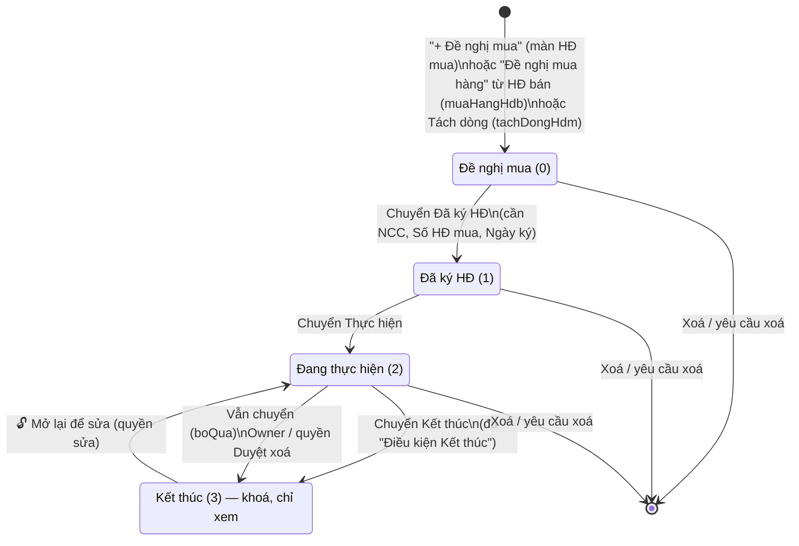

# Module Hợp đồng mua (key `hdmua`) — Tài liệu nghiệp vụ

> Nguồn phân tích: mã giao diện client (HTML + JS) của trang `?page=hdmua` đã tải về, cùng dữ liệu khởi động (`hdmKhoiDong`, `listHopDongMua`) đi kèm trang. Logic phía server (Apps Script) **không** có trong file, nên những gì server tự tính chỉ mô tả theo cách client hiển thị. Nội dung suy luận được gắn nhãn **[Suy luận]**. Mọi ví dụ trong tài liệu là dữ liệu giả định.

---

## 1. Mục đích & phạm vi

- Quản lý **hợp đồng mua hàng với nhà cung cấp (NCC)**, từ lúc có **Đề nghị mua** đến khi **Kết thúc** hợp đồng.
- Phạm vi gồm:
  - Hàng cần mua, giá mua chi tiết và giá vốn theo từng dòng hàng.
  - Giá trị hợp đồng: VNĐ hoặc ngoại tệ có tỷ giá, cộng VAT.
  - Chi phí phát sinh (vận chuyển, hải quan…). Chi phí này được phân bổ vào giá vốn.
  - Các đợt thanh toán NCC. Từ mỗi đợt có thể tạo phiếu chi và chuyển sang hàng chờ của Kế toán.
  - Nhận hàng: Mua hàng **báo hàng về**, sau đó Kho lập **phiếu nhập kho**.
  - Liên kết với các HĐ bán dùng hàng của HĐ mua này.
  - Hồ sơ lưu (file) và nhật ký.
  - Kênh **Phú Tài**: Phú Tài trả NCC, Oxy chỉ theo dõi.
- Ngoài phạm vi màn này:
  - Lập phiếu nhập kho (màn Kho).
  - Xử lý phiếu chi (màn Kế toán).
  - Duyệt yêu cầu xoá (màn Duyệt xoá).
  - Chia lợi nhuận Phú Tài (màn Phú Tài).

## 2. Vai trò & quyền liên quan

### 2.1. Quyền theo tài khoản (`APP.user.perm`)

Mỗi quyền có dạng `{v: xem, e: sửa, sc: phạm vi}`.

| Khoá quyền | Ý nghĩa (theo tên & cách dùng) |
|---|---|
| `hdm_xem` | Xem HĐ mua |
| `hdm_sua` | Sửa HĐ mua |
| `hdm_thanhtoan` | Thanh toán NCC |
| `kho_phieu` | Lập phiếu kho. **[Suy luận]** Quyền này là nguồn của `perms.kho` |
| `hethong_duyetxoa` | Có quyền này hoặc là Owner thì được ép chuyển **Kết thúc** khi chưa đủ điều kiện. Quyền này cũng quyết định xoá ngay hay chỉ gửi yêu cầu xoá |
| `nhatky_sua` | Sửa hoặc xoá dòng nhật ký tay của người khác |

- Vai trò có trong danh mục `roleLabels`: owner, giamdoc, admin, sale, ketoan, kho, muahang.
- Ngữ cảnh mẫu trong code: vai trò Mua hàng nhập số tiền và hạn trả, còn Kế toán nhập ngày đã trả.

### 2.2. Quyền theo từng hợp đồng (`d.perms`, server trả về)

| Cờ | Tác dụng trên UI |
|---|---|
| `xem` | Xem HĐ |
| `sua` | Sửa thông tin, dòng hàng, đợt TT (số tiền, hạn trả), chi phí, hồ sơ. Cờ này cũng cho phép báo hàng về, huỷ báo hàng về, liên kết HĐ bán, tách dòng, xoá HĐ, mở lại HĐ |
| `tt` | Nhập **Ngày đã trả**, bấm **Tạo phiếu chi** cho đợt thanh toán, tải hồ sơ nhóm "Thanh toán NCC" |
| `gia` | Xem giá. Thiếu quyền này thì ẩn cột đơn giá, thành tiền, CP phân bổ, giá vốn, ẩn tab Chi phí và tab hồ sơ có giá. Giá ở danh sách hiện `•••` |
| `kho` | Hiện nút "Mở Kho để lập phiếu nhập" |
| `chot` | Hiện nút chuyển giai đoạn trên thanh tiến độ |

- Nút **Lưu** chỉ hiện khi có `sua` hoặc `tt`.
- Danh sách trả kèm `canTao`. Chỉ khi `canTao` đúng mới hiện nút "+ Đề nghị mua".
- Danh sách cũng trả `coGia` theo từng dòng, quyết định có hiện giá trị ở danh sách hay không.

## 3. Danh sách màn hình

### 3.1. Màn Danh sách Hợp đồng mua (`viewList`)

- **Mục đích**: xem toàn bộ HĐ mua, lọc theo giai đoạn và kênh, mở chi tiết, tạo Đề nghị mua.
- **Bộ lọc** (lọc ngay tại client):

| Bộ lọc | Kiểu | Quy tắc |
|---|---|---|
| Tìm kiếm | Ô text có nút × | Không phân biệt hoa thường. Tìm trong: Số HĐ, tên NCC, danh sách hàng, Số HĐ và tên của các HĐ bán "Dùng cho" |
| Giai đoạn | Select | "Mọi giai đoạn" / Đề nghị mua / Đã ký HĐ / Đang thực hiện / Kết thúc |
| Kênh | Select | "Mọi kênh" / Oxy / Phú Tài. HĐ chưa có kênh được coi là Oxy |

- **Đếm**: "**x** / y hợp đồng mua".
- **Cột bảng**:

| # | Cột | Nội dung |
|---|---|---|
| 1 | STT | Số thứ tự |
| 2 | Số HĐ · Nhà cung cấp | Số HĐ, hoặc "Chưa có số" (in nghiêng). Dòng dưới là tên NCC, hoặc "— chưa chọn NCC —". Có nhãn tím "Phú Tài" nếu kênh là Phú Tài |
| 3 | Hàng hoá | Tối đa 2 dòng "Mã (nồng độ) × SL", phần còn lại hiện "+n mã khác" |
| 4 | Ngày ký | Định dạng dd.mm.yy. Dòng phụ "nhận dự kiến dd.mm.yy" hiện khi có ngày nhận dự kiến, tỉ lệ nhận < 100% và giai đoạn khác Đề nghị mua |
| 5 | Giá trị trước VAT | `giaTriVND` (đ), dòng phụ là giá trị ngoại tệ + mã tiền. Không có quyền giá thì hiện `•••` |
| 6 | Đã trả NCC | % kèm thanh tiến độ. Giai đoạn Đề nghị mua hiện "—" |
| 7 | Nhận hàng | % kèm thanh tiến độ. Hiện thêm "chờ nhập kho" (màu cam) nếu có đợt báo về đang chờ. Giai đoạn Đề nghị mua hiện "—" |
| 8 | Dùng cho | Danh sách Số HĐ bán liên kết |
| 9 | Giai đoạn | Pill màu: Đề nghị mua = cam; Đã ký HĐ và Đang thực hiện = màu nhấn; Kết thúc = xanh "done" |

- **Phân trang**:
  - Hiện 50 dòng mỗi lần.
  - Có nút "⬇ Xem thêm N dòng (còn M)" và nút "Hiện hết".
  - Khi cuộn gần cuối danh sách thì tự tải thêm.
- **Hành động**:
  - Bấm một dòng → mở chi tiết.
  - "+ Đề nghị mua" → mở form tạo mới.
- **Trạng thái rỗng**: "Không có hợp đồng mua nào khớp bộ lọc."

### 3.2. Màn Chi tiết Hợp đồng mua (`viewDetail`)

**Bố cục chung**

- **Thanh đầu (cố định)**:
  - Nút "← DS".
  - Số HĐ. Khi chưa có số thì hiện "Đề nghị mua mới" (form tạo mới) hoặc "Chưa có số".
  - Tên NCC, pill giai đoạn, pill "Kênh Phú Tài" (nếu có).
- **Nút bên phải thanh đầu**:
  - `● Chưa lưu`: hiện khi có thay đổi chưa lưu.
  - `🗑️`: hiện khi HĐ đã lưu, có quyền `sua` và giai đoạn < Kết thúc.
  - `💾 Lưu`: hiện khi giai đoạn < Kết thúc và có `sua` hoặc `tt`.
  - `🔓 Mở lại để sửa`: hiện khi giai đoạn = Kết thúc và có `sua`.
- **Cột phải ("Tiến độ Hợp đồng mua")**: thanh bước dọc gồm 4 giai đoạn.
  - Bước hiện tại đánh số. Bước đã qua có dấu ✓.
  - Ở giai đoạn Đang thực hiện, dưới bước hiện thêm "TT x% · Nhận y%".
  - Nút chuyển bước: "✅ Chuyển Đã ký HĐ →", "✅ Chuyển Thực hiện →", "✅ Chuyển Kết thúc →". Nút chỉ hiện khi HĐ đã lưu, có `chot` và giai đoạn < 3.
  - Khi chưa đủ điều kiện Kết thúc, nút hiện mờ (opacity .6) với tooltip "Chưa đủ điều kiện Kết thúc".

**Nội dung thân trang theo giai đoạn**

| Giai đoạn | Các khối hiển thị (theo thứ tự) |
|---|---|
| 0 – Đề nghị mua | Thẻ "Hàng cần mua" → Thẻ "Nhà cung cấp & Hợp đồng" → Thẻ "Dùng cho Hợp đồng bán" → Nhật ký (khi đã lưu) |
| 1, 2 – Đã ký HĐ / Đang thực hiện | Nhóm **Chung** → Nhóm **Giá trị** → Nhóm **Thanh toán NCC** → Thẻ **Nhận hàng** → Nhật ký |
| 3 – Kết thúc | Banner "🔒 Đã Kết thúc — chỉ xem" + thẻ "Điều kiện Kết thúc", sau đó các khối giống giai đoạn 1–2 ở chế độ chỉ đọc |

- Kênh Phú Tài có thêm banner tím ở đầu trang. Nội dung banner xem mục 7.6.

**Nhóm & tab con ("chip")**

- Mỗi nhóm có một thẻ chính và các chip mở thẻ phụ ngay bên dưới.
- Mỗi lúc chỉ mở 1 chip. Bấm lại chip đang mở thì đóng.
- Chip có huy hiệu đếm.

| Nhóm | Thẻ chính | Chip (thẻ phụ) | Huy hiệu |
|---|---|---|---|
| `chung` | Thông tin Hợp đồng | "Dùng cho HĐ bán"; "Hồ sơ Hợp đồng" | Số HĐ bán liên kết; số file đã lưu |
| `giatri` | Giá trị Hợp đồng | "Giá chi tiết & giá vốn"; "Chi phí phát sinh" (chỉ khi có quyền giá) | Số dòng có mã hàng; số dòng chi phí |
| `tt` | Thanh toán nhà cung cấp | "Các đợt thanh toán"; "Hồ sơ thanh toán" | Số đợt **quá hạn** (màu cảnh báo); số file |

**Thẻ thu gọn được**

- Thẻ thu gọn chỉ hiện một dòng tóm tắt.
- Thẻ thu gọn mặc định: Thông tin HĐ, Giá trị HĐ (từ giai đoạn 2), Thanh toán NCC, Nhận hàng (ở giai đoạn 3).
- Ví dụ tóm tắt: "NCC Mẫu A · HĐM-001/2026 · ký 05.03.26 · nhận dự kiến 20.03.26".

### 3.3. Danh sách popup / hộp thoại

| Popup | Mở từ | Nội dung | Hàm server |
|---|---|---|---|
| Xác nhận rời trang | ← DS khi đang có thay đổi chưa lưu | "Có thay đổi chưa lưu — Rời màn này sẽ bỏ phần chưa lưu." Nút: Bỏ thay đổi | — |
| Chuyển giai đoạn | Nút chuyển bước | Tiêu đề "Chuyển sang <GĐ>?". Nội dung: (0→1) "Cần có Nhà cung cấp, Số HĐ mua và Ngày ký."; (1→2) "HĐ bắt đầu thực hiện: thanh toán NCC, báo hàng về, nhập kho."; (2→3) "Toàn bộ dữ liệu khoá, chỉ xem." | `chuyenGiaiDoanHdm` |
| Chưa đủ điều kiện Kết thúc | Server trả lỗi chứa "Chưa đủ điều kiện", người dùng là Owner hoặc có `hethong_duyetxoa` | "<lỗi> Vẫn chuyển Kết thúc?". Nút đỏ "Vẫn chuyển" | `chuyenGiaiDoanHdm(…, {boQua:true})` |
| Mở lại HĐ | 🔓 | "Quay về Đang thực hiện để sửa." | `chuyenGiaiDoanHdm(id, 2)` |
| Xoá HĐ | 🗑️ | "Người có quyền Duyệt xoá xoá ngay; người khác gửi yêu cầu chờ duyệt." | `yeuCauXoa {loai:'HopDongMua'}` |
| Xoá dòng TT / chi phí đã lưu | ✕ trên dòng | Như trên | `yeuCauXoa {loai:'Dong', fieldKey:'HDM_ThanhToan' hoặc 'HDM_ChiPhi'}` |
| Xoá file hồ sơ | ✕ trên chip file | "Xoá file '<tên>'?" | `yeuCauXoa {loai:'HoSo', fileUrl}` |
| Tách dòng | ↗ trên dòng hàng | "<mã> × <SL> sẽ chuyển sang 1 Đề nghị mua mới (cùng HĐ bán liên kết) để chọn NCC khác…" | `tachDongHdm` |
| **Báo hàng về** | 📦 Báo hàng về | Ngày hàng về (mặc định hôm nay), Ghi chú cho Kho, bảng mã (Mã, Nồng độ, Chưa về, **Về lần này**). Nút "Báo Kho" | `baoHangVeHdm` |
| Huỷ báo hàng về | ✕ trên dòng báo về | "Huỷ báo hàng về?" | `huyBaoHangVe` |
| **Liên kết HĐ bán** | "Chọn / bỏ HĐ bán" | Ô tìm Số HĐ / khách. Danh sách checkbox, tối đa 80 dòng; HĐ đang chọn luôn hiện. Nút "Lưu liên kết" | `lienKetHdbHdm` |
| Sửa nhật ký | "Sửa" | Textarea, bắt buộc nhập | `suaNhatKy(id, txt, false)` |
| Xoá nhật ký | "Xoá" | Xác nhận | `suaNhatKy(id, '', true)` |
| Thanh cảnh báo bản nháp chưa lưu / xung đột | Tự hiện khi mở HĐ có bản lưu ngầm bị lỗi | Xem mục 7.9 | `saveHopDongMua`, `getHopDongMua` |

## 4. Chi tiết form / tab

### 4.1. Thẻ "Nhà cung cấp & Hợp đồng" / "Thông tin Hợp đồng"

- Tất cả trường bị khoá khi không có `sua` hoặc khi giai đoạn = Kết thúc.

| Trường | Kiểu nhập | Bắt buộc | Tự tính/nguồn | Ghi chú |
|---|---|---|---|---|
| Nhà cung cấp (`hd.tenNCC`) | Text + gợi ý (datalist danh mục NCC; gợi ý hiện "viết tắt · MST") | Bắt buộc để chuyển sang Đã ký HĐ | Khớp tên (không phân biệt hoa thường) với danh mục thì gán `nccId` | Dưới ô hiện "✓ Đã gắn NCC trong danh mục", hoặc "+ NCC mới — tự thêm vào danh mục khi lưu". Khi gắn NCC có ngoại tệ mặc định mà HĐ chưa có ngoại tệ thì tự điền ngoại tệ |
| Kênh sử dụng (`hd.kenh`) | Select: "Oxy trực tiếp" / "Phú Tài" | Có | Mặc định Oxy | Đổi kênh thì vẽ lại màn: hiện hoặc ẩn trường HĐ Phú Tài và banner |
| Số HĐ mua (`hd.soHD`) | Text | Bắt buộc để chuyển sang Đã ký HĐ | — | Ở giai đoạn 0, placeholder là "Nhập khi ký HĐ" |
| Ngày ký (`hd.ngayKy`) | Ngày (dd/mm/yyyy; gõ được 6 hoặc 8 chữ số) | Bắt buộc để chuyển sang Đã ký HĐ | — | |
| Ngày hiệu lực tạm ứng (`hd.ngayHieuLucTU`) | Ngày | Không | — | |
| Ngày nhận hàng dự kiến (`hd.ngayNhanDuKien`) | Ngày | Không | — | Hiện ở danh sách khi chưa nhận đủ hàng |
| HĐ Phú Tài liên kết (`hd.hdPhuTaiLienKet`) | Text tự do | Không | — | Chỉ hiện khi kênh = Phú Tài. Được hiển thị thành pill tím ở thẻ "Dùng cho" |
| Ghi chú (`hd.ghiChu`) | Textarea | Không | — | Chiếm cả dòng |

- Điều kiện "bắt buộc" trong bảng trên đến từ câu nhắc của hộp xác nhận chuyển giai đoạn. **[Suy luận]** Server mới là nơi kiểm tra thật.

**Ràng buộc khi lưu (client)**

- Có `sua` nhưng không có tên NCC **và** không có dòng hàng nào có mã → chặn lưu.
- Thông báo: "Nhập mã hàng cần mua hoặc nhà cung cấp trước khi lưu."

### 4.2. Thẻ "Hàng cần mua" (giai đoạn 0) / "Giá chi tiết mua & giá vốn" (giai đoạn ≥ 1)

- Sửa được khi có `sua` và giai đoạn < 3.
- HĐ mới luôn có sẵn 1 dòng trống.

| Trường | Kiểu nhập | Bắt buộc | Tự tính/nguồn | Ghi chú |
|---|---|---|---|---|
| STT | — | — | Tự đánh | |
| Mã hàng (`maHang`) | Text + gợi ý danh mục hàng hoá | **[Suy luận]** Dòng không có mã bị bỏ qua khi đếm hoặc báo về | Chọn đúng mã → tự điền Tên, ĐV, Nồng độ mặc định nếu các ô đó đang trống, và chuẩn hoá chữ hoa/thường theo danh mục | Ô này nhận dán dữ liệu từ Excel (mục 7.3) |
| Nồng độ (`nongDo`) | Text, placeholder "vd 30ppm" | Không | Lấy mặc định từ danh mục | Mã + nồng độ là khoá để báo về và nhập kho |
| Tên hàng (`tenHang`) | Text | Không | Lấy từ `moTa` của danh mục | |
| ĐV (`dvt`) | Text + gợi ý Bình / Cái / Chai / Bộ | Không | Lấy từ danh mục | |
| SL (`sl`) | Số (cho phép dấu thập phân "," hoặc ".") | **[Suy luận]** Có | — | |
| Đơn giá mua (`donGia`) | Tiền (tự thêm dấu chấm ngăn nghìn) | Không | — | Chỉ hiện khi có quyền giá |
| Thành tiền | Chỉ đọc | — | `sl × donGia`; để trống khi chưa có đơn giá | Chỉ hiện khi có quyền giá |
| CP phân bổ (`cpPhanBo`) | Chỉ đọc | — | Server trả | Hiện từ giai đoạn ≥ 1, khi có quyền giá |
| Giá vốn / ĐV (`giaVon`) | Chỉ đọc, in đậm | — | Server trả | Hiện từ giai đoạn ≥ 1, khi có quyền giá |
| Đã nhập (`daNhap`, `conLai`) | Chỉ đọc | — | Server trả. Hiện "x (còn y)" | Hiện từ giai đoạn ≥ 1 |
| Nút ↗ Tách dòng | Nút | — | — | Điều kiện hiện nút: xem mục 7.4 |
| Nút ✕ Xoá dòng | Nút | — | — | Xoá ngay trên form; thay đổi được lưu khi bấm 💾 |

- **Chân bảng**: "Tổng" = Σ thành tiền (chỉ hiện khi có quyền giá).
- **Hàng thao tác dưới bảng**: "+ Thêm dòng hàng", kèm gợi ý: "Chọn mã → tự điền tên, ĐV, nồng độ mặc định. Dán từ Excel vào ô Mã hàng: Mã · Nồng độ · Tên · ĐV · SL (· Đơn giá)".

### 4.3. Thẻ "Giá trị Hợp đồng" (giai đoạn ≥ 1)

- Thiếu quyền giá thì thẻ chỉ hiện "Cần quyền xem giá mua."

| Trường | Kiểu nhập | Bắt buộc | Tự tính/nguồn | Ghi chú |
|---|---|---|---|---|
| Ngoại tệ (`hd.ngoaiTe`) | Select: VNĐ (giá trị rỗng) / RMB / USD / EUR / JPY | Không | Mặc định theo NCC | Đổi ngoại tệ thì vẽ lại màn |
| Giá trị theo ngoại tệ (`hd.giaTriNT`) | Số | Không | — | Chỉ hiện khi có ngoại tệ |
| Tỷ giá áp dụng (`hd.tyGia`) | Số | Không | — | Chỉ hiện khi có ngoại tệ. Một tỷ giá cho cả HĐ |
| VAT (`hd.vatPct`) | Select 0% / 8% / 10% | Có | HĐ mới mặc định 8% | Nếu HĐ đang có mức VAT khác 3 mức trên thì vẫn giữ và hiện mức đó trong danh sách chọn |
| Trước VAT (quy đổi VNĐ) (`hd.giaTriVND`) | Ô tiền **chỉ khi** nhập tay; các trường hợp khác chỉ đọc | — | Xem công thức 6.2. Dòng phụ ghi nguồn: "theo Giá chi tiết mua" / "theo ngoại tệ × tỷ giá" / "nhập tay" | |
| Sau VAT (quy đổi VNĐ) | Chỉ đọc | — | 6.3 | |
| Chi phí phát sinh | Chỉ đọc | — | `tongHop.cpTong` (server) | Ghi chú "phân bổ vào giá vốn" |

### 4.4. Thẻ "Chi phí phát sinh" (chip, chỉ khi có quyền giá)

- Lưu **riêng** bằng nút "💾 Lưu chi phí" (`saveChiPhiHdm`). Nút 💾 Lưu chung **không** gửi chi phí.

| Trường | Kiểu nhập | Bắt buộc | Tự tính/nguồn | Ghi chú |
|---|---|---|---|---|
| Loại chi phí (`loai`) | Text + gợi ý | Không | Danh mục `loaiChiPhi`: Vận chuyển về kho, Hải quan, Bến bãi / lưu kho, Kiểm định, Phí ngân hàng, Khác | Placeholder "vd: Hải quan" |
| Số tiền (`soTien`) | Tiền | **[Suy luận]** Có | — | |
| Ngày (`ngay`) | Ngày | Không | — | |
| Có hoá đơn (`coHoaDon`) | Công tắc Có / Không | Không | — | |
| Phiếu chi | Trạng thái hoặc nút | — | Lấy từ `choXuLy` | "Dữ liệu cũ" / "Chờ kế toán" / trạng thái khác / "Phú Tài tự chi" (kênh PT) / nút "Tạo phiếu chi" (dòng đã lưu) / "Lưu trước" |
| ✕ | Nút | — | — | Ẩn khi dòng đã có phiếu chi (dòng bị khoá) |

- **Chân bảng**: "Tổng — phân bổ vào giá vốn theo tỉ trọng giá trị dòng" = Σ số tiền.

### 4.5. Thẻ "Thanh toán nhà cung cấp" + "Các đợt thanh toán NCC"

**Ô tiến độ (thẻ chính)**

- Ô 1:
  - Nhãn "Đã trả NCC". Kênh Phú Tài dùng nhãn "Phú Tài đã trả NCC".
  - Hiện % kèm thanh tiến độ.
  - Có quyền giá thì hiện thêm "Đã trả … · còn phải trả …".
- Ô 2:
  - Nhãn "Đã nhận hàng". Kênh Phú Tài thêm "(kho tạm PT)".
  - Hiện % kèm "slNhap / slMua đơn vị".

**Bảng đợt thanh toán**

| Trường | Kiểu nhập | Bắt buộc | Tự tính/nguồn | Ghi chú |
|---|---|---|---|---|
| Đợt | — | — | Đánh số "Đ1, Đ2…" theo thứ tự | **Không giới hạn số đợt** |
| Số tiền (`soTien`) | Tiền | — | — | Sửa khi có `sua`, giai đoạn < 3 và dòng chưa có phiếu chi. Cột ẩn khi thiếu quyền giá |
| Tỉ lệ | Chỉ đọc | — | 6.4 | |
| Hạn trả (`hanTra`) | Ngày | — | — | Cùng điều kiện sửa như Số tiền |
| Ngày đã trả NCC (`ngayTra`) | Ngày | — | — | Sửa khi có `tt` và giai đoạn < 3, **kể cả khi đã có phiếu chi**. Kênh PT có nhãn "Ngày Phú Tài đã trả" |
| Phiếu chi | Trạng thái hoặc nút | — | `choXuLy` | "Dữ liệu cũ" / "Chờ kế toán" / trạng thái khác / nút "Tạo phiếu chi" (kênh PT là "Phiếu chi chuyển PT") khi dòng đã lưu và có `tt`; "Lưu trước" khi chưa lưu |
| ✕ | Nút | — | — | Hiện khi có (`sua` hoặc `tt`), giai đoạn < 3, chưa có phiếu chi và không phải dữ liệu cũ |

- **Gợi ý dưới bảng**: "Mua hàng nhập số tiền + hạn trả; Kế toán nhập Ngày đã trả và bấm Tạo phiếu chi (vào hàng chờ Kế toán)".
- **Đợt quá hạn**: `hanTra < hôm nay` và chưa có `ngayTra`. Số đợt quá hạn hiện thành huy hiệu cảnh báo trên chip.

### 4.6. Thẻ "Nhận hàng" (giai đoạn ≥ 1)

- **Bảng tổng theo mã**: Mã hàng (+ tên), Nồng độ, SL mua, Đã nhập, Còn lại (tô màu cảnh báo khi > 0).
- **Nút thao tác**:
  - "📦 Báo hàng về": hiện khi có `sua`, giai đoạn 1–2 và còn mã chưa nhập.
  - "Mở Kho để lập phiếu nhập": hiện khi có `kho`, giai đoạn 1–2 và còn mã chưa nhập. Bấm thì chuyển sang màn Kho, tab `denghi`.
  - Ghi chú "n đợt đang chờ Kho lập phiếu nhập".
- **Bảng "Báo hàng về"**: Đợt (Đ1…), Ngày về + người báo, danh sách "Mã (nồng độ × SL)", Trạng thái ("Chờ Kho nhập" màu cam, hoặc số phiếu nhập màu xanh), nút ✕ huỷ (khi có `sua` và đợt còn chờ).
- **Bảng "Phiếu nhập kho"**: Số phiếu, Ngày, Kho, Mã (nồng độ × SL). Khi chưa có phiếu: "Chưa có phiếu nhập kho."

**Popup Báo hàng về**

| Trường | Kiểu nhập | Bắt buộc | Tự tính/nguồn | Ghi chú |
|---|---|---|---|---|
| Ngày hàng về | Ngày | — | Mặc định hôm nay | |
| Ghi chú cho Kho | Text | Không | — | Placeholder "vd: hàng về kho Hà Nội chiều nay" |
| Mã hàng / Nồng độ | Chỉ đọc | — | Các dòng có `conLai > 0` | Chỉ lấy các mã còn số lượng có thể báo về (`max > 0`) |
| Chưa về | Chỉ đọc | — | 6.6 | |
| Về lần này | Số | Ít nhất 1 dòng > 0 | Mặc định = Chưa về | Lỗi "Nhập số lượng về." |

### 4.7. Thẻ Hồ sơ lưu

Có 2 nhóm hồ sơ. Danh mục hồ sơ do server cấu hình (`hosoNhom`).

| Nhóm | Nhãn | Mục hồ sơ | Ai tải lên |
|---|---|---|---|
| `hdm_hopdong` (chip trong nhóm Chung) | Hợp đồng mua | Báo giá / Hợp đồng mua (file); Tờ khai hải quan; Hoá đơn NCC | `sua` |
| `hdm_thanhtoan` (chip trong nhóm Thanh toán) | Thanh toán NCC | Uỷ nhiệm chi / chứng từ trả NCC | `sua` hoặc `tt` |

- **Mỗi mục hồ sơ có**:
  - Tên mục.
  - Công tắc **Áp dụng / Không áp dụng**. Chỉ người có `sua` mới bật/tắt được. Thay đổi lưu ngay qua `setHoSoApDungHdm`.
  - Vùng "📎 Tải file lên": chọn nhiều file hoặc kéo-thả.
  - Danh sách chip file: mở link, tooltip "tên — người tải ngày giờ", nút ✕. File đã gửi yêu cầu xoá hiện "chờ xoá".
- **Điều kiện hiện chip hồ sơ**:
  - Nhóm có trong cấu hình.
  - HĐ đã lưu.
  - Nhóm có `coGia = true` thì người dùng phải có quyền giá. Cả 2 nhóm trên đều là `coGia = true`.

### 4.8. Thẻ Nhật ký (khi HĐ đã lưu)

- **Ô thêm**: textarea "Ghi chú tiến độ, trao đổi với NCC…" và nút "Thêm". Dòng mới ghi vào mục `chung`.
- **Mỗi dòng nhật ký có**:
  - Thời gian và người ghi.
  - Nhãn mục: Giai đoạn / Thông tin / Thanh toán / Nhận hàng / Chi phí / Hồ sơ / Xoá / Ghi chú.
  - Nội dung.
- **Loại dòng**:
  - Dòng tự động: hiển thị khác dòng tay (class `auto`).
  - Dòng tay (`loai = 'tay'`): người ghi hoặc người có `nhatky_sua` được Sửa / Xoá.

## 5. Luồng giai đoạn

**Quy tắc chuyển giai đoạn**

- Chỉ chuyển **tiến 1 bước**. Lệnh gọi là `chuyenGiaiDoanHdm(id, gd+1, {boQua})`.
- Nếu đang có thay đổi chưa lưu thì client tự lưu trước, sau đó mới hỏi xác nhận.
- Lùi bước chỉ có một trường hợp: Kết thúc → Đang thực hiện, qua nút Mở lại.
- **Điều kiện Kết thúc**:
  - Server trả về danh sách `dieuKien.list[{label, met}]` và cờ `dieuKien.du`.
  - Client hiển thị danh sách này dạng checklist ở giai đoạn 3.
  - Nội dung các điều kiện **không có trong client** (do server định nghĩa). **[Suy luận]** Các điều kiện có thể là đã trả đủ NCC, đã nhận đủ hàng và đủ hồ sơ áp dụng. Không kiểm chứng được.
- **Thao tác được phép theo giai đoạn**:

| Thao tác | GĐ0 | GĐ1 | GĐ2 | GĐ3 |
|---|---|---|---|---|
| Sửa thông tin / dòng hàng | ✓ | ✓ | ✓ | — |
| Tách dòng | ✓ | ✓ | — | — |
| Giá trị HĐ, chi phí, đợt TT, hồ sơ | (ẩn) | ✓ | ✓ | xem |
| Báo hàng về / mở Kho | — | ✓ | ✓ | — |
| Liên kết HĐ bán | ✓ | ✓ | ✓ | — |
| Xoá HĐ | ✓ | ✓ | ✓ | — |

- Danh sách giai đoạn trên server (`giaiDoanMua`) trùng với mảng `GD` mà client khai báo cứng: Đề nghị mua, Đã ký HĐ, Đang thực hiện, Kết thúc.

## 6. Công thức tính toán (đúng như code client)

| # | Chỉ tiêu | Công thức |
|---|---|---|
| 6.1 | Thành tiền dòng | `sl × donGia`, chỉ tính khi `donGia` có giá trị. Tổng bảng = `Σ (sl × donGia)` (giá trị rỗng tính là 0) |
| 6.2 | **Trước VAT (VNĐ)** `giaTriVND` | Ưu tiên theo thứ tự: **(a)** có ít nhất 1 dòng có đơn giá → `Σ sl × donGia`; **(b)** có ngoại tệ, `giaTriNT` và `tyGia` → `round(giaTriNT × tyGia)`; **(c)** nhập tay. Trường hợp (a) và (b) ghi đè `hd.giaTriVND` ngay khi người dùng gõ |
| 6.3 | Sau VAT | `round(giaTriVND × (1 + vatPct))` |
| 6.4 | Tỉ lệ đợt TT | `round(soTien / SauVAT × 1000) / 10` (%; 1 chữ số thập phân). Để trống khi Sau VAT = 0 |
| 6.5 | Tổng chi phí phát sinh (trên form) | `Σ soTien` các dòng chi phí. Ô tóm tắt dùng `tongHop.cpTong` do server tính |
| 6.6 | SL có thể báo về (popup) | `max = max(0, conLai − Σ SL các đợt báo về đang "Chờ nhập kho" cùng mã + nồng độ)`. So khớp mã + nồng độ không phân biệt hoa thường |
| 6.7 | Đợt quá hạn | `hanTra < hôm nay` và `ngayTra` trống |
| 6.8 | % hiển thị | `round(x × 100)` với `x` = `tiLeTT` hoặc `tiLeNhan` |
| 6.9 | Số tiền hiển thị | Làm tròn số nguyên, ngăn nghìn bằng dấu "." và thêm hậu tố " đ" |

**Chỉ tiêu do server tính (client chỉ hiển thị)**

- `tongHop`: `tiLeTT`, `daTra`, `conPhaiTra`, `tiLeNhan`, `slMua`, `slNhap`, `sauVAT`, `cpTong`.
- Theo dòng hàng: `cpPhanBo`, `giaVon`, `daNhap`, `conLai`.
- **[Suy luận]** Các công thức dưới đây suy từ nhãn trên giao diện, chưa đối chiếu với code server:
  - `tiLeTT = daTra / sauVAT`, với `daTra` = tổng các đợt đã có ngày trả.
  - `conPhaiTra = sauVAT − daTra`.
  - `cpPhanBo_dòng = cpTong × (thành tiền dòng / Σ thành tiền)`. Căn cứ là chú thích "theo tỉ trọng giá trị dòng".
  - `giaVon/ĐV = donGia + cpPhanBo_dòng / sl`.
  - `tiLeNhan = slNhap / slMua`.

**Đa tiền tệ**

- Loại tiền và tỷ giá đặt ở **cấp hợp đồng**, không đặt ở từng dòng.
- **[Suy luận]** Khi có đơn giá dòng, tổng VNĐ lấy thẳng `Σ sl × donGia` mà không nhân tỷ giá, nên đơn giá dòng đang được hiểu là VNĐ.

## 7. Quy tắc nghiệp vụ, ràng buộc, hành động tự động

1. **Tạo Đề nghị mua**: HĐ mới có giá trị mặc định giai đoạn "Đề nghị mua", kênh Oxy, VAT 8%. Lần lưu đầu gọi `saveHopDongMua` theo kiểu đồng bộ, xong hiện "Đã tạo Đề nghị mua". Sau đó tải lại danh mục (để có NCC mới).
2. **NCC mới**:
   - Tên NCC không khớp danh mục thì hiện "+ NCC mới — tự thêm vào danh mục khi lưu".
   - Việc thêm vào danh mục do server làm trong `saveHopDongMua`.
   - Client không gọi `saveNhaCungCap`, `timNccTrung` hay `traCuuMST` trên màn này.
3. **Dán Excel**:
   - Kích hoạt khi dán vào ô Mã hàng một nội dung có tab hoặc xuống dòng.
   - Các cột lần lượt là Mã, Nồng độ, Tên, ĐV, SL, Đơn giá. Cột Đơn giá chỉ đọc khi có quyền giá.
   - Dữ liệu ghi từ dòng đang đứng trở xuống; thiếu dòng thì tự thêm dòng.
   - Mã có trong danh mục thì chuẩn hoá mã và bổ sung Tên, ĐV nếu đang trống.
4. **Tách dòng** (`tachDongHdm`):
   - **Điều kiện hiện nút**: có `sua`, giai đoạn ≤ Đã ký HĐ, HĐ đã lưu, có > 1 dòng đã lưu, chưa có báo hàng về, chưa có phiếu nhập.
   - Phải lưu hết thay đổi trước khi tách.
   - **Kết quả**: dòng được chọn chuyển sang **1 Đề nghị mua mới**, mang theo cùng HĐ bán liên kết. Client mở ngay HĐ mới đó (`moiId`).
   - Mục đích là để chọn NCC khác cho dòng hàng đó.
5. **Lưu ngầm** (HĐ đã có id):
   - Bấm 💾 thì client báo "Đã lưu" ngay.
   - Lệnh `saveHopDongMua({hd, gct, tt})` được xếp vào hàng đợi gửi nền theo khoá `hdm:<id>`.
   - Payload **không** chứa chi phí: chi phí lưu riêng bằng `saveChiPhiHdm`.
   - Bản đang chờ gửi được giữ trong IndexedDB. Khi đang gửi mà đóng trang thì trình duyệt hỏi xác nhận.
6. **Phiếu chi → Kế toán**:
   - Có 2 loại: phiếu chi cho đợt thanh toán (`taoPhieuChiTtHdm`) và phiếu chi cho chi phí (`taoPhieuChiCpHdm`).
   - Phiếu tạo ra vào hàng chờ của Kế toán, thông báo "Đã gửi sang Kế toán · Chờ xử lý".
   - Phải lưu trước khi tạo phiếu: 💾 Lưu cho đợt TT, 💾 Lưu chi phí cho chi phí.
   - Dòng đã có phiếu (`choXuLyId`) bị khoá số tiền, hạn trả (đợt TT) và toàn bộ dòng (chi phí). Riêng ngày đã trả vẫn sửa được.
   - Dòng chuyển từ dữ liệu cũ có `choXuLyId = 'du_lieu_cu'` và hiện nhãn "Dữ liệu cũ".
7. **Kênh Phú Tài**:
   - Banner: "Phú Tài trả NCC và chi phí phát sinh — Oxy theo dõi tiến độ".
   - Khi Oxy chuyển tiền cho Phú Tài để trả NCC: bấm "**Phiếu chi chuyển PT**" ở đợt thanh toán. Khoản này tính vào công nợ Phú Tài nội bộ.
   - Chi phí phát sinh hiện "Phú Tài tự chi" và không có nút tạo phiếu chi.
   - Hàng về được Kho nhập vào **kho tạm Phú Tài** (không phải kho Oxy), hoặc ghi **Giao thẳng**.
   - Ở màn Kho, danh sách kho được lọc theo kênh: kho loại "Phú Tài" cộng "GIAOTHANG".
8. **Nhận hàng (2 bước)**:
   - Bước 1: Mua hàng **Báo hàng về** (`baoHangVeHdm(id, lines[{maHang,nongDo,sl}], ngày, ghi chú)`). Mỗi lần báo tạo 1 đợt có trạng thái "Chờ nhập kho".
   - Bước 2: Kho thấy đợt này ở mục "Đề nghị cấp hàng / nhập kho" và lập **Phiếu nhập kho** (`lapPhieuNhap` ở màn Kho; chọn kho, ngày, SL nhập).
   - Nhập được một phần, nhiều đợt.
   - Đợt còn chờ thì huỷ được (`huyBaoHangVe`).
   - Không có thao tác nào sinh phiếu nhập trực tiếp từ màn HĐ mua.
9. **Xung đột / bản nháp lỗi**:
   - Lưu nền thất bại thì hiện thanh cảnh báo.
   - **Lỗi thường**: lựa chọn "Khôi phục để lưu lại" hoặc "Bỏ bản này".
   - **Lỗi `XUNG_DOT:`** (có người khác vừa sửa HĐ):
     - "Vẫn lưu bản của tôi": gửi lại với `ghiDe: true`.
     - "Khôi phục bản của tôi".
     - "Tải bản mới (bỏ thay đổi của tôi)".
   - Payload có trường `phienBan` và `capNhatBoi`. **[Suy luận]** Server dùng `phienBan` để phát hiện xung đột.
10. **Xoá**: mọi thao tác xoá (HĐ, dòng đợt TT, dòng chi phí, file) đều đi qua `yeuCauXoa`.
    - Người có quyền Duyệt xoá: server xoá ngay (`deleted`).
    - Người khác: tạo yêu cầu chờ duyệt. Nếu đã có yêu cầu trước đó thì hiện "Đã có yêu cầu xoá đang chờ duyệt".
    - Dòng **chưa lưu** thì xoá thẳng trên form.
11. **Tải file**:
    - Tối đa 20MB/file. File lớn hơn bị bỏ qua và có thông báo.
    - Ảnh JPEG/PNG/WebP/BMP > 1MB được thu nhỏ về cạnh dài 2000px và chuyển JPEG chất lượng 0,82 (chỉ khi file nhỏ hơn bản gốc).
    - File đầu tiên tải trước, sau đó tải song song 3 luồng.
    - Metadata gửi kèm: `{doiTuong:'hdm', doiTuongId, nhom, loaiHoSo}`.
12. **Đồng bộ dữ liệu**:
    - Danh sách và chi tiết được cache trong IndexedDB (`oxy2-kho`).
    - Client hỏi `taiNeuDoi` để biết dữ liệu có đổi không (mã "dấu" phiên bản).
    - Chi tiết các HĐ được nạp trước theo lô qua `dongBoChiTiet('hdm', …)`, tối đa 40 id, ưu tiên HĐ chưa Kết thúc.
    - Mở HĐ từ cache thì client vẫn gọi lại `getHopDongMua` ở nền. Có bản mới mà người dùng đang sửa dở thì chỉ báo bằng toast.
    - Khi người khác cập nhật, shell hiện thanh "Có dữ liệu mới…" kèm nút 🔄 Cập nhật. Đang có thay đổi chưa lưu thì không cho cập nhật.
13. **Định dạng nhập**:
    - Ngày: nhập dd/mm/yyyy, hoặc gõ 6 hay 8 chữ số. Ngày sai thì báo lỗi.
    - Ô tiền: tự chèn dấu "." ngăn nghìn.
    - Khi focus vào ô số thì nội dung được chọn toàn bộ.

## 8. Liên kết module khác

| Module | Liên kết | Cơ chế |
|---|---|---|
| **HĐ bán** | Quan hệ nhiều-nhiều "Dùng cho HĐ bán" | `lienKetHdbHdm(id, [hdbIds])`. Danh sách HĐ bán lấy từ `hdmKhoiDong.hdb`. Bấm pill để mở HĐ bán (`openScreen('hdban',{id})`). Ở HĐ bán có mục "Hợp đồng mua liên kết" và cột "đang về" trỏ ngược lại HĐ mua |
| **HĐ bán → HĐ mua** | HĐ bán thiếu hàng → "Đề nghị mua hàng" | Màn HĐ bán gọi `muaHangHdb(hdbId, lines, ghiChu)`. Thông báo: "Đã tạo Đề nghị mua — Mua hàng sẽ lập Hợp đồng mua". **[Suy luận]** Lệnh này tạo HĐ mua ở giai đoạn Đề nghị mua, đã liên kết sẵn HĐ bán đó |
| **Kho** | Báo hàng về → phiếu nhập kho | Màn Kho có thống kê "Chờ nhập hàng (HĐ mua)" và danh sách báo hàng về (Đợt, Số HĐ mua, NCC, kênh, người báo). Kho có thể lập phiếu nhập theo đợt báo về hoặc chọn thẳng HĐ mua còn hàng chưa nhập (`hdmCon`). Gọi `lapPhieuNhap({hdmId, bhvId, maKho, ngay, ghiChu, lines})`. Tồn kho có cột "Thuộc HĐ mua". Thao tác **Báo hàng về / Huỷ báo hàng về** chỉ có ở màn HĐ mua (`baoHangVeHdm`, `huyBaoHangVe`); client màn Kho không gọi 2 hàm này, chỉ hiển thị các đợt báo về và mở lại HĐ mua (`openScreen('hdmua', {id})`) |
| **Kế toán** | Phiếu chi thanh toán NCC và phiếu chi chi phí | Vào hàng chờ Kế toán ("từ HĐ bán, HĐ mua, Phú Tài"). Trạng thái phiếu hiển thị ngược lại ở HĐ mua. Màn Kế toán có công nợ nhóm "Nhà cung cấp (HĐ mua)" |
| **Phú Tài** | HĐ mua kênh Phú Tài làm nguồn hàng | Màn Phú Tài có thẻ "Nguồn hàng" liệt kê HĐ mua liên kết (Số HĐ, NCC, giai đoạn, giá trị VNĐ, % nhận hàng). "Giá mua đầu vào" mặc định = tổng HĐ mua liên kết, có thể nhập tay đè lên. Liên kết thực hiện ở màn HĐ mua (Dùng cho HĐ bán). Trường text `hdPhuTaiLienKet` dùng để ghi chú tham chiếu |
| **Danh mục** | NCC, hàng hoá, loại chi phí, ngoại tệ, kho | Lấy qua `hdmKhoiDong` |
| **Duyệt xoá** | Mọi yêu cầu xoá | `yeuCauXoa` |

## 9. Hàm server sử dụng

| Hàm | Mục đích | Gọi từ màn này? |
|---|---|---|
| `hdmKhoiDong()` | Dữ liệu khởi động: giai đoạn, NCC, hàng hoá, HĐ bán, kho, ngoại tệ, loại chi phí, nhóm hồ sơ, quyền `canGia`/`canSua`… | Có |
| `listHopDongMua({})` | Danh sách HĐ mua + `canTao`, `coGia` | Có |
| `getHopDongMua(id)` | Chi tiết 1 HĐ: `hd, gct, tt, cp, bhv, pnk, hdbLienKet, tongHop, dieuKien, perms, hoso, hosoAd, nhatKy, choXuLy` | Có |
| `getHopDongMuaBatch` | Nạp chi tiết theo lô. Client chỉ dùng tên hàm để xác định loại `hdm` cho `dongBoChiTiet` | Gián tiếp |
| `dongBoChiTiet('hdm', dau, bam, ids)` | Đồng bộ cache chi tiết theo lô | Có |
| `taiNeuDoi(fn, args, dau)` | Chỉ trả dữ liệu khi có thay đổi | Có |
| `saveHopDongMua({hd, gct, tt, ghiDe?})` | Tạo hoặc lưu HĐ, dòng hàng, đợt TT. Tự thêm NCC mới vào danh mục | Có |
| `tachDongHdm(id, [gctId])` | Tách dòng sang Đề nghị mua mới. Trả `{hd, moiId}` | Có |
| `saveChiPhiHdm(id, cp[])` | Lưu bảng chi phí phát sinh | Có |
| `taoPhieuChiCpHdm(cpId)` | Tạo phiếu chi cho chi phí (vào hàng chờ Kế toán) | Có |
| `taoPhieuChiTtHdm(ttId)` | Tạo phiếu chi đợt TT NCC, hoặc phiếu chi chuyển Phú Tài | Có |
| `chuyenGiaiDoanHdm(id, to, {boQua})` | Chuyển giai đoạn, mở lại, ép Kết thúc | Có |
| `baoHangVeHdm(id, lines, ngay, ghiChu)` | Tạo đợt báo hàng về cho Kho | Có |
| `huyBaoHangVe(bhvId)` | Huỷ đợt báo hàng về còn chờ | Có |
| `lienKetHdbHdm(id, hdbIds)` | Cập nhật danh sách HĐ bán liên kết | Có |
| `setHoSoApDungHdm(id, nhom, muc, on)` | Bật/tắt "Áp dụng" một mục hồ sơ | Có |
| `uploadHoSo(b64, ten, mime, meta)` | Tải file hồ sơ | Có |
| `yeuCauXoa({...})` | Xoá ngay hoặc gửi yêu cầu xoá: HĐ, dòng, file | Có |
| `themNhatKy('hdm', id, 'chung', txt)` / `suaNhatKy(id, txt, xoa)` | Nhật ký tay | Có |
| `muaHangHdb` | Tạo Đề nghị mua từ HĐ bán | Không (gọi ở màn HĐ bán) |
| `lapPhieuNhap` | Kho lập phiếu nhập từ HĐ mua hoặc từ đợt báo về | Không (gọi ở màn Kho) |
| `timNccTrung`, `traCuuMST`, `saveNhaCungCap`, `saveHangHoa`, `moMaHangMoi` | Danh mục NCC / hàng hoá | **Không thấy được gọi trong client màn HĐ mua**. Có trong danh sách hàm của app; `traCuuMST` có wrapper dùng chung `apiTraMst` |

## 10. Khác biệt so với spec rev.md

| # | Spec rev.md | App thực tế |
|---|---|---|
| 1 | HopDongMua có 4 tab (Thông tin chung · Lưu trữ hồ sơ · Chi tiết hàng hoá · Thanh toán NCC) | Không chia tab. Dùng thẻ và nhóm có chip; khối hiển thị thay đổi theo giai đoạn. Có thêm Nhận hàng, Chi phí phát sinh, Dùng cho HĐ bán, Nhật ký |
| 2 | Có trường "Trạng thái", nhưng không liệt kê giá trị | 4 giai đoạn: Đề nghị mua → Đã ký HĐ → Đang thực hiện → Kết thúc. Mở lại được từ Kết thúc. Không có trạng thái Huỷ (thay bằng Xoá qua duyệt) |
| 3 | Tab 1 có Địa chỉ, MST NCC | Form chỉ có tên NCC (gắn danh mục). MST chỉ hiện trong gợi ý chọn NCC. Có thêm Kênh, Ngày hiệu lực tạm ứng, Ngày nhận dự kiến, HĐ Phú Tài liên kết, Ghi chú |
| 4 | "HĐ bán liên quan" là 1 ô tuỳ chọn | Liên kết **nhiều-nhiều**, chọn qua popup. Tách dòng giữ nguyên liên kết |
| 5 | Loại tiền (VNĐ/USD/RMB) + tỷ giá đặt **theo từng dòng hàng**; có Ghi chú dòng | Ngoại tệ + tỷ giá đặt **ở cấp HĐ** (VNĐ/RMB/USD/EUR/JPY). Dòng hàng có Mã hàng (danh mục), Nồng độ, ĐV, SL, Đơn giá, không có ghi chú dòng |
| 6 | Tối đa 3 đợt thanh toán | Không giới hạn số đợt. Mỗi đợt có Hạn trả, Ngày đã trả và phiếu chi chuyển sang Kế toán |
| 7 | Có "Xuất hoá đơn (Đã/Chưa)", checklist tiến độ hàng | Không có cờ hoá đơn. Thay bằng mục hồ sơ "Hoá đơn NCC" (công tắc Áp dụng) và checklist "Điều kiện Kết thúc" do server tính |
| 8 | Đánh dấu "đã nhập kho" thì tự sinh phiếu nhập | Quy trình 2 bước: Mua hàng **Báo hàng về** (nhiều đợt, một phần), sau đó **Kho lập phiếu nhập**. Kênh PT nhập kho tạm PT hoặc Giao thẳng |
| 9 | Không có chi phí đầu vào ở HĐ mua; chi phí thực hiện gắn HĐ bán | HĐ mua có bảng **Chi phí phát sinh** (vận chuyển, hải quan, bến bãi, kiểm định, phí NH…). Chi phí phân bổ vào **giá vốn/ĐV** từng dòng |
| 10 | HĐ Phú Tài là module tách biệt, chỉ "link" giá mua từ HĐ Mua | HĐ mua có trường **Kênh = Phú Tài**: Phú Tài trả NCC; "Phiếu chi chuyển PT" tính công nợ PT nội bộ |
| 11 | Bộ lọc chuẩn có Năm/Quý/Tháng + multi-select | Chỉ có tìm text, Giai đoạn, Kênh (select đơn) |
| 12 | Công nợ phải trả = Giá trị HĐ Mua − đã trả | Client hiện "còn phải trả" và % đã trả do server tính. **[Suy luận]** Tính trên giá trị sau VAT, vì tỉ lệ đợt TT chia cho Sau VAT |
| 13 | — | Có thêm: Tách dòng, Đề nghị mua từ HĐ bán, Lưu ngầm + xử lý xung đột, Nhật ký, công tắc áp dụng hồ sơ, ẩn giá theo quyền |

## 11. Ghi chú thiết kế UI

- **Bố cục 2 cột**: nội dung chính bên trái, thanh tiến độ dọc (stepper) bên phải; thanh đầu cố định khi cuộn. Màn hẹp nên đưa stepper lên trên thành thanh ngang.
- **Hiển thị theo giai đoạn**:
  - Giai đoạn 0 chỉ có 3 khối: Hàng, NCC, Dùng cho.
  - Từ giai đoạn 1 mới mở các khối giá trị, thanh toán, nhận hàng.
  - Khối nào đã xong ở giai đoạn sau thì thu gọn mặc định và hiện một dòng tóm tắt.
- **Chip trong nhóm**: mỗi lúc mở một chip. Huy hiệu đếm (số HĐ bán, số dòng, số file, số đợt quá hạn màu cảnh báo) cần thấy được mà không phải mở chip.
- **Bảng nhập dạng lưới (kiểu Excel)**:
  - Ô mã có gợi ý.
  - Dán nhiều dòng từ Excel.
  - Ô tiền tự định dạng.
  - Thành tiền và tổng cập nhật ngay khi gõ.
  - Cột giá ẩn hoàn toàn khi thiếu quyền giá. Không chỉ làm mờ.
- **Trạng thái dòng**: dòng đã có phiếu chi bị khoá và có pill trạng thái ("Chờ kế toán" màu cam, "Dữ liệu cũ" màu xám). Nút hành động trên dòng ("Tạo phiếu chi", "Phiếu chi chuyển PT") chỉ hiện khi dòng đã lưu.
- **Kênh Phú Tài**:
  - Dùng màu tím nhất quán: pill, banner.
  - Đổi nhãn: "Phú Tài đã trả NCC", "Ngày Phú Tài đã trả", "(kho tạm PT)", "Phú Tài tự chi".
- **Phản hồi lưu**:
  - Chấm "● Chưa lưu" trên thanh đầu.
  - Pill nổi góc dưới phải: "⏳ Đang lưu lên máy chủ…", "✓ Đã lưu lên máy chủ", "⚠ Chưa lưu được…".
  - Thanh cảnh báo xung đột có 2–3 lựa chọn rõ ràng.
- **Hai nút lưu tách biệt**: "💾 Lưu" (HĐ, dòng hàng, đợt TT) và "💾 Lưu chi phí". Khi thiết kế lại nên gộp hoặc ghi rõ phạm vi của từng nút để người dùng không bỏ sót.
- **Danh sách**:
  - Cột tiến độ dùng thanh mini kèm %.
  - Pill giai đoạn có màu.
  - Hàng hoá hiện tối đa 2 dòng kèm "+n mã khác".
  - Phân trang 50 dòng kèm cuộn vô hạn.
- **Ví dụ giả định cho mockup**:
  - HĐ "HĐM-001/2026", NCC "Công ty Mẫu A", kênh Oxy, 2 dòng: "KC-N2-40L (99,99%) × 10 Bình × 1.200.000", "TB-VAN-01 × 2 Cái × 850.000".
  - Trước VAT 13.700.000 đ, VAT 8%, Sau VAT 14.796.000 đ.
  - Đợt 1 = 7.398.000 đ (50,0%).
