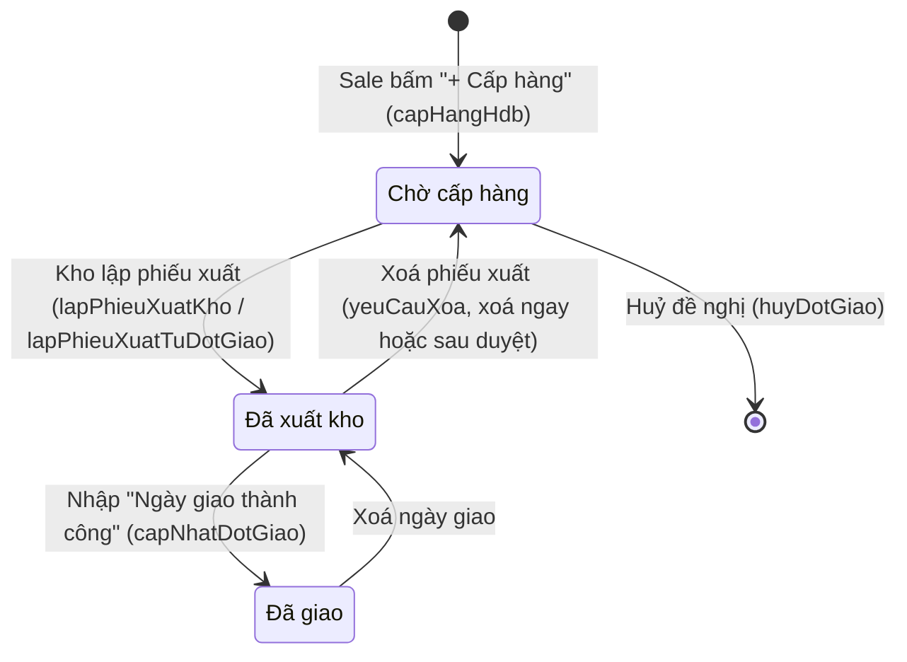
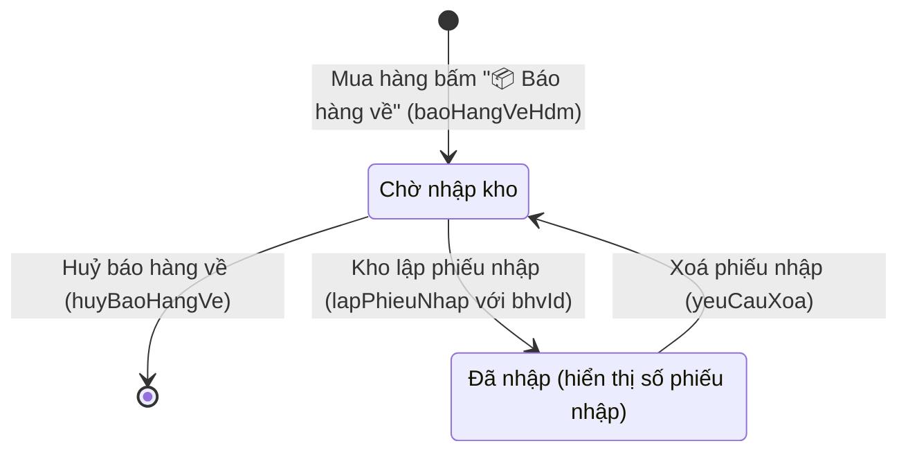
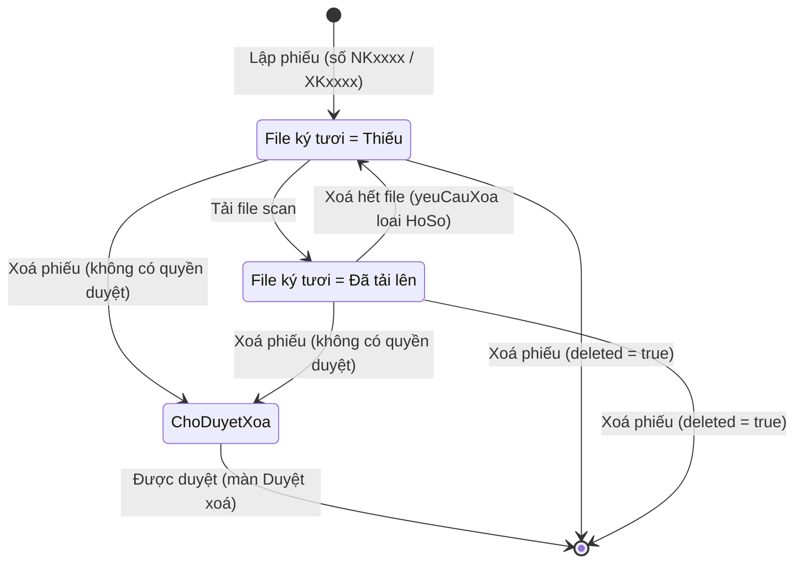

# 03 — Module Kho (key `kho`)

> Nguồn phân tích: mã giao diện client (HTML + JS) của màn `kho` đã tải về (giải mã từ `goog.script.init` → `userHtml`), kèm các đoạn liên quan trong màn `hdban`, `hdmua`, `danhmuc`, `taikhoan`, `duyetxoa`.
> Chỉ ghi điều thấy trong code client. Logic phía server (Apps Script) **không có trong file tải về** — mọi nhận định về server được gắn nhãn **[Suy luận]**.
> Mọi ví dụ (mã hàng, số phiếu, tên kho, số lượng) là **giả định**.

---

## 1. Mục đích & phạm vi

- Theo dõi **tồn kho theo mã gốc × nồng độ × kho/vị trí**, kèm số đã phân bổ cho HĐ bán và số khả dụng.
- Là "hộp việc" của bộ phận Kho: nhận **Đề nghị cấp hàng** (từ HĐ bán) và **Báo hàng về** (từ HĐ mua), lập **Phiếu xuất kho / Phiếu nhập kho** tương ứng.
- Quản lý **danh sách kho**: Kho Oxy, Kho tạm Phú Tài (nhiều kho), và kho đặc biệt **Giao thẳng** (`GIAOTHANG`).
- Lưu file **phiếu ký tươi (scan)** cho từng phiếu.
- Công cụ dọn dữ liệu: phát hiện & **sửa nồng độ ghi lệch** (vd `0.1` thay vì `10%`) trên toàn bộ chứng từ.

Ngoài phạm vi màn Kho (nằm ở module khác nhưng tác động tồn): kiểm tra kho / tạo đề nghị cấp hàng (HĐ bán — **HDB-13, HDB-14**), lập phiếu xuất ngay trong HĐ bán (**HDB-15**), báo hàng về (HĐ mua — **HDM-13**), quy tắc mã hàng / mở mã hàng / chuẩn hoá & gộp mã (Danh mục — **DM-07, DM-08, DM-09**), duyệt xoá (Hệ thống — **DX-01..DX-03**). Các mục dưới đây vẫn mô tả để hiểu màn Kho, nhưng chức năng được quản lý ở mã tương ứng.

Không thấy trong giao diện Kho: đơn giá, giá trị tồn, giá vốn, kiểm kê, phiếu điều chỉnh nhập tay, chuyển kho. (Giá vốn HĐ có ở màn Báo cáo — **BC-07**.)

---

## 2. Vai trò & quyền liên quan

Khoá quyền (màn Quản lý tài khoản, nhóm "Kho"):

| Khoá | Nhãn trong app | Ý nghĩa thấy trong code |
|---|---|---|
| `kho_xem` | Xem tồn kho | Vào màn Kho |
| `kho_phieu` | Lập phiếu nhập / xuất kho | [Suy luận] map sang cờ `canPhieu` do `getKhoData` trả về: hiện nút Lập phiếu nhập/xuất, sửa/xoá phiếu, tải/xoá file |
| `hanghoa` | (Danh mục Hàng hoá) | Có quyền sửa → mở mã hàng mới tạo ngay; không có → gửi yêu cầu cho Kho |
| `hdb_giaohang` | (HĐ bán – giao hàng) | Tạo đề nghị cấp hàng, huỷ đề nghị, nhập ngày giao thành công (ở HĐ bán) |
| `hdm_sua` | (HĐ mua – sửa) | Báo hàng về, huỷ báo hàng về (ở HĐ mua) |
| `hethong_duyetxoa` | Duyệt xoá | [Suy luận] quyết định `yeuCauXoa` xoá ngay (`deleted=true`) hay vào hàng chờ duyệt; `getKhoData` trả `canDuyetXoa` |

Cờ do server trả trong `getKhoData` (client chỉ đọc): `canKho` (tạo/sửa/xoá kho), `canPhieu` (lập/sửa/xoá phiếu), `canSuaNd` (nút Sửa nồng độ lệch), `canDuyetXoa`. **[Suy luận]** cách server tính `canKho`, `canSuaNd` không thấy trong client.

Mẫu quyền mặc định theo vai trò (roleTemplates):

| Vai trò | kho_xem | kho_phieu | hanghoa | hdb_giaohang |
|---|---|---|---|---|
| Giám đốc | xem+sửa | xem+sửa | xem+sửa | xem+sửa (all) |
| Admin | xem+sửa | xem+sửa | xem+sửa | xem+sửa (all) |
| Kho | xem+sửa | xem+sửa | xem+sửa | xem+sửa (all) |
| Sale | chỉ xem | không | chỉ xem | xem+sửa (own) |
| Kế toán | chỉ xem | không | chỉ xem | chỉ xem (all) |
| Mua hàng | chỉ xem | không | xem+sửa | không |

---

## 3. Danh sách màn hình / tab

Bố cục: thanh tab cố định trên (`.tier2`, freeze khi cuộn) + vùng nội dung `#main`. Tab mặc định `ton`, có thể mở thẳng tab qua `openScreen('kho', {tab})`.

| Key | Nhãn tab | Badge |
|---|---|---|
| `ton` | Tồn kho | — |
| `denghi` | Đề nghị cấp hàng / nhập kho | số = `choCap.length + choNhap.length` (ẩn khi 0) |
| `nhap` | Phiếu nhập kho | — |
| `xuat` | Phiếu xuất kho | — |
| `dskho` | Danh sách kho | — |

### 3.1 Tab Tồn kho (`ton`)

**Mục đích:** xem tồn theo mã gốc, tách dòng theo nồng độ × kho/vị trí; thấy hàng đang chờ nhập (của HĐ mua) đã phân bổ cho HĐ bán.

**Thẻ thống kê (stat-row):**

| Thẻ | Giá trị | Điều kiện hiện |
|---|---|---|
| Tồn trong kho Oxy | `stat.tong` + "đơn vị · `stat.soMa` mã gốc" | luôn |
| Kho tạm Phú Tài | `stat.pt` + "không phải kho Oxy · khả dụng `stat.ptKhaDung`" | `stat.pt > 0` |
| Khả dụng chưa phân bổ | `stat.khaDung` | luôn |
| Chờ nhập hàng (HĐ mua) | `stat.cho` | luôn |
| Nồng độ ghi lệch (cảnh báo) | số dòng có nồng độ lệch (tính ở client) | khi > 0 |
| Dòng sổ kho âm (dữ liệu cũ) (cảnh báo) | `stat.am` | `stat.am > 0` |

**Bộ lọc:**

| Bộ lọc | Kiểu | Logic |
|---|---|---|
| Ô tìm "Lọc theo mã gốc (vd KC-CO) — hiện mọi nồng độ" + nút × | text, lọc tức thì | chứa chuỗi trong `maHang + ' ' + tenHang` (không phân biệt hoa thường), lọc ở cấp **nhóm mã gốc** |
| Nhóm kho | select: Mọi nhóm kho / Kho Oxy / Kho tạm Phú Tài | `oxy` → dòng `pt=false`; `pt` → dòng `pt=true` |
| Vị trí | select: Mọi vị trí + danh sách `viTri` duy nhất (sắp xếp) | so khớp chính xác |
| Hiện dòng âm | switch (chỉ hiện khi `stat.am>0`) | mặc định tắt → ẩn dòng `am=true` (trừ dòng nồng độ lệch luôn hiện) |
| Chỉ dòng nồng độ lệch | switch (chỉ hiện khi có dòng lệch) | chỉ giữ dòng nồng độ lệch |
| Đếm | text "N mã gốc" | số nhóm còn ≥1 dòng sau lọc |

**Cột bảng** (mã gốc gộp ô `rowspan` theo số dòng con):

| Cột | Nội dung |
|---|---|
| Mã gốc | `maHang` (đậm) + dòng phụ `tenHang` |
| Nồng độ | `nongDo` hoặc "—"; nếu lệch → tô đỏ, tooltip "có thể là X%", nút **Sửa** (khi `canSuaNd`) |
| Vị trí | nếu `cho` → pill vàng "Chờ nhập hàng" (+ " · Phú Tài" nếu `pt`); ngược lại `viTri` + pill tím "kho tạm PT" nếu `pt` và không phải `GIAOTHANG` |
| Tồn (số) | `ton`; nếu `am` thêm dòng phụ "sổ kho âm" |
| Đã phân bổ (số) | `phanBo` (mặc định 0) |
| Khả dụng (số, đậm) | `0` nếu `cho`, ngược lại `khaDung` |
| Thuộc HĐ mua | link số HĐ mua (`hdm`) → mở màn HĐ mua; "—" nếu không có |
| Phân bổ cho HĐ bán | danh sách `hdb[]` xuống dòng; "—" nếu rỗng |

Dòng `am` có class `am`, dòng `pt` có class `pt-row` (định dạng riêng). Không khớp lọc → "Không có hàng khớp bộ lọc."

**Hành động:** Sửa nồng độ (popup 3.6.4); bấm số HĐ mua → mở HĐ mua.

### 3.2 Tab Đề nghị cấp hàng / nhập kho (`denghi`)

**Mục đích:** hàng việc chờ Kho xử lý, gộp 2 nguồn: `choCap` (đề nghị cấp hàng từ HĐ bán) rồi đến `choNhap` (báo hàng về từ HĐ mua). Không có bộ lọc.

| Cột | Đề nghị cấp hàng | Báo hàng về |
|---|---|---|
| Loại | pill xanh "Đề nghị cấp hàng · Đ{dot}" | pill vàng "Báo hàng về · Đ{dot}" |
| Từ | link số HĐ bán (mở HĐ bán ở tab `kho`) + phụ: tên · "Phú Tài" nếu kênh PT · người đề nghị | link số HĐ mua (hoặc "HĐ mua") + phụ: tên · Phú Tài · người báo |
| Mã hàng (nồng độ × SL) | danh sách `maHang (nongDo) × sl` | như bên trái |
| Ngày | `ngay`; nếu có `han` → phụ "hạn giao dd/mm/yyyy", **nhấp nháy** khi còn ≤ 3 ngày (tính `daysBetween(today, han)`) | `ngay` |
| Thao tác | `canPhieu` → nút **Lập phiếu xuất**; không → "Chờ Kho" | `canPhieu` → nút **Lập phiếu nhập**; không → "Chờ Kho" |

Trống → "Không có việc chờ xử lý." Ghi chú cuối bảng: Sale đề nghị cấp hàng ở HĐ bán (Kho & Giao hàng); Mua hàng báo hàng về ở HĐ mua (Nhận hàng); Giao thẳng chọn vị trí "Giao thẳng" khi lập phiếu nhập; HĐ kênh Phú Tài nhập/xuất từ kho tạm Phú Tài.

### 3.3 Tab Phiếu nhập kho (`nhap`) / Phiếu xuất kho (`xuat`)

Dùng chung 1 khung, khác cột thứ 3 và nút.

**Bộ lọc:** ô tìm "Tìm số phiếu / HĐ / mã hàng..." (+ nút ×), tìm trong: số phiếu, nguồn/NCC (nhập) hoặc đích/KH (xuất), tên kho, các mã hàng. Đếm "N phiếu".

**Nút:** (khi `canPhieu`)
- Tab nhập: **+ Lập phiếu nhập** → popup 3.6.2 (chế độ chọn HĐ mua).
- Tab xuất: **+ Lập phiếu xuất (từ đề nghị cấp hàng)** → chỉ chuyển sang tab `denghi` (không có lập phiếu xuất tự do).

**Cột:** Số phiếu · Ngày · Nguồn hàng (HĐ mua) *hoặc* Đích (HĐ bán) [số HĐ + phụ NCC/KH] · Kho · Mã hàng (nồng độ × SL) · File ký tươi (pill "Đã tải lên" nếu `file>0`, pill cảnh báo "Thiếu").

**Phân trang:** 50 dòng/lần, nút "⬇ Xem thêm N dòng (còn M)" + "Hiện hết"; tự nạp thêm khi cuộn tới (IntersectionObserver). Bấm 1 dòng → popup Chi tiết phiếu (3.6.3). Trống → "Chưa có phiếu."

### 3.4 Tab Danh sách kho (`dskho`)

Ghi chú đầu trang: Kho tạm Phú Tài là nơi nhập hàng HĐ kênh Phú Tài (không phải kho Oxy); HĐ bán Phú Tài chỉ xuất từ kho tạm đã nhập hàng hoặc Giao thẳng; có thể tạo nhiều kho tạm.

**Nút:** **+ Tạo kho** (khi `canKho`).

**Cột:** Mã (mono) · Tên kho (+ phụ địa chỉ) · Loại (pill "Giao thẳng" / "Kho tạm Phú Tài" / "Kho Oxy") · Số phiếu · Ghi chú · [nút **Sửa** khi `canKho` và không phải `GIAOTHANG`].

### 3.5 Bảng tóm tắt popup

| Popup | Mở từ | Hàm server |
|---|---|---|
| Tạo kho / Sửa kho {mã} | Danh sách kho | `luuKho`, `xoaKho` |
| Lập phiếu xuất kho — Đợt N | Đề nghị cấp hàng | `lapPhieuXuatKho` |
| Lập phiếu nhập kho [— báo hàng về ĐN] | Đề nghị (báo hàng về) / tab Phiếu nhập | `lapPhieuNhap` |
| Phiếu nhập/xuất kho {số} | Bấm dòng phiếu | `getPhieuKho`, `suaPhieuKho`, `yeuCauXoa`, upload |
| Sửa nồng độ {mã} | Nút Sửa ở dòng đỏ (Tồn kho) | `suaNongDoHang` |
| Xác nhận xoá (kho/phiếu/file) | Trong các popup trên | — |

### 3.6 Mô tả popup

#### 3.6.1 Tạo / Sửa kho
Nút: [Xoá kho] (chỉ khi sửa và `soPhieu = 0`, có xác nhận) · Huỷ · Lưu. Lỗi hiện trong vùng `[data-err]` của popup. Focus vào Tên kho.

#### 3.6.2 Lập phiếu nhập kho
Hai chế độ:
- **Từ báo hàng về** (`bhvId`): nguồn HĐ mua hiển thị khoá; dòng hàng = các dòng báo về, cột "Báo về"; ngày mặc định = ngày báo hàng về.
- **Tự chọn HĐ mua**: select HĐ mua lấy từ `hdmCon` (HĐ mua còn hàng chưa nhập); đổi HĐ → vẽ lại dòng (cột "Còn chưa nhập" = `conLai`) và lọc lại danh sách kho theo kênh của HĐ. Nếu `hdmCon` rỗng → toast "Không có HĐ mua nào còn hàng chưa nhập kho." và không mở.

Nút: Huỷ · **Lập phiếu nhập**. Thành công → toast "Đã lập {soPhieu}", nạp lại dữ liệu.

#### 3.6.3 Chi tiết phiếu kho
Hiện: nguồn/đích (khoá), Kho (select nếu `canPhieu`, ngược lại khoá), Ngày, Ghi chú; bảng dòng (Mã hàng · Nồng độ · Tên hàng · SL + ĐVT) — **chỉ xem, không sửa dòng**; mục "Phiếu ký tươi (file scan)": vùng **📎 Tải file lên** (nhiều file) + chip file (mở tab mới), nút ✕ xoá file, chip "chờ xoá" nếu file đang chờ duyệt xoá; dòng "Lập bởi {người} · {thời điểm}".
Nút: [Xoá phiếu] · Đóng · [Lưu] (Xoá/Lưu chỉ khi `canPhieu`).

#### 3.6.4 Sửa nồng độ
Hộp nhập 1 giá trị, bắt buộc. Mặc định = gợi ý `ndGoiY(nd)`. Nội dung cảnh báo: đổi ở **mọi chứng từ** (HĐ bán, HĐ mua, đợt giao, phiếu nhập/xuất) của mã này. Nút **Đổi**. Thành công → toast "Đã đổi N dòng: {mã} "{cũ}" → "{mới}"".

---

## 4. Chi tiết form

### 4.1 Form Tạo / Sửa kho

| Trường | Kiểu nhập | Bắt buộc | Tự tính/nguồn | Ghi chú |
|---|---|---|---|---|
| Mã kho | — (không nhập) | — | Server sinh [Suy luận]; dữ liệu mẫu dạng `KHO001` | Gửi `maKho=''` khi tạo mới |
| Tên kho (`tenKho`) | text | [Suy luận] có — client không kiểm | — | placeholder "vd Kho tạm Phú Tài — {địa danh}" |
| Loại kho (`loai`) | select: `Phú Tài` (Kho tạm Phú Tài – không phải kho Oxy) / `Oxy` (Kho Oxy) | có (luôn có giá trị) | Mặc định khi tạo mới = **Phú Tài** | **Khoá** khi kho đã có phiếu (`soPhieu>0`): "Kho đã có phiếu — không đổi loại" |
| Địa chỉ (`diaChi`) | text | không | — | |
| Ghi chú (`ghiChu`) | text | không | — | |

Loại thứ 3 `Giao thẳng` chỉ có ở kho hệ thống `GIAOTHANG` — không tạo/sửa được từ UI.

### 4.2 Form Lập phiếu xuất kho (từ đề nghị cấp hàng)

| Trường | Kiểu nhập | Bắt buộc | Tự tính/nguồn | Ghi chú |
|---|---|---|---|---|
| Kho xuất (`maKho`) | select | có | Danh sách lọc theo kênh HĐ bán (xem 7.3); mặc định kho đầu tiên **không phải** Giao thẳng | Kênh Phú Tài mà chưa có kho tạm → ghi chú "Chưa có kho tạm Phú Tài — tạo ở tab Danh sách kho" |
| Ngày xuất (`ngay`) | date | có | Mặc định hôm nay | |
| Dòng hàng | chỉ xem | — | = đúng mã/nồng độ/SL của đợt đề nghị | "Phiếu xuất theo đúng mã hàng / số lượng của đề nghị cấp hàng" — không sửa SL |
| Thông tin HĐ | chỉ xem | — | số HĐ · tên; cảnh báo nếu kênh Phú Tài | |

Gọi: `lapPhieuXuatKho(dgId, maKho, ngay)`.

### 4.3 Form Lập phiếu nhập kho

| Trường | Kiểu nhập | Bắt buộc | Tự tính/nguồn | Ghi chú |
|---|---|---|---|---|
| Nguồn hàng (HĐ mua) | khoá (từ báo hàng về) / select (`hdmCon`: "Số HĐ · NCC") | có | — | |
| Kho nhập / vị trí (`maKho`) | select | có | Lọc theo kênh HĐ mua; có lựa chọn **Giao thẳng** | Đổi HĐ mua → lọc lại danh sách |
| Ngày nhập (`ngay`) | date | có | Mặc định = ngày báo hàng về, hoặc hôm nay | |
| Ghi chú (`ghiChu`) | text | không | — | |
| Bảng dòng: Mã hàng (+ tên) | chỉ xem | — | Từ báo hàng về / dòng HĐ mua còn lại | |
| Nồng độ | chỉ xem | — | như trên | |
| Báo về / Còn chưa nhập | chỉ xem (số) | — | `sl` báo về / `conLai` | Là giá trị mặc định & "max" |
| SL nhập | số (inputmode numeric, `parseNum`) | ≥ 1 dòng có SL > 0 | Mặc định = max | Dòng SL ≤ 0 bị bỏ. Lỗi: "Nhập số lượng nhập kho." Client **không** chặn SL > max — [Suy luận] server kiểm |

Payload `lapPhieuNhap`: `{hdmId, bhvId, maKho, ngay, ghiChu, lines:[{maHang, nongDo, sl}]}`; trả `{data, phieu:{soPhieu}}`.

### 4.4 Form Sửa phiếu kho (chi tiết phiếu)

| Trường | Kiểu nhập | Bắt buộc | Tự tính/nguồn | Ghi chú |
|---|---|---|---|---|
| Nguồn hàng (HĐ mua) / Đích (HĐ bán) | khoá | — | `lienKet.soHD · ten` | |
| Kho (`maKho`) | select (lọc theo `lienKet.kenh`) | có | giá trị hiện tại | Không có quyền → ô khoá hiển thị `tenKho` |
| Ngày (`ngay`) | date | [Suy luận] có | — | |
| Ghi chú (`ghiChu`) | text | không | — | |
| Dòng hàng | chỉ xem | — | `x.lines` (maHang, nongDo, tenHang, sl, dvt) | Không sửa SL/mã |
| File ký tươi | upload nhiều file | không (nhưng hiện cảnh báo "Thiếu" ở danh sách) | nhóm `kho_phieu`, loại hồ sơ "Phiếu ký tươi (file scan)" | Upload xong mở lại popup |
| Người lập · thời điểm | chỉ xem | — | `nguoiLap`, `lapLuc` | |

Lưu bằng cơ chế **lưu ngầm** (`luuNgam`, khoá `pk:{id}`): đóng popup và báo "Đã lưu" ngay, gửi `suaPhieuKho(loai, id, {ngay, maKho, ghiChu})` nền; lỗi → toast "⚠ Chưa lưu được phiếu kho: …" và nạp lại. `loai` = `pnk` (nhập) / `pxk` (xuất).

### 4.5 Form Sửa nồng độ

| Trường | Kiểu nhập | Bắt buộc | Tự tính/nguồn | Ghi chú |
|---|---|---|---|---|
| Nồng độ mới | text (promptBox) | có | Gợi ý `ndGoiY(ndCũ)` | Áp dụng cho cặp (mã gốc, nồng độ cũ) trên mọi chứng từ |

### 4.6 Form liên quan ở module khác (tác động Kho)

> Thuộc mã: Báo hàng về → **HDM-13**; Kiểm tra kho / Cấp hàng → **HDB-13, HDB-14** (đề nghị mua → **HDM-22**); Mã hàng hoá → **DM-06, DM-07**.

**Báo hàng về (HĐ mua → Nhận hàng):** Ngày hàng về (date, mặc định hôm nay) · Ghi chú cho Kho · bảng dòng: Mã hàng · Nồng độ · "Chưa về" = `max(0, conLai − SL đang chờ nhập của các đợt báo về chưa nhập)` · "Về lần này" (mặc định = Chưa về). Chặn nếu HĐ chưa lưu ("Bấm 💾 Lưu trước khi báo hàng về.").

**Kiểm tra kho / Cấp hàng (HĐ bán → tab Kho & Giao hàng):** cột Mã hàng · Nồng độ · SL cần · Đã đề nghị cấp · Còn thiếu · Tồn khả dụng (kênh PT: "Tồn kho tạm PT"; phụ "giữ chỗ HĐ khác N", "sổ kho âm N") · Đang về (HĐ mua × SL) · **Cấp lần này** (mặc định `capDuoc`, khoá khi `capDuoc=0`) · **Mua thêm** (mặc định `canMua`). Nút "+ Cấp hàng" → `capHangHdb`; "+ Mua hàng" → `muaHangHdb` (mỗi lần bấm = 1 đề nghị mua).

**Mã hàng hoá (Danh mục):** Mã hàng hoá (gốc) (khoá khi sửa) · Loại sản phẩm (Khí chuẩn / Khí Công nghiệp / Dung dịch chuẩn / Thiết bị; mặc định Khí chuẩn) · Vật liệu bình (—/Nhôm/Thép) · Mô tả · Đơn vị tính (gợi ý Bình/Cái/Chai/Bộ; mặc định Bình) · Xuất xứ/hãng · Nồng độ mặc định · Ghi chú.

---

## 5. Luồng phiếu / trạng thái

### 5.1 Đợt đề nghị cấp hàng (HĐ bán) ↔ Phiếu xuất kho

Ghi chú: chuyển `Đã xuất kho → Đã giao` theo ngày giao là **[Suy luận]** (client chỉ thấy: ô ngày giao mở khi trạng thái ≠ "Chờ cấp hàng"; toast "Đã ghi nhận giao hàng"/"Đã bỏ ngày giao"). Hệ quả xoá phiếu xuất lấy từ câu xác nhận: "Đợt đề nghị cấp hàng quay lại Chờ cấp hàng."

### 5.2 Đợt báo hàng về (HĐ mua) ↔ Phiếu nhập kho

Phiếu nhập cũng có thể lập **không qua báo hàng về** (chọn HĐ mua trong `hdmCon`).

### 5.3 Vòng đời phiếu kho

Trạng thái "Chờ duyệt xoá" của phiếu không hiển thị trong danh sách phiếu; chỉ file có cờ `choXoa` ("chờ xoá"). [Suy luận] phiếu chờ xoá vẫn hiện bình thường cho tới khi duyệt.

### 5.4 Mã hàng mới (thuộc **DM-08**)

Người nhập HĐ bán gõ mã chưa có → "Mở mã hàng mới": có quyền `hanghoa` sửa → `moMaHangMoi` tạo ngay (`taoNgay`, `daCo` nếu trùng); không có quyền → tạo việc "Mở mã hàng mới" cho Kho ở ToDoList, HĐ vẫn lưu được với mã này.

---

## 6. Công thức tính

Client **không tự tính tồn** — nhận sẵn từ `getKhoData`. Dưới đây là phần thấy trong code + đối chiếu với dữ liệu mẫu.

| Chỉ tiêu | Công thức | Nguồn |
|---|---|---|
| Khả dụng hiển thị (dòng) | `cho ? 0 : khaDung` | code client |
| `khaDung` (dòng) | [Suy luận] `max(0, ton − phanBo)` — dữ liệu: dòng tồn âm có khaDung = 0; dòng chờ nhập có ton = phanBo, khaDung = 0 | server |
| `ton` (dòng) | [Suy luận] Σ SL phiếu nhập − Σ SL phiếu xuất theo (mã gốc, nồng độ, kho); có thể âm (`am=true`) khi xuất > nhập | server, nhãn "sổ kho âm" |
| Dòng "Chờ nhập hàng" (`cho=true`) | [Suy luận] SL HĐ mua chưa nhập kho đã gắn/phân bổ cho HĐ bán; `ton = phanBo`; không có `maKho` | server |
| `stat.tong` | [Suy luận] Σ `ton` dương của dòng kho Oxy (bỏ dòng âm, dòng chờ, dòng PT) — khớp dữ liệu mẫu | server |
| `stat.khaDung` | [Suy luận] Σ `khaDung` dòng kho Oxy | server |
| `stat.cho` | [Suy luận] Σ `ton` các dòng `cho` — khớp dữ liệu mẫu | server |
| `stat.am` | số dòng `am=true` | server |
| `stat.soMa` | số mã gốc trong `ton[]` | server |
| `stat.pt`, `stat.ptKhaDung` | [Suy luận] Σ tồn / khả dụng ở kho tạm Phú Tài (không gồm dòng chờ) | server |
| Số dòng nồng độ lệch | đếm dòng thoả `ndLech(nongDo)` | client |
| Còn thiếu (HĐ bán) | hiển thị `conThieu`; [Suy luận] = SL cần − Đã đề nghị cấp | server `kiemTraKhoHdb` |
| Chưa về (báo hàng về) | `max(0, conLai − Σ sl các đợt "Chờ nhập kho" cùng mã|nồng độ)` (khoá so khớp chữ thường) | client hdmua |
| Hạn giao nhấp nháy | `daysBetween(hôm nay, han) ≤ 3` | client |

**Giá trị tồn / giá vốn:** không có trong giao diện Kho (không có trường đơn giá/thành tiền nào trong `getKhoData`).

**Nồng độ lệch** — regex: `/^\s*0?[.,]\d+\s*%?\s*$/` (vd `0.1`, `,5`, `0.25%`).
**Gợi ý nồng độ** — `round(x × 1 000 000) / 10 000` + `%` với `x = parseFloat(nd thay ',' → '.')` (vd `0.1` → `10%`, `0.0005` → `0.05%`).

---

## 7. Quy tắc nghiệp vụ

### 7.1 Mã hàng / biến thể

> Quy tắc mã hàng thuộc **DM-07**; chuẩn hoá & gộp mã thuộc **DM-09**; công cụ sửa nồng độ lệch tại màn Kho là **KHO-06**.
- **Biến thể tồn kho = Mã gốc (`maHang`) × Nồng độ (`nongDo`) × Kho/vị trí.** Nồng độ là chuỗi tự do; mỗi chuỗi khác nhau là một dòng tồn khác nhau (vì vậy `0.1` và `10%` bị tách dòng → công cụ sửa nồng độ).
- Nhóm hiển thị theo mã gốc; tìm "KC-CO" hiện mọi nồng độ của mã đó.
- Khí chuẩn: mã tạo mới **tự gắn đuôi `-AL`** (bình nhôm); popup Mở mã gợi Loại = Khí chuẩn khi mã bắt đầu `KC-`/`KC ` (vd giả định `KC-CO` → `KC-CO-AL`).
- **Mã trùng không phân biệt hoa thường** → dùng lại mã có sẵn (`daCo`).
- Mã gốc không sửa được sau khi tạo (ô khoá ở form sửa).
- So khớp mã + nồng độ ở client dùng khoá `(maHang|nongDo).toLowerCase()`.
- Hàm server `chuanHoaKhiN2`, `chuanHoaMaHonHop`, `gopMaHangTrung`: có trong danh sách hàm server nhưng **không thấy màn hình nào gọi** — [Suy luận] là công cụ quản trị chạy tay để chuẩn hoá mã khí N2, mã hỗn hợp khí và gộp mã trùng.

### 7.2 Phiếu
- Số phiếu: nhập `NK` + 4 số, xuất `XK` + 4 số (theo dữ liệu mẫu; [Suy luận] server tự tăng).
- **Phiếu xuất chỉ lập từ một đợt đề nghị cấp hàng**, SL/mã đúng như đề nghị — không lập xuất tự do.
- **Phiếu nhập luôn gắn 1 HĐ mua** (qua báo hàng về hoặc chọn HĐ mua còn hàng chưa nhập). Cho nhập một phần, nhiều đợt.
- Sau khi lập: chỉ sửa được **Ngày, Kho, Ghi chú**; không sửa dòng hàng. Muốn đổi SL → xoá phiếu, lập lại.
- Xoá phiếu đi qua `yeuCauXoa` (loại `PhieuNhapKho`/`PhieuXuatKho`): xoá ngay hoặc chờ duyệt. Xoá phiếu nhập: tồn giảm; đợt báo hàng về quay lại "Chờ nhập kho". Xoá phiếu xuất: đợt đề nghị quay lại "Chờ cấp hàng".
- File ký tươi không bắt buộc khi lập, nhưng danh sách gắn cờ "Thiếu". Xoá file cũng qua `yeuCauXoa` (loại `HoSo`).

### 7.3 Kho & kênh
- Kho có 3 loại: **Oxy**, **Phú Tài** (kho tạm, không phải kho Oxy, cho phép nhiều kho), **Giao thẳng** (`GIAOTHANG`, hệ thống, không sửa).
- Lọc kho khi lập/sửa phiếu theo kênh HĐ: kênh `Phú Tài` → kho loại Phú Tài + Giao thẳng; kênh khác → kho **không** phải Phú Tài (Oxy) + Giao thẳng. Mặc định chọn kho đầu tiên không phải Giao thẳng.
- HĐ bán Phú Tài chỉ cấp/xuất hàng đã nhập kho tạm Phú Tài hoặc Giao thẳng; HĐ bán Oxy chỉ cấp được hàng đang có trong kho, thiếu thì đề nghị mua.
- Không đổi Loại kho khi kho đã có phiếu; chỉ xoá kho khi chưa có phiếu nào.
- "Giao thẳng": [Suy luận] dùng khi hàng đi thẳng NCC → khách, không làm tăng tồn kho thực (theo ghi chú màn Đề nghị và spec).

### 7.4 Phân bổ / giữ chỗ
- Tồn có cột **Đã phân bổ** và **Phân bổ cho HĐ bán**; HĐ bán thấy "giữ chỗ HĐ khác N". [Suy luận] phân bổ phát sinh khi HĐ bán liên kết HĐ mua (hàng mua cho đơn cụ thể) và khi có đề nghị cấp hàng chưa xuất.

### 7.5 Hành động tự động / kỹ thuật
- Dữ liệu `getKhoData` dùng cache IndexedDB + stale-while-revalidate (hiện bản cache rồi cập nhật).
- `window.onAppRefresh = load` — nạp lại khi app yêu cầu làm mới.
- Lưu ngầm khi sửa phiếu (hàng đợi `luuNgam`, giữ bản nháp trên máy nếu lỗi).

---

## 8. Liên kết module khác

| Module | Liên kết |
|---|---|
| HĐ bán (`hdban`, tab Kho & Giao hàng) | Kiểm tra kho (`kiemTraKhoHdb`), tạo đề nghị cấp hàng (`capHangHdb`) → vào tab Đề nghị của Kho; đề nghị mua (`muaHangHdb`) → sinh HĐ mua "Đề nghị mua"; lập phiếu xuất ngay tại HĐ bán (`lapPhieuXuatTuDotGiao`, cần `khoPhieu`); ghi ngày giao thành công. Từ Kho bấm số HĐ → mở HĐ bán tab `kho`. |
| HĐ mua (`hdmua`, mục Nhận hàng) | Báo hàng về (`baoHangVeHdm`)/huỷ (`huyBaoHangVe`) → vào tab Đề nghị; bảng SL mua/Đã nhập/Còn lại; danh sách phiếu nhập; nút "Mở Kho để lập phiếu nhập". HĐ mua không tách dòng khi đã có báo hàng về/phiếu nhập. |
| Danh mục Hàng hoá | `saveHangHoa`, `moMaHangMoi` (mã gốc, loại SP, nồng độ mặc định, ĐVT). |
| ToDoList | Việc "Mở mã hàng mới" giao cho Kho. |
| Duyệt xoá | Yêu cầu xoá `PhieuNhapKho`, `PhieuXuatKho`, `HoSo` (file). |
| Hồ sơ (upload) | Nhóm `kho_phieu` / loại "Phiếu ký tươi (file scan)" (danh mục hồ sơ quyền "Phiếu kho"). |
| Phú Tài | Kênh `Phú Tài` của HĐ dùng kho tạm Phú Tài. |

---

## 9. Hàm server sử dụng → mục đích

| Hàm | Gọi từ | Tham số (thấy ở client) | Mục đích |
|---|---|---|---|
| `getKhoData` | Kho | — | Trả `{ton[], stat, choCap[], choNhap[], phieuNhap[], phieuXuat[], hdmCon[], kho[], canKho, canPhieu, canSuaNd, canDuyetXoa}` |
| `lapPhieuNhap` | Kho | `{hdmId, bhvId, maKho, ngay, ghiChu, lines}` | Lập phiếu nhập; trả `{data, phieu}` |
| `lapPhieuXuatKho` | Kho | `dgId, maKho, ngay` | Lập phiếu xuất từ đợt đề nghị cấp hàng; trả data Kho |
| `getPhieuKho` | Kho | `loai ('pnk'/'pxk'), id` | Chi tiết phiếu: `{phieu, lines, hoso, lienKet{soHD,ten,kenh}, tenKho, canPhieu}` |
| `suaPhieuKho` | Kho (lưu ngầm) | `loai, id, {ngay, maKho, ghiChu}` | Sửa đầu phiếu |
| `luuKho` | Kho | `{maKho, tenKho, loai, diaChi, ghiChu}` | Tạo/sửa kho |
| `xoaKho` | Kho | `maKho` | Xoá kho chưa có phiếu |
| `suaNongDoHang` | Kho | `maHang, ndCu, ndMoi` | Đổi nồng độ trên mọi chứng từ; trả `{data, soDong}` |
| `yeuCauXoa` | Kho | `{loai, doiTuongId, tenHienThi[, fileUrl]}` | Xoá phiếu/file (ngay hoặc chờ duyệt); trả `{deleted}` |
| `kiemTraKhoHdb` | HĐ bán | `hdbId` | Bảng kiểm kho theo dòng HĐ bán |
| `capHangHdb` | HĐ bán | `hdbId, lines, ''` | Tạo đợt đề nghị cấp hàng |
| `lapPhieuXuatTuDotGiao` | HĐ bán | `dgId, maKho, ngay` | Lập phiếu xuất ngay trong HĐ bán |
| `baoHangVeHdm` | HĐ mua | `hdmId, lines, ngayVe, ghiChu` | Tạo đợt báo hàng về |
| `saveHangHoa` | Danh mục | `{maHang, loaiSP, vatLieu, moTa, dvt, xuatXu, nongDoMacDinh, ghiChu, laMoi}` | Lưu mã hàng; trả `daCo` nếu trùng |
| `moMaHangMoi` | HĐ bán | `{maHang, loaiSP, dvt, moTa, nongDo, hdId, nguon}` | Mở mã mới (tạo ngay hoặc gửi việc cho Kho) |
| `chuanHoaKhiN2`, `chuanHoaMaHonHop`, `gopMaHangTrung` | không thấy nơi gọi | — | [Suy luận] công cụ chuẩn hoá/gộp mã chạy tay |
| Liên quan: `huyDotGiao`, `capNhatDotGiao`, `huyBaoHangVe`, `muaHangHdb`, `uploadHoSo` | HĐ bán/HĐ mua/upload | — | Huỷ đề nghị, ghi ngày giao, huỷ báo về, đề nghị mua, tải file |

---

## 10. Khác biệt so với spec rev.md

| # | Spec rev.md (Module 3) | App thực tế |
|---|---|---|
| 1 | Phiếu nhập **tự sinh** khi đánh dấu "đã nhập kho" ở HĐ mua | Quy trình 2 bước: Mua hàng **Báo hàng về** → Kho **lập phiếu nhập** (chọn kho, sửa SL). Có thể lập phiếu nhập trực tiếp từ HĐ mua còn hàng. |
| 2 | Phiếu xuất **tự sinh** khi đánh dấu "đã giao hàng" | Sale **đề nghị cấp hàng** (theo đợt) → Kho **lập phiếu xuất** → sau đó ghi ngày giao thành công. Phiếu xuất có trước giao hàng. |
| 3 | Có phiếu nhập/xuất **nhập tay (điều chỉnh)** | Không có: phiếu luôn gắn HĐ mua / đợt đề nghị. Dữ liệu âm xử lý bằng hiển thị "sổ kho âm", không có phiếu điều chỉnh. |
| 4 | Đối tượng chính: vỏ bình/phụ kiện; biến thể nồng độ/thể tích/áp suất | Đối tượng: mã hàng hoá (Khí chuẩn, Khí công nghiệp, Dung dịch chuẩn, Thiết bị); biến thể chỉ **nồng độ** (chuỗi tự do). Vật liệu bình là thuộc tính mã, không phải biến thể. |
| 5 | Kho đặc biệt "Để tại Phú Tài" + "Chuyển thẳng — không qua kho" | Loại kho **Kho tạm Phú Tài** (nhiều kho, không phải kho Oxy) + kho hệ thống **Giao thẳng** (`GIAOTHANG`). |
| 6 | Module Phú Tài: hàng không qua kho Oxy | HĐ kênh Phú Tài **có** phiếu nhập/xuất, nhưng vào kho tạm Phú Tài, thống kê tách riêng. |
| 7 | Tồn = Σ Nhập − Σ Xuất theo loại × thuộc tính × vị trí | Có thêm **Đã phân bổ**, **Khả dụng**, dòng **Chờ nhập hàng** (HĐ mua chưa về) và liên kết HĐ mua/HĐ bán. |
| 8 | Kho link HĐ → tính giá trị thực hiện gốc | Có link HĐ (nguồn/đích phiếu, phân bổ) nhưng **không có giá trị/giá vốn** trong màn Kho. Giá vốn HĐ tính ở màn Báo cáo (**BC-07**) theo HĐ mua liên kết / bình quân, không từ phiếu kho. |
| 9 | (không có) | Thêm: file phiếu ký tươi, xoá qua duyệt, công cụ sửa nồng độ lệch, quản lý danh sách kho có khoá loại khi đã có phiếu. |

---

## 11. Ghi chú thiết kế UI

- Giữ 5 tab; tab Đề nghị cần badge đếm việc chờ — đây là "inbox" chính của vai trò Kho, nên cân nhắc đặt làm tab mặc định cho vai trò Kho [Suy luận/đề xuất].
- Bảng tồn dạng **nhóm theo mã gốc** (ô gộp) + dòng con theo nồng độ/kho; cần phân biệt rõ 4 trạng thái dòng: bình thường, **âm** (đỏ nhạt, ẩn mặc định), **kho tạm Phú Tài** (tím), **chờ nhập hàng** (vàng, khả dụng = 0), **nồng độ lệch** (ô đỏ + nút Sửa).
- Thẻ thống kê có điều kiện (ẩn khi = 0); thẻ cảnh báo màu warn.
- Danh sách phiếu: phân trang 50 + cuộn vô hạn; cột "File ký tươi" dạng pill Thiếu/Đã tải lên — nên thêm bộ lọc "Thiếu file" [đề xuất].
- Popup lập phiếu: bảng dòng hàng có cột "max" + ô SL căn phải, `inputmode=numeric`; danh sách kho phụ thuộc kênh, hiện cảnh báo khi kênh Phú Tài chưa có kho tạm.
- Chi tiết phiếu: dòng hàng chỉ đọc; vùng upload kéo-thả nhiều file; chip file có trạng thái "chờ xoá".
- Hành động xoá luôn có hộp xác nhận nêu rõ hệ quả (tồn giảm / đợt quay về trạng thái chờ); kết quả có 2 thông điệp: "Đã xoá" hoặc "Đã gửi yêu cầu xoá — chờ duyệt".
- Lưu phiếu là lưu ngầm (đóng popup ngay) — UI mới cần chỉ báo trạng thái đồng bộ (badge góc phải dưới như app hiện tại).
- Liên kết chéo: số HĐ mua/HĐ bán là link mở màn tương ứng (HĐ bán mở thẳng tab Kho).
- Hạn giao ≤ 3 ngày: hiệu ứng nhấp nháy — nên thay bằng pill màu cảnh báo cho dễ đọc [đề xuất].
- Ẩn/hiện nút theo `canPhieu`/`canKho`/`canSuaNd`; người không có quyền thấy chữ "Chờ Kho" thay cho nút.

---

## 12. Đối chiếu mã chức năng (features/kho.json)

| Mã | Chức năng | Mục trong tài liệu |
|---|---|---|
| KHO-01 | Bảng tồn kho theo mã gốc × nồng độ × kho | 3.1, 6, 7.4 |
| KHO-02 | Thẻ thống kê tồn kho | 3.1 |
| KHO-03 | Bộ lọc tồn kho | 3.1 |
| KHO-04 | Dòng "Chờ nhập hàng" | 3.1, 6 |
| KHO-05 | Hiển thị sổ kho âm | 3.1, 6 |
| KHO-06 | Phát hiện & sửa nồng độ ghi lệch | 3.6.4, 4.5, 6 |
| KHO-07 | Tab Đề nghị cấp hàng / nhập kho | 3.2 |
| KHO-08 | Lập phiếu xuất kho từ đề nghị cấp hàng | 4.2, 5.1 |
| KHO-09 | Lập phiếu nhập kho | 3.6.2, 4.3, 5.2 |
| KHO-10 | Danh sách phiếu nhập / xuất | 3.3 |
| KHO-11 | Xem / sửa / xoá phiếu kho | 3.6.3, 4.4, 5.3 |
| KHO-12 | Danh sách kho | 3.4, 3.6.1, 4.1 |
| KHO-13 | Lọc kho theo kênh HĐ | 7.3 |
| KHO-14 | Giao thẳng | 7.3 |
| KHO-15 | File phiếu ký tươi | 3.6.3, 5.3 |
| KHO-16 | Phiếu điều chỉnh nhập tay — **chỉ có trong spec** | 10 (#3) |

Chức năng đã gộp sang module khác (màn Kho chỉ hiển thị / gọi lại): DM-07 Quy tắc mã hàng · DM-08 Mở mã hàng mới · DM-09 Chuẩn hoá & gộp mã · HDB-14 Đề nghị cấp hàng (kèm HDB-13 Kiểm tra kho) · HDM-13 Báo hàng về · BC-07 Giá trị thực hiện gốc / giá vốn theo HĐ (spec KH-07 — app tính ở màn Báo cáo, không từ phiếu kho; xem mục 10 #8).
