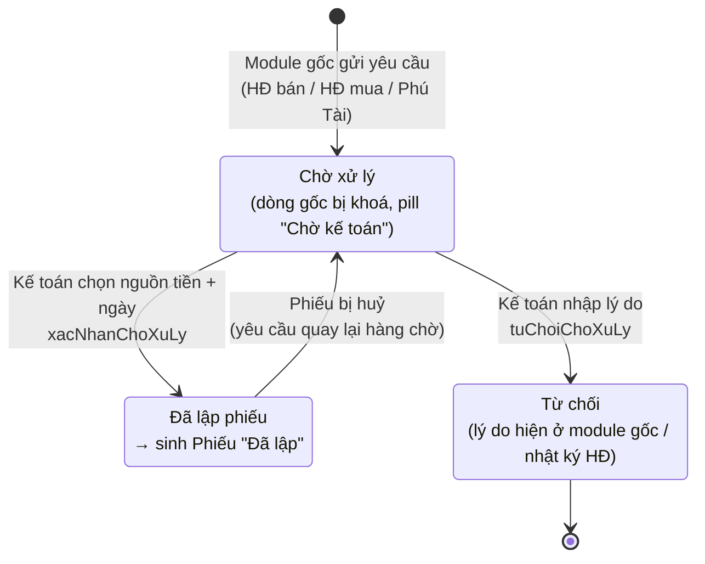
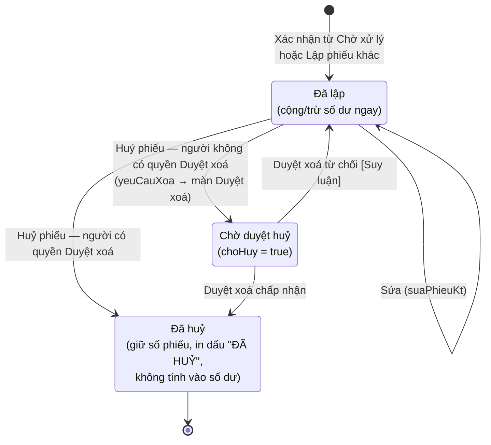
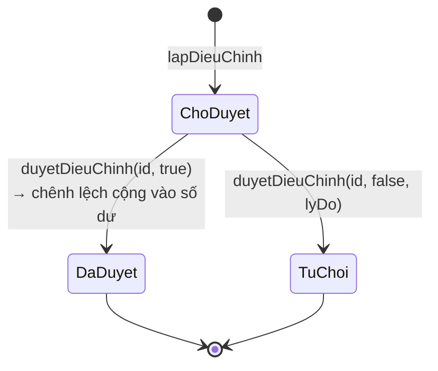

# 04 — Module Kế toán (key `ketoan`)

> Nguồn phân tích: mã client của màn `?page=ketoan` (đã giải mã từ `ketoan.html`), đối chiếu thêm mã client của HĐ bán, HĐ mua, Phú Tài, Tài khoản, Duyệt xoá.
> Chỉ ghi những gì thấy trong code client. Logic phía server (Apps Script) **không đọc được**; chỗ nào suy ra từ tên hàm, chữ trên giao diện hoặc dữ liệu mẫu thì gắn nhãn **[Suy luận]**.
> Mọi ví dụ (tên, số tiền, số tài khoản) trong tài liệu này là **giả định**.

---

## 1. Mục đích & phạm vi

Module Kế toán quản lý **sổ quỹ thu – chi** của Oxy theo từng **nguồn tiền** (tiền mặt, tài khoản ngân hàng…). Module là nơi **duy nhất** lập phiếu thu / phiếu chi có hiệu lực với số dư quỹ.

Phạm vi trên giao diện (5 tab):

| Tab (key) | Tên hiển thị | Nội dung |
|---|---|---|
| `nguontien` | Nguồn tiền | Thẻ số dư từng nguồn tiền, Phiếu điều chỉnh số dư, giao dịch gần đây |
| `cho` | Chờ xử lý | Hàng chờ các yêu cầu thu / chi do HĐ bán, HĐ mua, Phú Tài gửi sang |
| `thu` | Phiếu thu | Sổ phiếu thu |
| `chi` | Phiếu chi | Sổ phiếu chi |
| `congno` | Công nợ | Công nợ khách hàng, NCC, Phú Tài nội bộ (chỉ xem, tự tính) |

Ngoài phạm vi màn này (nằm ở module khác nhưng có liên quan): nhập đợt thanh toán, chi phí thực hiện HĐ, thưởng KD, dòng tiền Phú Tài (xem mục 8).

Tab mặc định: `nguontien` (hoặc `APP.initialTab` khi shell mở màn kèm tab). Màn hỗ trợ `onAppOpen({tab})` để module khác mở thẳng tới 1 tab, và `onAppRefresh` để tải lại.

---

## 2. Vai trò & quyền liên quan

### 2.1 Khoá quyền của module

| Khoá quyền (perm) | Nhãn trong màn Tài khoản | Trường trong `getKeToanData().perms` | Tác dụng trên UI |
|---|---|---|---|
| `kt_xem` | Xem nguồn tiền, phiếu thu / chi, công nợ | `xem` | Vào được màn |
| `kt_xacnhan` | Xác nhận & lập phiếu thu / chi | `xacNhan` | Hiện cột chọn nguồn tiền / ngày + nút "Xác nhận & Lập phiếu", "Từ chối" ở Chờ xử lý; nút "+ Lập phiếu thu/chi khác" |
| `kt_nguontien` | Quản lý nguồn tiền | `nguonTien` | Nút "+ Thêm nguồn tiền", nút ✎ sửa trên thẻ |
| `kt_dieuchinh` | Lập Phiếu điều chỉnh số dư | `dieuChinh` | Nút "Tạo Phiếu điều chỉnh số dư" |
| `kt_duyetdc` | Duyệt Phiếu điều chỉnh số dư | `duyetDc` | Nút "Phê duyệt" / "Từ chối" trên dòng điều chỉnh "Chờ duyệt" |
| `hethong_duyetxoa` | (module Hệ thống) Duyệt xoá | — | Huỷ phiếu / xoá file **ngay**; không có quyền thì tạo yêu cầu chờ duyệt |

Quyền sửa 1 phiếu cụ thể do server trả về (`getPhieuKt(id).can`). [Suy luận] gắn với `kt_xacnhan`.

### 2.2 Quyền mặc định theo vai trò (mẫu quyền trong màn Tài khoản)

`v` = xem, `e` = sửa, `—` = không có.

| Vai trò | kt_xem | kt_xacnhan | kt_nguontien | kt_dieuchinh | kt_duyetdc | hethong_duyetxoa |
|---|---|---|---|---|---|---|
| Giám đốc (`giamdoc`) | v,e | v,e | v,e | v,e | **v,e** | v,e |
| Admin (`admin`) | v,e | v,e | v,e | v,e | — | v,e |
| Kế toán (`ketoan`) | v | v,e | v,e | v,e | — | — |
| Sale, Kho, Mua hàng | — | — | — | — | — | — |

Owner (`owner`) không có mẫu riêng trong dữ liệu đọc được. [Suy luận] Owner có toàn quyền.

### 2.3 Ai lập – ai duyệt

| Nghiệp vụ | Người lập / gửi | Người xử lý / duyệt |
|---|---|---|
| Yêu cầu thu / chi từ HĐ | Người dùng HĐ bán / HĐ mua / Phú Tài (theo quyền module đó) | Kế toán (`kt_xacnhan`): xác nhận → phiếu, hoặc từ chối |
| Phiếu thu / chi khác | Người có `kt_xacnhan` | Không duyệt — phiếu có hiệu lực ngay |
| Phiếu điều chỉnh số dư | Người có `kt_dieuchinh` | Người có `kt_duyetdc` (mặc định chỉ Giám đốc) |
| Huỷ phiếu, xoá file scan | Người có quyền sửa phiếu | Người có `hethong_duyetxoa`: huỷ ngay. Người không có quyền này: gửi yêu cầu sang màn Duyệt xoá |

---

## 3. Danh sách màn hình / tab

Khung chung: thanh tab cố định (sticky) ở trên; tab "Chờ xử lý" có badge đếm số yêu cầu (`cho.length`). Khi tải lỗi: hộp đỏ `err-box` hiện thông báo lỗi.

### 3.1 Tab "Nguồn tiền"

**Mục đích:** xem số dư từng nguồn tiền, quản lý nguồn tiền, lập / duyệt điều chỉnh số dư, xem giao dịch gần đây.

**Khối 1 — Lưới thẻ nguồn tiền** (mỗi nguồn 1 thẻ):

| Thành phần thẻ | Nội dung |
|---|---|
| Tiêu đề | Tên · loại (· "Ngừng dùng" nếu trạng thái Ngừng) |
| Giá trị lớn | Số dư (`soDu`), màu cảnh báo khi âm |
| Dòng phụ | Số TK · Ngân hàng (nếu có); "Đầu kỳ X (dd.mm.yy) · Thu X · Chi X · Điều chỉnh X" (Điều chỉnh chỉ hiện khi khác 0) |
| Pill vàng | "Điều chỉnh ±X chờ duyệt" khi nguồn có phiếu điều chỉnh đang Chờ duyệt |
| Cảnh báo | "Số dư âm — kiểm tra số dư đầu kỳ / phiếu thiếu" khi `soDu < 0` |
| Nút ✎ | Sửa nguồn tiền (chỉ khi có quyền `nguonTien`) |
| Bấm thẻ | Lọc bảng giao dịch theo nguồn này. Bấm lại thì bỏ lọc. Thẻ đang chọn được tô nổi; thẻ Ngừng hiện mờ |

Danh sách rỗng: "Chưa có nguồn tiền."

**Khối 2 — Thanh hành động** (chỉ hiện khi có ít nhất 1 nút):
- `+ Thêm nguồn tiền` (quyền `nguonTien`) → popup Nguồn tiền (4.1).
- `Tạo Phiếu điều chỉnh số dư` (quyền `dieuChinh`) → popup Điều chỉnh (4.2).
- Ghi chú cố định: "Số dư = đầu kỳ + phiếu thu − phiếu chi + điều chỉnh đã duyệt. Lệch với sao kê / kiểm quỹ: lập Phiếu điều chỉnh, người có quyền duyệt Phê duyệt mới cộng vào."

**Khối 3 — Bảng "Phiếu điều chỉnh số dư"** (chỉ hiện khi có dữ liệu):

| Cột | Nguồn dữ liệu |
|---|---|
| Số phiếu | `soPhieu` |
| Ngày | `ngay` (dd.mm.yy) |
| Nguồn tiền | tên theo `maTK` |
| Sổ sách | `soDuSoSach` |
| Thực tế | `soDuSaoKe` |
| Chênh lệch | `chenhLech` (in đậm, có dấu + nếu dương) |
| Lý do | `lyDo`; dòng phụ "Duyệt: …" (`ghiChuDuyet`) |
| Trạng thái | Pill: Chờ duyệt (vàng) / Đã duyệt (xanh) / Từ chối (đỏ); dòng phụ "người lập → người duyệt" |
| (hành động) | `Phê duyệt` · `Từ chối` — chỉ khi có quyền `duyetDc` và trạng thái là Chờ duyệt |

- Phê duyệt: hộp xác nhận "Phê duyệt điều chỉnh số dư? — Chênh lệch được cộng vào số dư nguồn tiền." → `duyetDieuChinh(id, true, '')`.
- Từ chối: hộp nhập "Lý do" (bắt buộc) → `duyetDieuChinh(id, false, lyDo)`.

**Khối 4 — Bảng "Giao dịch gần đây" / "Phiếu của {nguồn} (n)"**
- Không lọc: 15 phiếu đầu tiên, bỏ phiếu Đã huỷ. [Suy luận] Server đã sắp phiếu mới nhất lên đầu.
- Đang lọc theo nguồn: mọi phiếu chưa huỷ của nguồn đó. Có link "✕ Bỏ lọc".
- Link nhanh: "Xem phiếu thu", "Xem phiếu chi" (chuyển tab).
- Cột: Ngày · Số phiếu · Nguồn tiền · Nội dung · Kênh (pill Oxy / Phú Tài) · Số tiền (+ xanh cho Thu, − đỏ cho Chi).
- Bấm dòng → popup chi tiết phiếu (4.4).

### 3.2 Tab "Chờ xử lý"

**Mục đích:** Kế toán xử lý các yêu cầu thu / chi do bộ phận khác gửi.

**Thẻ thống kê (3 thẻ):** Chờ lập phiếu thu (tổng tiền) · Chờ lập phiếu chi (tổng tiền) · Số yêu cầu (dòng phụ: "N yêu cầu đã từ chối trước đây" nếu `soChoTuChoi > 0`, nếu không thì "từ HĐ bán, HĐ mua, Phú Tài").

**Banner hướng dẫn:** "Các bộ phận gửi yêu cầu thu / chi từ Hợp đồng bán, Hợp đồng mua, Phú Tài. Kế toán chọn nguồn tiền thực tế và ngày, bấm Xác nhận & Lập phiếu — số dư nguồn tiền cập nhật ngay, ngày đã trả ở dòng gốc tự điền nếu còn trống."

**Bảng** (không phân trang, không có bộ lọc):

| Cột | Nội dung |
|---|---|
| Loại | Pill "Thu" (xanh) / "Chi" (đỏ) |
| Từ module | `module` (VD "HĐ bán"); dòng phụ: người tạo · thời điểm tạo |
| Nội dung | `noiDung`; dòng phụ: link HĐ liên quan (số HĐ + tên đối tác, bấm mở HĐ); cảnh báo ⚠ `canhBao` nếu server trả về |
| Người nộp / nhận | `nguoiNhan`, nếu trống thì lấy tên đối tác của HĐ |
| Số tiền | +/− có màu |
| Hình thức | `TM` / `CK` |
| Nguồn tiền thực tế * | Combobox nguồn tiền (bỏ nguồn Ngừng), **gợi ý sẵn**: TM → nguồn loại "Tiền mặt" đầu tiên; CK → nguồn "Ngân hàng" đầu tiên; không có thì lấy nguồn đầu danh sách |
| Ngày * | Ô ngày, mặc định hôm nay |
| (hành động) | `Xác nhận & Lập phiếu` · `Từ chối` |

(*) 3 cột cuối chỉ hiện khi có quyền `xacNhan`.

- Xác nhận: `xacNhanChoXuLy(id, {maTK, ngay})` → toast "Đã lập PT-…/PC-…".
- Từ chối: hộp nhập lý do (bắt buộc, placeholder "Lý do (bộ phận gửi sẽ thấy trong nhật ký HĐ)") → `tuChoiChoXuLy(id, lyDo)`.
- Rỗng: "Không có yêu cầu nào chờ xử lý."

### 3.3 Tab "Phiếu thu" / "Phiếu chi" (cùng 1 giao diện, `loai` = Thu / Chi)

**Bộ lọc** (một hàng, xuống dòng khi hẹp):

| Bộ lọc | Kiểu | Giá trị |
|---|---|---|
| Tìm kiếm | Ô text + nút × xoá | Tìm trong: số phiếu, nội dung, người nộp/nhận, loại chi phí, mã cũ, số HĐ liên quan, tên đối tác HĐ (không phân biệt hoa thường, lọc khi gõ) |
| Tháng | Select | "Mọi tháng" + các tháng có phiếu của loại đó (mới nhất trước), hiển thị "Tháng mm/yyyy" |
| Kênh | Select | Mọi kênh / Oxy / Phú Tài (phiếu không có kênh được coi là Oxy) |
| Nguồn tiền | Select | Mọi nguồn tiền + toàn bộ nguồn (kể cả Ngừng) |
| Hiện phiếu đã huỷ | Công tắc | Mặc định tắt |
| `+ Lập phiếu thu/chi khác` | Nút chính (bên phải) | Chỉ khi có quyền `xacNhan` |

**Cột bảng:**

| Cột | Nội dung |
|---|---|
| Số phiếu | `soPhieu`; dòng phụ "cũ {maCu}" nếu là dữ liệu chuyển đổi |
| Ngày | dd.mm.yy |
| Nguồn tiền | tên |
| Nội dung | `noiDung`; dòng phụ: module · loại chi phí (· Phú Tài) |
| Người nộp (Thu) / Người nhận (Chi) | `doiTac` |
| Liên quan | Link HĐ (bấm mở HĐ bán / HĐ mua / Phú Tài). HĐ đã lưu trữ: chỉ hiện chữ "… · lưu trữ {năm}" |
| Số tiền | +/− có màu |
| Scan ký tươi | Pill "📄 n" nếu có file scan, nếu không "—" |
| Trạng thái | Pill "Đã lập" / "Chờ duyệt huỷ" / "Đã huỷ" + nút 🖨 (✓, ✓2… = số lần đã in) |

- Dòng Đã huỷ có style riêng (`.huy`).
- Chân bảng: "{n} phiếu" + tổng tiền. **Không tính phiếu Đã huỷ** dù đang hiện.
- Phân trang kiểu "xem thêm" (bước 50 dòng, cuộn tới cuối thì tự nạp thêm; nút "⬇ Xem thêm n dòng (còn m)" và "Hiện hết").
- Bấm dòng → popup chi tiết (4.4). Bấm 🖨 → popup in (4.5).
- Rỗng: "Không có phiếu khớp bộ lọc."

### 3.4 Tab "Công nợ"

**Thẻ thống kê:**

| Thẻ | Giá trị | Dòng phụ |
|---|---|---|
| Khách còn nợ Oxy | `stat.kh` | "quá hạn X" hoặc "HĐ bán kênh Oxy đang thực hiện / kết thúc" |
| Oxy còn nợ NCC | `stat.ncc` | "quá hạn X" hoặc "HĐ mua kênh Oxy"; thêm "· kênh Phú Tài X (không cộng)" nếu `nccPT > 0` |
| Phú Tài còn phải chuyển Oxy | `stat.pt` | "N HĐ chưa có giá mua — chưa tính" hoặc "theo màn Phú Tài" |

**Sub-tab** (kèm số dòng): Khách hàng (HĐ bán) · Nhà cung cấp (HĐ mua) · Phú Tài nội bộ.

a) **Khách hàng:** Số HĐ · Khách hàng · Sale · Giai đoạn · Hoá đơn (mỗi hoá đơn 1 dòng: số + ngày; hoặc "Chưa xuất") · Giá trị sau VAT · Đã thu · **Còn phải thu** · Hạn / quá hạn. Chân: "{n} HĐ" + tổng còn phải thu.

b) **Nhà cung cấp:** Số HĐ mua (+ pill "Phú Tài") · NCC · Giai đoạn · Giá trị sau VAT · Đã trả · **Còn phải trả** · Hạn / quá hạn. Chân: "{n} HĐ mua (tổng chỉ tính kênh Oxy)". Ghi chú: "Đã trả lấy từ Ngày đã trả của các đợt thanh toán HĐ mua. HĐ mua kênh Phú Tài: Phú Tài trả NCC (Oxy chuyển tiền cho Phú Tài thì tính ở Phú Tài nội bộ)."

c) **Phú Tài nội bộ:** Số HĐ · Khách hàng cuối · Khách đã trả PT (hiển thị **%**, `khTiLe`) · Oxy hưởng ("Chưa có giá mua" nếu `coGia = false`) · Oxy đã chuyển PT · PT đã chuyển Oxy · **PT còn phải chuyển** ("—" nếu null). Ghi chú công thức (mục 6.5).

Cột "Hạn / quá hạn": pill đỏ "Quá hạn {số tiền}" nếu `quaHan > 0`; nếu không: "Hạn tới dd.mm.yy", thêm "(n ngày)" khi còn ≤ 7 ngày; nếu không có hạn thì "—".

Bấm dòng → mở chi tiết HĐ ở module tương ứng (`hdban` / `hdmua` / `phutai`).

### 3.5 Danh sách popup

| Popup | Mở từ | Kích thước |
|---|---|---|
| Thêm / Sửa nguồn tiền | Tab Nguồn tiền | md |
| Phiếu điều chỉnh số dư | Tab Nguồn tiền | md |
| Phê duyệt điều chỉnh (xác nhận) / Từ chối điều chỉnh (nhập lý do) | Bảng điều chỉnh | nhỏ |
| Từ chối yêu cầu (nhập lý do) | Tab Chờ xử lý | nhỏ |
| Lập phiếu thu / chi khác | Tab Phiếu thu / chi | md |
| Chi tiết phiếu (xem / sửa / huỷ / scan) | Bấm dòng phiếu | md |
| Xác nhận huỷ phiếu / xoá file | Popup chi tiết | nhỏ |
| Xem / In phiếu | 🖨 hoặc nút trong chi tiết | lg |
| "Phiếu này đã in" (Huỷ / Lưu bản mới / Ghi đè) | Nút In khi đã in trước đó | nhỏ |
| Thông tin in trên phiếu (đơn vị / người ký) | Popup In | md |

---

## 4. Chi tiết form

Quy ước nhập liệu chung (theo code):
- Ô tiền (`data-money`): tự định dạng nhóm nghìn bằng dấu chấm khi gõ (VD `1.250.000`); khi focus thì tự bôi đen. Giá trị gửi lên server là số nguyên.
- Ô ngày: ô text kiểu `dd/mm/yyyy`, cho gõ tắt `041026` hoặc `04102026`; ngày sai thì báo "Ngày không hợp lệ…". Giá trị gửi lên server dạng ISO `yyyy-mm-dd`.
- Client **không kiểm tra bắt buộc**. Lỗi do server trả về hiện ở dòng lỗi đỏ trong popup. Cột "Bắt buộc" dưới đây ghi **[Suy luận]** nếu chỉ suy ra từ nghiệp vụ.

### 4.1 Nguồn tiền (`luuNguonTien`)

| Trường | Kiểu nhập | Bắt buộc | Tự tính / nguồn | Ghi chú |
|---|---|---|---|---|
| maTK | ẩn | — | Server sinh khi thêm mới | Dữ liệu mẫu có dạng `TKnnn`. Tiêu đề popup sửa: "Sửa nguồn tiền {maTK}" |
| ten — Tên nguồn tiền | text | [Suy luận] Có | — | Placeholder "vd Ngân hàng VCB" |
| loai — Loại | select | Có (luôn có giá trị) | Danh mục `loaiNguonTien`: Tiền mặt / Ngân hàng / Khác | Mặc định "Ngân hàng" khi thêm mới |
| soTaiKhoan — Số tài khoản | text | Không | — | In lên phiếu chi/thu chuyển khoản |
| nganHang — Ngân hàng | text | Không | — | |
| soDuDauKy — Số dư đầu kỳ | tiền | Không (mặc định 0) | — | **Nguồn đã có phiếu thì không sửa được** (ghi chú trên form; server chặn) → dùng Phiếu điều chỉnh |
| ngayDauKy — Ngày đầu kỳ | ngày | Không | Mặc định hôm nay khi thêm | |
| trangThai — Trạng thái | select | Có | Đang dùng / Ngừng | Nguồn Ngừng bị ẩn khỏi các combobox khi lập phiếu mới. Dữ liệu cũ có giá trị khác ("Active") được coi là Đang dùng |
| thu, chi, dc, soDu | chỉ đọc | — | Server tính | Xem 6.1 |

### 4.2 Phiếu điều chỉnh số dư (`lapDieuChinh`)

Mô tả trên popup: "Phiếu ở trạng thái Chờ duyệt — số dư chỉ đổi khi người có quyền duyệt Phê duyệt."

| Trường | Kiểu nhập | Bắt buộc | Tự tính / nguồn | Ghi chú |
|---|---|---|---|---|
| maTK — Nguồn tiền | select | Có | Nguồn đang dùng | |
| ngay — Ngày | ngày | [Suy luận] Có | Mặc định hôm nay | |
| Số dư sổ sách (app) | chỉ đọc | — | = `soDu` hiện tại của nguồn đang chọn | Cập nhật lại khi đổi nguồn |
| soDuSaoKe — Số dư thực tế (sao kê / kiểm quỹ) | tiền | Có | — | |
| lyDo — Lý do chênh lệch | text | [Suy luận] Có | — | Placeholder "vd Phí ngân hàng tháng 9 chưa ghi phiếu" |
| (xem trước) | nhãn | — | "Chênh lệch sẽ điều chỉnh: ±X đ" = thực tế − sổ sách | |
| soPhieu, chenhLech, soDuSoSach, trangThai, nguoiLap, nguoiDuyet, ghiChuDuyet | — | — | Server sinh / ghi | Trạng thái: Chờ duyệt → Đã duyệt / Từ chối |

### 4.3 Lập phiếu thu / chi khác (`lapPhieuKhac`)

Mô tả trên popup: "Khoản thu / chi không đi qua module (văn phòng, lương, vay, luân chuyển giữa nguồn tiền...)."

| Trường | Kiểu nhập | Bắt buộc | Tự tính / nguồn | Ghi chú |
|---|---|---|---|---|
| loai | ẩn | Có | Theo tab đang mở (Thu / Chi) | |
| ngay — Ngày | ngày | [Suy luận] Có | Mặc định hôm nay | Quyết định số phiếu (yymm) [Suy luận] |
| maTK — Nguồn tiền | select | Có | Nguồn đang dùng | |
| soTien — Số tiền | tiền | [Suy luận] Có, > 0 | — | |
| doiTac — Người nộp (Thu) / Người nhận (Chi) | text | Không | — | In vào "Họ và tên người nộp/nhận tiền" |
| noiDung — Nội dung | text (cả hàng) | [Suy luận] Có | — | In vào "Lý do nộp/chi" |
| loaiChiPhi — Loại chi phí | text + gợi ý (datalist) | Không | Danh mục `loaiChiPhi` (cho gõ tự do) | Danh mục hiện có: Kinh doanh, Hàng hóa, Vận chuyển, Văn phòng, Marketing, Công tác phí, Lương, Tiền vay, Thuế / phí, Khác |
| kenh — Kênh | select | Có | Oxy / Phú Tài | Mặc định Oxy |
| ghiChu — Ghi chú | text | Không | — | |
| hinhThuc | ẩn | — | **Tự suy ra**: nguồn loại "Tiền mặt" → `TM`, ngược lại → `CK` | |
| soPhieu, module ("Phiếu khác"), nguoiLap, lapLuc, trangThai ("Đã lập") | — | — | Server sinh | Kết quả: toast "Đã lập {soPhieu}" |

### 4.4 Chi tiết phiếu (`getPhieuKt` → `suaPhieuKt`)

Tiêu đề: "Phiếu thu {soPhieu}" / "Phiếu chi {soPhieu}".

| Trường | Kiểu nhập | Sửa được khi | Ghi chú |
|---|---|---|---|
| Ngày | ngày | có quyền và phiếu chưa huỷ | |
| Nguồn tiền | select (mọi nguồn) | như trên | Đổi nguồn thì số dư 2 nguồn đổi theo [Suy luận] |
| Số tiền | tiền | như trên **và phiếu lập tay** (`choXuLyId` rỗng) | Phiếu sinh từ yêu cầu module: số tiền **phải sửa ở module gốc** |
| Người nộp / nhận | text | như trên | |
| Nội dung | text | như trên | |
| Loại chi phí | text + gợi ý | như trên | |
| Từ module | chỉ đọc | — | `module` (+ "· Phú Tài") |
| Ghi chú | text | như trên | |
| Khối "Yêu cầu gốc" | chỉ đọc | — | Chỉ với phiếu từ Chờ xử lý: "Yêu cầu gốc: {nội dung} — {người tạo} gửi {thời điểm}. Số tiền sửa ở module gốc (huỷ phiếu → yêu cầu quay lại Chờ xử lý)." |
| Phiếu ký tươi (file scan) | upload nhiều file + chip file | có quyền | Mỗi file ≤ 20 MB, ảnh được nén sang JPG trước khi tải; lưu `doiTuong='ktp'`, `nhom='kt_phieu'`, `loaiHoSo='Phiếu ký tươi (file scan)'`. Nút ✕ xoá file → `yeuCauXoa({loai:'HoSo'})`; file đang chờ xoá có nhãn "chờ xoá" |
| Phiếu đã in | danh sách link PDF | — | "{loại} · thời gian · người in", bản đầu có nhãn "mới nhất"; rỗng: "Chưa in lần nào." |
| Dòng chân | chỉ đọc | — | "Lập bởi {nguoiLap} · {lapLuc}" (+ "· Đã huỷ {huyLuc}", "· Đang chờ duyệt huỷ") |

Nút: `Huỷ phiếu` (đỏ; ẩn nếu không có quyền, phiếu đã huỷ hoặc đang chờ huỷ) · `🖨 Xem / In phiếu` · `Đóng` · `Lưu` (chỉ khi có quyền).

**Lưu kiểu "lưu ngầm" (`luuNgam`):** popup đóng ngay, dòng trong bảng cập nhật ngay, lệnh lưu chạy nền. Lỗi → toast "⚠ Chưa lưu được phiếu …" và tải lại. Đóng tab khi còn lệnh lưu chưa xong thì trình duyệt hỏi xác nhận rời trang.

### 4.5 Xem / In phiếu (`luuBanInPhieu`)

| Thành phần | Kiểu | Ghi chú |
|---|---|---|
| Khổ in | select | "Khổ A5 ngang — 1 liên" (mặc định) / "Khổ A4 — 2 liên (lưu + giao)". Lựa chọn được nhớ trên máy (localStorage `oxy-kho-in`) |
| ✎ Thông tin đơn vị / người ký | nút | Chỉ khi `can` |
| Gợi ý | nhãn | Chưa có địa chỉ đơn vị: "Chưa có địa chỉ đơn vị — bấm 'Thông tin đơn vị' để điền 1 lần, các phiếu sau tự in." |
| Khung xem trước | iframe | Cao 58vh |
| Phiếu đã in | danh sách | "— mỗi lần in lưu 1 bản PDF trên Drive" |
| `🖨 In phiếu` | nút chính | Gọi lệnh in của trình duyệt, đồng thời gửi HTML bản in lên server để lưu PDF. Nếu đã in trước đó: hỏi "Đã in n lần, gần nhất … Ghi đè lên bản đã in, hay lưu thành bản in mới?" → Huỷ / ➕ Lưu bản mới / ♻️ Ghi đè bản đã in (bản cũ vào Thùng rác Drive) |

Trình duyệt chặn lệnh in → báo "Bấm chuột phải vào phiếu → In". Lưu PDF lỗi → "Đã in, nhưng lưu bản PDF lên Drive bị lỗi: …".

### 4.6 Thông tin in trên phiếu thu / chi (`luuThongTinCty`)

Mô tả: "Lưu 1 lần, mọi phiếu in sau đều dùng. Tên người ký để trống thì ký tay."

| Trường | Kiểu nhập | Bắt buộc | Tự tính / nguồn | Ghi chú |
|---|---|---|---|---|
| ten — Tên đơn vị | text | Không | — | "Đơn vị: …" |
| diaChi — Địa chỉ | text (cả hàng) | Không | — | Trống → in dòng chấm |
| mst — Mã số thuế | text | Không | — | |
| dienThoai — Điện thoại | text | Không | — | |
| giamDoc — Giám đốc (tên in dưới chữ ký) | text | Không | — | |
| keToanTruong — Kế toán trưởng | text | Không | — | |
| thuQuy — Thủ quỹ | text | Không | — | |
| ghiChuMau — Dòng dưới "Mẫu số" | text (cả hàng) | Không | — | Để trống nếu không cần |

### 4.7 Hộp xác nhận ở Chờ xử lý (theo từng dòng)

| Trường | Kiểu nhập | Bắt buộc | Tự tính / nguồn | Ghi chú |
|---|---|---|---|---|
| maTK — Nguồn tiền thực tế | select trong dòng | Có | Gợi ý theo hình thức TM/CK | |
| ngay — Ngày | ngày trong dòng | Có | Hôm nay | Ngày phiếu; server tự điền "ngày đã trả" ở dòng gốc nếu dòng đó còn trống |
| lyDo (khi từ chối) | text | **Có** (client chặn) | — | Bộ phận gửi thấy trong nhật ký HĐ |

---

## 5. Luồng trạng thái

### 5.1 Yêu cầu "Chờ xử lý" (bảng chờ) và phiếu thu / chi





### 5.2 Phiếu điều chỉnh số dư



### 5.3 Phiếu từ module khác đẩy sang thế nào

| Module gốc | Thao tác ở module gốc | Hàm server | Loại yêu cầu |
|---|---|---|---|
| HĐ bán — Thanh toán | Kế toán / Admin nhập ngày + số tiền khách trả ở đợt thanh toán rồi Lưu ("tự gửi 1 phiếu thu sang Kế toán") | [Suy luận] gửi trong lúc lưu HĐ, không có hàm riêng phía client | Thu |
| HĐ bán — Chi phí thực hiện HĐ (từng dòng: loại, đợt giao, số tiền, ngày, có hoá đơn, TM/CK) | Nút "Tạo phiếu chi" trên dòng đã lưu | `taoPhieuChiCpHdb(dongId)` | Chi |
| HĐ bán — Thưởng KD (phân bổ từng người) | Nút "Tạo phiếu chi" trên dòng → xác nhận "Gửi … sang Kế toán để lập phiếu chi" | `guiPhieuThuongKd(id)` | Chi |
| HĐ bán — Chi phí KD trả khách | "Tạo phiếu chi trả khách?" (tiền mặt, người nhận = người nhận CPKD của HĐ) | `taoPhieuChiCpkd(hdId)` | Chi |
| HĐ bán — Phí QL | "Ghi nhận sổ Phí quản lý" | `ghiNhanPhiQL(hdId)` | [Suy luận] Không tạo yêu cầu thu/chi — chỉ ghi sổ Phí quản lý |
| HĐ mua — Thanh toán NCC (đợt) | "Tạo phiếu chi" (kênh Oxy) / "Phiếu chi chuyển PT" (kênh Phú Tài: Oxy chuyển tiền để Phú Tài trả NCC) | `taoPhieuChiTtHdm(dotId)` | Chi |
| HĐ mua — Chi phí | "Tạo phiếu chi" (phải lưu trước) | `taoPhieuChiCpHdm(dongId)` | Chi |
| Phú Tài — Chi phí không hoá đơn | "Tạo phiếu chi TM" | `guiPhieuPhuTai('cp', id)` | Chi (tiền mặt, trừ phần Oxy) |
| Phú Tài — Dòng tiền PT chuyển Oxy | "Tạo phiếu thu" | `guiPhieuPhuTai('thu', id)` | Thu |
| Phú Tài — Hoa hồng | "Tạo phiếu chi HH" | `guiPhieuPhuTai('hh', id)` | Chi |

Hiển thị ở module gốc: pill "Chờ kế toán" (vàng) → "Đã lập phiếu" (xanh) / "Từ chối" (đỏ, kèm lý do). Khi trạng thái là "Chờ xử lý" hoặc "Đã lập phiếu" thì dòng gốc **bị khoá sửa**.

Giá trị `choXuLyId` đặc biệt ở dòng gốc: `du_lieu_cu` (pill "Dữ liệu cũ", đã xử lý ở app cũ) và `phu_tai` (đợt khách trả cho Phú Tài, "không vào quỹ Oxy").

---

## 6. Công thức

### 6.1 Số dư nguồn tiền (server tính; client chỉ hiển thị)

```
soDu = soDuDauKy + thu − chi + dc
  thu = Σ soTien phiếu Thu của nguồn (không tính phiếu Đã huỷ)
  chi = Σ soTien phiếu Chi của nguồn (không tính phiếu Đã huỷ)
  dc  = Σ chenhLech phiếu điều chỉnh ĐÃ DUYỆT của nguồn
```
Nguồn của công thức: dòng ghi chú trên màn ("Số dư = đầu kỳ + phiếu thu − phiếu chi + điều chỉnh đã duyệt") và hộp xác nhận huỷ ("số dư nguồn tiền trừ lại"). [Suy luận] Phiếu có ngày trước `ngayDauKy` có bị loại hay không thì không thấy trong client.

### 6.2 Chênh lệch điều chỉnh

```
chenhLech = soDuSaoKe (thực tế) − soDuSoSach (soDu tại lúc lập)
```
(Client xem trước bằng `sk − t.soDu`; server lưu `soDuSoSach` và `chenhLech`.)

### 6.3 Đánh số phiếu

| Đối tượng | Định dạng | Căn cứ |
|---|---|---|
| Phiếu thu | `PT-yymm-nnn` (VD `PT-2610-007`) | Dữ liệu mẫu: 101/101 phiếu có `yymm` trùng **tháng của ngày phiếu** (không phải ngày lập); `nnn` 3 chữ số, chạy lại từ 001 theo **từng tháng, từng loại** — [Suy luận] từ dữ liệu, server không đọc được |
| Phiếu chi | `PC-yymm-nnn` | như trên |
| Mã cũ (`maCu`) | `PTnnnn` / `PCnnnn` | Số phiếu ở sổ cũ, hiện dòng phụ "cũ …" |
| Phiếu điều chỉnh | không rõ | Không có dữ liệu mẫu |
| Nguồn tiền `maTK` | `TKnnn` | Dữ liệu mẫu [Suy luận] |

### 6.4 Tổng trên các bảng

- Chân bảng phiếu: `n` và `Σ soTien` chỉ của các phiếu **khớp bộ lọc và chưa huỷ**.
- Thẻ Chờ xử lý: `tong.Thu = Σ soTien (loai = Thu)`, `tong.Chi = Σ soTien (loai ≠ Thu)`, đếm = số yêu cầu đang chờ.

### 6.5 Công nợ (server tính; nhãn và ghi chú lấy từ client)

| Chỉ tiêu | Công thức / quy tắc |
|---|---|
| Còn phải thu (KH) | `con = sauVAT − daTT`. [Suy luận] Đã thu = tổng các đợt khách đã trả |
| Thẻ "Khách còn nợ Oxy" | Σ `con` của HĐ bán **kênh Oxy**, giai đoạn **Đang thực hiện / Kết thúc** |
| Còn phải trả (NCC) | `con = sauVAT − daTra`; `daTra` lấy từ **Ngày đã trả** của các đợt thanh toán HĐ mua |
| Thẻ "Oxy còn nợ NCC" | Σ `con` HĐ mua **kênh Oxy**; kênh Phú Tài hiện riêng `nccPT` "(không cộng)" |
| Quá hạn | `quaHan` = số tiền các đợt đã qua hạn mà chưa trả [Suy luận]; ở HĐ mua client đếm đợt quá hạn theo `hanTra < hôm nay và chưa có ngayTra` |
| Hạn tới | `hanToi` = hạn gần nhất; hiện số ngày khi `daysBetween(hôm nay, hanToi) ≤ 7` |
| PT còn phải chuyển | `con = oxyHuong + oxyChuyen − daNhan` — "Oxy hưởng (70% chênh lệch) + tiền Oxy đã chuyển Phú Tài để trả NCC − tiền Phú Tài đã chuyển Oxy". `con = null` khi HĐ chưa có giá mua (`coGia = false`) và không được cộng vào thẻ tổng (đếm vào `ptChuaGia`) |

### 6.6 Đọc số tiền bằng chữ (`docSoTien`, dùng khi in)

- Lấy giá trị tuyệt đối, làm tròn; 0 → "Không đồng."
- Tách nhóm 3 chữ số, đơn vị nhóm: "", nghìn, triệu, tỷ, nghìn tỷ, triệu tỷ. Nhóm bằng 0 thì bỏ qua.
- Trong nhóm: nhóm không phải nhóm đầu luôn đọc "… trăm" (kể cả "không trăm"); "lẻ" khi hàng chục = 0 và có hàng đơn vị; "mười"; "mốt" (hàng chục ≥ 2, đơn vị 1); "tư" (hàng chục ≥ 2, đơn vị 4); "lăm" (đơn vị 5 sau mười / mươi).
- Viết hoa chữ đầu, thêm " đồng", thêm " chẵn" nếu chia hết cho 1.000, kết thúc bằng dấu chấm.
- VD (giả định): 1.250.000 → "Một triệu hai trăm năm mươi nghìn đồng chẵn."; 2.005 → "Hai nghìn không trăm lẻ năm đồng."

### 6.7 Gợi ý nguồn tiền & hình thức

- `goiYTK(hinhThuc)`: TM → nguồn đầu tiên có loại "Tiền mặt" và không Ngừng; khác → nguồn "Ngân hàng" đầu tiên không Ngừng; không có → nguồn đầu danh sách.
- Phiếu khác: `hinhThuc = (loại nguồn = Tiền mặt) ? 'TM' : 'CK'`.

---

## 7. Quy tắc nghiệp vụ & ràng buộc

1. **Không có bước duyệt phiếu thu / chi.** Phiếu có hiệu lực ngay khi lập ("Đã lập"). Bước kiểm soát là: (a) Kế toán xác nhận yêu cầu từ module, (b) huỷ phiếu phải qua Duyệt xoá, (c) điều chỉnh số dư phải qua duyệt.
2. **Một phiếu gắn đúng 1 nguồn tiền**, chỉ VNĐ. Nguồn Ngừng không chọn được khi lập phiếu mới, nhưng vẫn chọn được trong bộ lọc và khi sửa phiếu cũ.
3. **Không xoá phiếu.** Huỷ thì giữ phiếu với trạng thái "Đã huỷ" và số phiếu cũ. Phiếu huỷ không tính vào số dư và tổng. Phiếu huỷ từ Chờ xử lý → yêu cầu gốc quay lại "Chờ xử lý".
4. **Số tiền của phiếu sinh từ module không sửa ở Kế toán.** Chỉ sửa ở module gốc (huỷ phiếu → sửa → xác nhận lại).
5. **Đầu kỳ bị khoá** khi nguồn đã có phiếu → lệch số dư phải dùng Phiếu điều chỉnh (chờ duyệt).
6. Số dư âm được phép nhưng hiện cảnh báo trên thẻ.
7. Xác nhận yêu cầu: server tự điền **ngày đã trả / ngày thanh toán** ở dòng gốc nếu dòng đó còn trống (theo banner).
8. Từ chối yêu cầu bắt buộc có lý do. Lý do ghi vào nhật ký HĐ của module gốc.
9. **Tạm ứng / quyết toán tạm ứng:** không có loại phiếu riêng, không có liên kết tạm ứng – quyết toán. Tạm ứng ghi như phiếu chi thường (nội dung tự do). [Suy luận] từ việc chỉ có 2 loại Thu / Chi. Phiếu chuyển từ sổ cũ chỉ còn ghi loại phiếu gốc ("Loại phiếu: Tạm ứng / Quyết toán / Luân chuyển / Thanh toán…") trong trường Ghi chú, không phải loại phiếu của app.
10. **Luân chuyển tiền giữa nguồn:** không có loại phiếu riêng. Popup "Lập phiếu thu / chi khác" ghi rõ dùng cho "luân chuyển giữa nguồn tiền" → [Suy luận] lập 2 phiếu: 1 phiếu chi ở nguồn đi + 1 phiếu thu ở nguồn đến. Hai phiếu này không liên kết với nhau và vẫn tính vào tổng thu / chi.
11. **Kênh Oxy / Phú Tài:** mỗi phiếu có `kenh`. Phiếu từ module Phú Tài, hoặc phiếu khác chọn kênh Phú Tài, vẫn ghi vào **quỹ Oxy** (đi qua nguồn tiền của Oxy) và được gắn nhãn Phú Tài để lọc. Công nợ NCC: HĐ mua kênh Phú Tài **không cộng** vào tổng nợ NCC của Oxy. Tiền Oxy chuyển Phú Tài để trả NCC được tính vào "Phú Tài nội bộ".
12. **Dữ liệu cũ:** phiếu chuyển từ sổ cũ có `module = 'Dữ liệu cũ'`, `nguoiLap = 'Chuyển dữ liệu'` (khi in thì ô "Người lập phiếu" để trống), có `maCu`. Dòng gốc ở HĐ có `choXuLyId = 'du_lieu_cu'` và không xoá được.
13. HĐ đã lưu trữ: link "Liên quan" chỉ hiện chữ (không bấm được) kèm "lưu trữ {năm}".
14. Upload scan: mỗi file ≤ 20 MB; ảnh PNG/WEBP/BMP được nén về JPG nếu nhỏ hơn. Xoá file đi qua Duyệt xoá như huỷ phiếu.
15. Mỗi lần in lưu 1 bản PDF lên Drive. Có thể chọn ghi đè bản in gần nhất. Đếm số lần in (`soIn`) hiện cạnh nút 🖨.
16. Dữ liệu được cache theo kiểu stale-while-revalidate (IndexedDB `oxy2-kho`): mở màn hiện ngay dữ liệu cũ, sau đó server báo "không đổi" hoặc trả dữ liệu mới. Mọi lệnh ghi trả về toàn bộ `getKeToanData` mới và màn vẽ lại.

---

## 8. Liên kết module khác

| Module | Chiều | Nội dung |
|---|---|---|
| HĐ bán (`hdban`) | → KT | Yêu cầu thu đợt khách trả; yêu cầu chi: chi phí thực hiện HĐ, thưởng KD, chi phí KD trả khách. Phí QL ghi sổ riêng |
| HĐ bán | KT → | Tự điền ngày đã thanh toán; trạng thái yêu cầu hiện ở dòng gốc; lý do từ chối vào nhật ký HĐ; Công nợ KH lấy giá trị sau VAT, đợt đã thu, hoá đơn, hạn từ HĐ bán |
| HĐ mua (`hdmua`) | ↔ | Yêu cầu chi đợt thanh toán NCC / "Phiếu chi chuyển PT"; chi phí HĐ mua; Công nợ NCC lấy từ ngày đã trả các đợt |
| Phú Tài (`phutai`) | ↔ | Yêu cầu chi TM (chi phí không hoá đơn), thu (PT chuyển Oxy), chi hoa hồng; Công nợ "Phú Tài nội bộ" (Oxy hưởng 70% chênh lệch…) |
| Duyệt xoá (`duyetxoa`) | KT → | Yêu cầu huỷ phiếu (`loai = 'PhieuKeToan'`, tên hiển thị = số phiếu) và xoá file (`loai = 'HoSo'`) |
| Tài khoản | → KT | 5 khoá quyền `kt_*` |
| Hồ sơ / Drive | ↔ | `uploadHoSo` (scan ký tươi), `luuBanInPhieu` (PDF bản in) |
| Shell | ↔ | `openScreen(page,{id})` mở HĐ; `oxy-data-changed` báo các màn khác làm mới sau mỗi lệnh ghi |

---

## 9. Hàm server → mục đích

| Hàm | Gọi từ | Tham số (client) | Mục đích |
|---|---|---|---|
| `getKeToanData` | KT | — | Trả `{nguonTien[], cho[], phieu[], dieuChinh[], congNo{kh,ncc,pt,stat}, perms, loaiChiPhi[], loaiNguonTien[], me, soChoTuChoi}` |
| `xacNhanChoXuLy` | KT | `id, {maTK, ngay}` | Lập phiếu từ yêu cầu chờ; trả `{data, phieu}` |
| `tuChoiChoXuLy` | KT | `id, lyDo` | Từ chối yêu cầu |
| `lapPhieuKhac` | KT | `{loai, ngay, maTK, soTien, doiTac, noiDung, loaiChiPhi, kenh, ghiChu, hinhThuc}` | Lập phiếu tay; trả `{data, phieu}` |
| `suaPhieuKt` | KT (lưu ngầm) | `id, {ngay, maTK, doiTac, noiDung, loaiChiPhi, ghiChu[, soTien]}` | Sửa phiếu |
| `getPhieuKt` | KT | `id` | Chi tiết phiếu: `{phieu, can, choHuy, cho, hoso[], banIn[], inPhieu{cty, nguonTien, soHD, diaChi}}` |
| `luuThongTinCty` | KT | `{ten, diaChi, mst, dienThoai, giamDoc, keToanTruong, thuQuy, ghiChuMau}` | Lưu thông tin in phiếu; trả `cty` |
| `luuBanInPhieu` | KT | `phieuId, html, kho('a5'/'a4'), thayUrl` | Lưu PDF bản in lên Drive (ghi đè nếu có `thayUrl`); trả `{banIn[]}` |
| `luuNguonTien` | KT | `{maTK, ten, loai, soTaiKhoan, nganHang, soDuDauKy, ngayDauKy, trangThai}` | Thêm / sửa nguồn tiền |
| `lapDieuChinh` | KT | `{maTK, ngay, soDuSaoKe, lyDo}` | Lập phiếu điều chỉnh (Chờ duyệt) |
| `duyetDieuChinh` | KT | `id, dongY(bool), ghiChu` | Phê duyệt / từ chối điều chỉnh |
| `yeuCauXoa` | KT | `{loai:'PhieuKeToan', doiTuongId, tenHienThi}` hoặc `{loai:'HoSo', doiTuongId, fileUrl, tenHienThi}` | Huỷ phiếu / xoá file; trả `deleted = true` nếu làm ngay |
| `uploadHoSo` | KT (qua `uploadFiles`) | base64, tên, mime, meta | Tải file scan |
| `taoPhieuChiCpHdb` | HĐ bán | `dongId` | Gửi yêu cầu chi cho 1 dòng chi phí thực hiện HĐ bán |
| `taoPhieuChiCpkd` | HĐ bán | `hdId` | Gửi yêu cầu chi tiền mặt "chi phí KD trả khách" |
| `guiPhieuThuongKd` | HĐ bán | `id dòng thưởng` | Gửi yêu cầu chi thưởng KD cho 1 người |
| `ghiNhanPhiQL` | HĐ bán | `hdId` | Ghi nhận Phí QL vào "sổ Phí quản lý" [Suy luận: không qua Chờ xử lý] |
| `taoPhieuChiTtHdm` | HĐ mua | `dotId` | Gửi yêu cầu chi đợt thanh toán NCC / chuyển PT |
| `taoPhieuChiCpHdm` | HĐ mua | `dongId` | Gửi yêu cầu chi chi phí HĐ mua |
| `guiPhieuPhuTai` | Phú Tài | `loai ('cp'/'thu'/'hh'), id` | Gửi yêu cầu chi TM / thu / chi hoa hồng |
| `chuyenSoQuyCu` | — | — | Không có lời gọi nào trong client đã tải. [Suy luận] Công cụ chuyển sổ quỹ cũ thành phiếu "Dữ liệu cũ" (có `maCu`) |
| `taiNeuDoi` | khung chung | `fn, args, dau` | Cơ chế cache: chỉ tải lại khi dữ liệu đổi |

---

## 10. Khác biệt so với spec rev.md

| # | Spec rev.md | App hiện tại |
|---|---|---|
| 1 | Số phiếu tự sinh **theo năm**, VD `TC26-0001`, chung 1 dãy | Tách 2 dãy `PT-yymm-nnn` / `PC-yymm-nnn`, đánh lại **theo tháng** của ngày phiếu |
| 2 | Loại phiếu: Thu / Chi / **Tạm ứng / Quyết toán tạm ứng** | Chỉ có Thu / Chi |
| 3 | Trạng thái Nháp → Chờ duyệt → Đã duyệt / Từ chối; chỉ phiếu Đã duyệt mới tính quỹ | Phiếu "Đã lập" tính quỹ ngay; chỉ có Đã lập / Chờ duyệt huỷ / Đã huỷ. Kiểm soát chuyển sang bước **Chờ xử lý** (với yêu cầu từ module) và **Duyệt xoá** (khi huỷ) |
| 4 | Trường Người đề nghị, Người duyệt; 2 cột Số tiền Thu / Số tiền Chi | 1 cột Số tiền + Loại; Người lập; người gửi yêu cầu / người xử lý nằm ở bảng chờ |
| 5 | Sổ quỹ **không gắn HĐ** | Phiếu có `lk` liên kết HĐ bán / mua / Phú Tài (phiếu từ module) |
| 6 | **Chi phí thực hiện HĐ** là sổ riêng, nhập ở màn Kế toán | Nhập ở HĐ bán / HĐ mua; đẩy sang Chờ xử lý → thành **phiếu chi trong cùng sổ quỹ** (trừ số dư nguồn tiền) |
| 7 | Luân chuyển tiền: "bổ sung", chưa chốt | Không có chức năng riêng; dùng phiếu thu / chi khác. Đối chiếu sao kê bằng **Phiếu điều chỉnh số dư** (có duyệt) — spec không có |
| 8 | DM_NguonTien: Mã, Tên, Loại (TM/NH), Đầu kỳ | Thêm Số TK, Ngân hàng, Ngày đầu kỳ, Trạng thái (Đang dùng / Ngừng), loại "Khác"; khoá sửa đầu kỳ khi đã có phiếu |
| 9 | DM Loại chi phí tách 2 nhóm (vận hành / thực hiện HĐ) | Danh sách phẳng 10 giá trị, chỉ để gợi ý, cho gõ tự do; màn này không có UI quản lý danh mục |
| 10 | Công nợ 2 chiều | 3 chiều: thêm **Phú Tài nội bộ**; thêm quá hạn, hạn tới, hoá đơn, Sale, giai đoạn; loại kênh Phú Tài khỏi nợ NCC |
| 11 | Phú Tài "không đụng vào quỹ… chính của Oxy"; quỹ ảo riêng | Phiếu thu / chi của Phú Tài **đi qua nguồn tiền Oxy** (gắn kênh Phú Tài) |
| 12 | Phú Tài: Oxy hưởng 90% LN sau thuế | Ghi chú ở Công nợ: "Oxy hưởng (70% chênh lệch)" |
| 13 | File đính kèm | "Phiếu ký tươi (file scan)" + lưu PDF mỗi lần in |
| 14 | (không có) | In phiếu theo mẫu 01-TT / 02-TT, A5 / A4 2 liên, thông tin đơn vị / người ký, đọc số bằng chữ |
| 15 | Quyết toán vận chuyển theo HĐ | Không thấy trong màn Kế toán |

---

## 11. Ghi chú thiết kế UI

### 11.1 Bố cục & tương tác
- Thanh tab cố định ở trên. Badge đỏ đếm số yêu cầu ở tab "Chờ xử lý" là tín hiệu công việc chính của Kế toán.
- Tab Nguồn tiền: lưới thẻ (responsive) — thẻ vừa là KPI vừa là bộ lọc (toggle). Cần trạng thái "đang chọn", "ngừng" (mờ), "âm" (đỏ), pill "điều chỉnh chờ duyệt".
- Bảng dạng Excel (`table.xl`), số căn phải, cột số tiền có dấu +/− và màu xanh / đỏ. Dòng bấm được có con trỏ tay.
- Tab Chờ xử lý: thao tác **ngay trong dòng** (chọn nguồn + ngày + 2 nút). Thiết kế lại nên giữ thao tác 1 chạm, có giá trị gợi ý sẵn.
- Phân trang tăng dần (50 dòng / bước, tự nạp khi cuộn, có "Hiện hết").
- Pill màu: xanh `done` (Thu, Đã lập, Đã duyệt), đỏ `warn` (Chi, Từ chối, Quá hạn), vàng `amber` (Chờ duyệt, Chờ duyệt huỷ), tím `violet` (Phú Tài), xám (Oxy, Đã huỷ).
- Toast cho mọi kết quả; lỗi trong popup hiện ở dòng đỏ phía trên nút.
- Định dạng: tiền `1.234.567` (+ " đ" ở thẻ), ngày trong bảng `dd.mm.yy`, ô nhập `dd/mm/yyyy`, thời điểm `dd/mm/yyyy hh:mm`.
- Vai trò không có quyền: **ẩn hẳn** nút / cột hành động, không chỉ vô hiệu hoá.

### 11.2 Mẫu in phiếu thu / chi

Khổ: **A5 ngang (1 liên)** hoặc **A4 dọc (2 liên)**: "Liên 1: Lưu" và "Liên 2: Giao người nộp tiền / Giao người nhận tiền", ngăn bằng nét đứt. Font Times New Roman 13.5px, lề 0 (`@page`).

```
┌──────────────────────────────────────────────┬─────────────────────┐
│ Đơn vị: CÔNG TY ABC                          │   Mẫu số 01 - TT    │
│ Địa chỉ: 123 Đường X, Quận Y                 │ (ghiChuMau)         │
│ MST: 0100000000 · ĐT: 0900 000 000           │ (Liên 1: Lưu)       │
├────────────┬────────────────────────┬────────┴─────────────────────┤
│            │       PHIẾU THU        │ Quyển số: ......             │
│            │ Ngày 05 tháng 10 năm 2026│ Số: PT-2610-001            │
│            │                        │ Nợ: ......   Có: ......      │
└────────────┴────────────────────────┴──────────────────────────────┘
Họ và tên người nộp tiền: Nguyễn Văn A ..............................
Địa chỉ: ...........................................................
Lý do nộp: Khách thanh toán đợt 1 — HĐ số 001/HĐKT ...................
Hình thức: Chuyển khoản — Ngân hàng X (TK 0000000000 – Ngân hàng X)
Số tiền: 1.250.000 đồng
Viết bằng chữ: Một triệu hai trăm năm mươi nghìn đồng chẵn.
Kèm theo: ............................................ chứng từ gốc.
                                    Ngày 05 tháng 10 năm 2026
 Giám đốc | Kế toán trưởng | Người nộp tiền | Người lập phiếu | Thủ quỹ
(Ký, họ tên, đóng dấu) | (Ký, họ tên) …
 [tên GĐ]  | [tên KTT]      | [doiTac]       | [nguoiLap]      | [tên TQ]
Đã nhận đủ số tiền (viết bằng chữ): .................................
```

Quy tắc in:
- Phiếu thu: "Mẫu số 01 - TT", tiêu đề PHIẾU THU, "người **nộp** tiền", "Lý do **nộp**". Hàng ký: Giám đốc · Kế toán trưởng · Người nộp tiền · Người lập phiếu · Thủ quỹ.
- Phiếu chi: "Mẫu số 02 - TT", PHIẾU CHI, "người **nhận** tiền", "Lý do **chi**". Hàng ký: Giám đốc · Kế toán trưởng · Thủ quỹ · Người lập phiếu · Người nhận tiền.
- Lý do = `noiDung`; nếu phiếu gắn HĐ và nội dung chưa có số HĐ thì nối thêm " — HĐ số {soHD}".
- Hình thức: nguồn "Tiền mặt" → "Tiền mặt"; khác → "Chuyển khoản — {tên nguồn} (TK {số TK} – {ngân hàng})". Không có nguồn thì bỏ dòng này.
- Địa chỉ người nộp/nhận lấy từ `inPhieu.diaChi` (server; [Suy luận] địa chỉ đối tác của HĐ).
- Quyển số, Nợ, Có: để dòng chấm (ghi tay). Ngày trống → "Ngày ..... tháng ..... năm .....".
- Tên dưới chữ ký: lấy từ Thông tin đơn vị; trống thì ký tay. Người lập "Chuyển dữ liệu" → để trống.
- Phiếu Đã huỷ: in dấu mờ chéo "ĐÃ HUỶ" màu đỏ nhạt.
- Màn hình xem trước nền xám, trang trắng có bóng. Bản PDF lưu Drive bỏ nền và bóng (`body.pdf`).
