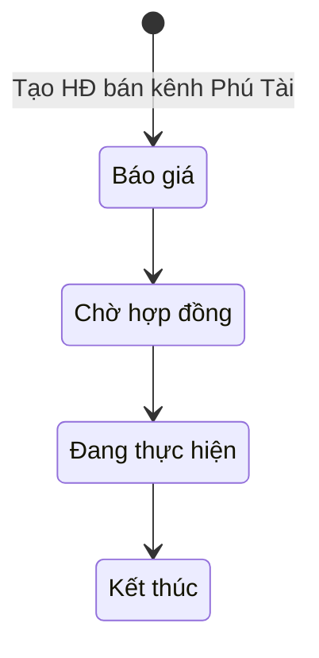
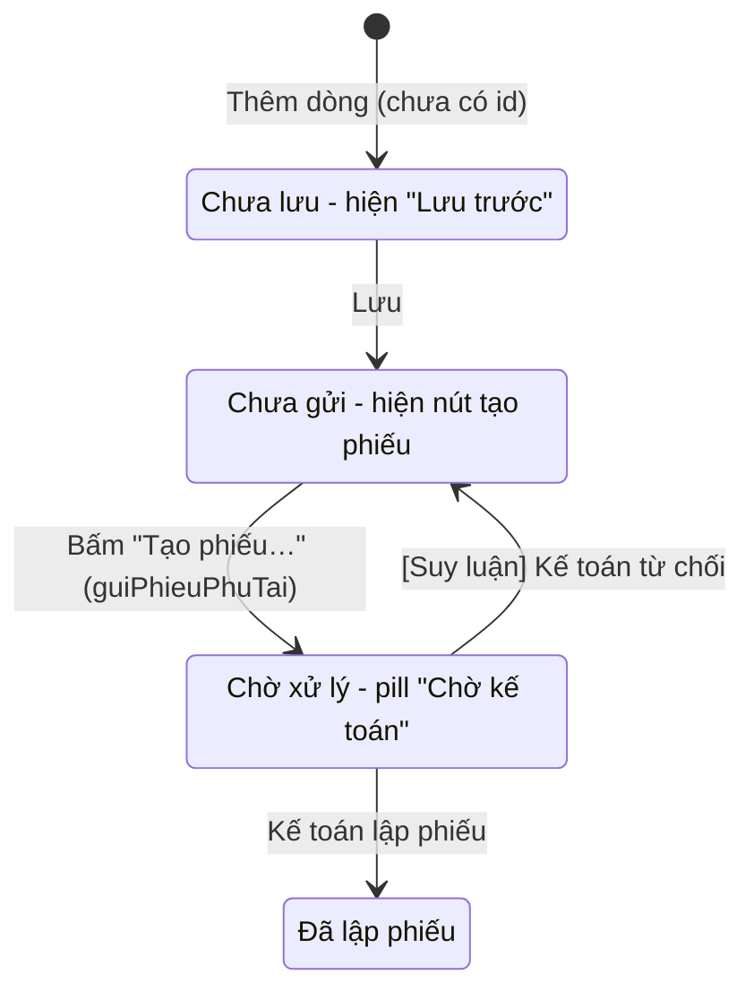

# 05 — Module Phú Tài (key `phutai`)

> Nguồn phân tích: mã client của màn `?page=phutai` (HTML + JS tải về từ web app). Mọi số liệu trong tài liệu là **ví dụ giả định**. Nội dung không thấy trực tiếp trong code được gắn nhãn **[Suy luận]**. Logic phía server (Apps Script) không có trong file tải về — chỉ thấy tên hàm và cấu trúc dữ liệu trả về.

---

## 1. Mục đích & phạm vi

- Theo dõi các **hợp đồng bán ký về Phú Tài** (HĐ bán thuộc kênh "Phú Tài"): hàng về kho tạm Phú Tài hoặc giao thẳng, **khách trả tiền cho Phú Tài, Phú Tài xuất hoá đơn**. Oxy theo dõi nguồn hàng, chi phí, chia lợi nhuận và tiền Phú Tài chuyển về (nội dung banner trong app).
- Màn này **không tạo / không sửa thông tin gốc HĐ**. Banner ghi: "Tạo / sửa HĐ ở màn Hợp đồng bán (kênh Phú Tài)". Màn Phú Tài chỉ quản lý phần riêng của Phú Tài:
  - Giá mua đầu vào (nhập tay, thay cho tổng HĐ mua liên kết).
  - Chi phí có / không hoá đơn.
  - Hoa hồng khách và người nhận.
  - Bảng chia lợi nhuận.
  - Các đợt Phú Tài chuyển tiền về Oxy, kèm hoa hồng chi theo đợt.
  - Gửi yêu cầu lập phiếu thu / phiếu chi sang Kế toán.
- Ngoài phạm vi màn này:
  - Tiến độ khách trả tiền: ghi ở màn Hợp đồng bán, tab Thanh toán.
  - Liên kết HĐ mua: làm ở màn Hợp đồng mua, mục "Dùng cho HĐ bán".
  - Đổi giai đoạn HĐ: [Suy luận] làm ở màn Hợp đồng bán (màn Phú Tài không có nút đổi giai đoạn).

## 2. Vai trò & quyền liên quan

| Mã quyền (trong `APP_BOOT.user.perm`) | Ý nghĩa thấy trong code |
|---|---|
| `pt_xem` | Xem module Phú Tài. [Suy luận] Không có quyền này thì không mở được màn hoặc menu bị ẩn; client không có đoạn kiểm tra. |
| `pt_sua` | Sửa. Server trả về `perms.sua` (trong `listPhuTai` và `getPhuTaiChiTiet`). Khi `sua = false`: không có nút **Lưu**, ô nhập bị khoá, không có nút thêm / xoá dòng và nút tạo phiếu (hiện "—"). |
| `perms.kt` (server trả về) | Có trong dữ liệu `listPhuTai` nhưng client **không dùng**. [Suy luận] Đây là cờ quyền Kế toán. |

- Mỗi quyền có cấu trúc `{v: xem, e: sửa, sc: phạm vi}`. Với `pt_xem` / `pt_sua`, `sc = null`, tức là **không có phạm vi "HĐ của mình"**. Ai có quyền thì thấy mọi HĐ Phú Tài.
- Ví dụ quan sát được: vai trò "Giám đốc" (`giamdoc`) có đủ `pt_xem` và `pt_sua`. Ma trận đầy đủ theo vai trò nằm ở module Tài khoản, ngoài phạm vi tài liệu này.

## 3. Danh sách màn hình

### 3.1. Màn Danh sách HĐ Phú Tài

- **Mục đích**: xem tổng quan mọi HĐ bán thuộc kênh Phú Tài và tình trạng chia lợi nhuận / tiền về.
- **Bộ lọc** (thanh tier2 phía trên, lọc phía client, tức là lọc ngay trên máy không gọi lại server):
  - Ô tìm kiếm, placeholder "Tìm số HĐ, khách hàng cuối, NCC...". Tìm không phân biệt hoa thường trên: số HĐ, tên KH cuối, sale, và số HĐ mua + tên NCC của các nguồn hàng. Nút "×" xoá nội dung tìm.
  - Chọn **Giai đoạn**: "Mọi giai đoạn" / Báo giá / Chờ hợp đồng / Đang thực hiện / Kết thúc.
  - Nhãn đếm "N HĐ" (số dòng sau khi lọc).
- **Thẻ KPI** (4 thẻ, server tính sẵn trong `stat`, không đổi theo bộ lọc):

| Thẻ | Giá trị | Dòng phụ |
|---|---|---|
| HĐ ký về Phú Tài | `stat.soHD` (số HĐ) | "giá bán" + `stat.giaBan` |
| Oxy hưởng (đã có giá mua) | `stat.oxyHuong` | Nếu `stat.chuaGia > 0`: "N HĐ chưa có giá mua — chưa chia được"; nếu không: "70% chênh lệch" |
| Phú Tài đã chuyển Oxy | `stat.daNhan` | — |
| Phú Tài còn phải chuyển | `stat.ptConNo` | — |

- **Banner tím**: mô tả mô hình Phú Tài và chỉ dẫn "Tạo / sửa HĐ ở màn Hợp đồng bán (kênh Phú Tài)".
- **Bảng** (cố định tiêu đề, cuộn; tải dần 50 dòng, có nút "⬇ Xem thêm 50 dòng (còn N)" và "Hiện hết", tự tải thêm khi cuộn tới):

| Cột | Nội dung |
|---|---|
| Số HĐ · KH cuối | Số HĐ (đậm) + tên khách hàng cuối |
| Nguồn hàng | Mỗi HĐ mua liên kết là 1 pill số HĐ mua. Chưa có: "Chưa liên kết HĐ mua" |
| Ngày ký | dd/mm/yyyy |
| Giá bán (chưa VAT) | số tiền |
| Oxy hưởng | Có giá mua: số tiền. Chưa có: pill vàng "Chưa có giá mua" |
| Đã nhận | Tổng tiền Phú Tài đã chuyển Oxy |
| Khách đã trả PT | % (`khTiLe`) + thanh tiến độ mini |
| Giai đoạn | pill |

- **Hành động**: bấm 1 dòng thì mở màn Chi tiết. Không có nút tạo mới.
- **Trạng thái rỗng**: "Không có HĐ khớp bộ lọc."

### 3.2. Màn Chi tiết HĐ Phú Tài

**Thanh đầu trang**:
- Nút "← DS" để quay lại danh sách. Nếu còn thay đổi chưa lưu, hiện popup xác nhận "Bỏ thay đổi chưa lưu?" với nút nguy hiểm "Bỏ thay đổi".
- Số HĐ (nếu chưa có số thì hiện "Báo giá"), tên KH, pill giai đoạn, pill tím "Kênh Phú Tài".
- Nút **Mở HĐ bán**: chuyển sang màn `hdban` với cùng id.
- Nút **Lưu** (chỉ khi có quyền sửa).

**Banner công thức**: "Chênh lệch = Giá bán − (Giá mua + CP có hoá đơn); Phú Tài thu X%, thuế TNDN Y%, Oxy hưởng phần còn lại". X và Y lấy từ `tinh.tlGiu` và `tinh.tlThue`, mặc định 10% và 20%.

Thân màn gồm **4 thẻ (card)** xếp dọc:

1. **Thông tin chung** (chỉ xem)
   - Lưới key–value gồm: Khách hàng cuối, MST, Ngày ký, Sale, Giá bán chưa VAT, Sau VAT (kèm VAT%), Khách đã trả Phú Tài (số tiền · %).
   - Nếu có đợt thanh toán của khách: bảng Đợt | Đề nghị | Hạn | Ngày khách trả | Khách trả. Ngày trống thì hiện "chưa". Cột Khách trả lấy `soTienTT`, nếu trống thì lấy `soTienDeNghi`.
   - Ghi chú: "Tiến độ khách trả ghi ở màn Hợp đồng bán (tab Thanh toán) — tiền vào Phú Tài, không lập phiếu thu Oxy."
2. **Nguồn hàng**
   - Chip cho từng HĐ mua liên kết, bấm vào thì mở màn `hdmua`. Chip gồm:
     - Số HĐ mua; NCC · giai đoạn.
     - "Giá trị … · nhận hàng …%".
     - "Oxy đã chuyển PT …" (nếu có).
     - "CP: loại số tiền (có HĐ / không HĐ)".
     - "Báo hàng về: Đn ngày trạng thái".
   - Chưa liên kết thì hiện ghi chú hướng dẫn liên kết ở màn HĐ mua, hoặc nhập Giá mua đầu vào.
   - Ô **Giá mua đầu vào (chưa VAT)**: nhãn ghi "để trống = tổng HĐ mua liên kết (…)".
   - Ô **Ghi chú**.
   - Bảng con **Chi phí**: Có hoá đơn (checkbox) | Mô tả | Số tiền | Ngày | Ghi chú | Phiếu chi Oxy | ✕. Nút "+ Thêm chi phí" kèm chú thích quy tắc.
3. **Chia lợi nhuận**
   - Ô **Hoa hồng khách (Oxy chi tiền mặt)** và ô **Người nhận hoa hồng**. Ô người nhận có gợi ý từ danh sách nhân viên `staff`.
   - Bảng tính từng bước, tính lại ngay khi gõ (xem mục 6).
4. **Dòng tiền Phú Tài → Oxy theo đợt**
   - Bảng con: Đợt (Đ1, Đ2…) | Ngày nhận | Phú Tài chuyển Oxy | Hình thức (TM/CK) | Phiếu thu | Hoa hồng khách | Người nhận | Phiếu chi HH | Ghi chú | ✕.
   - Nút "+ Thêm đợt" kèm chú thích.
   - Dòng tổng phía dưới: "Phú Tài đã chuyển Oxy … · Oxy đã chuyển PT để trả NCC … · Phú Tài còn phải chuyển Oxy …".

**Popup / thông báo**:
- Popup xác nhận "Bỏ thay đổi chưa lưu?".
- Toast: "Đã lưu"; "⚠ Chưa lưu được HĐ Phú Tài: … — thay đổi vẫn trên màn hình, bấm Lưu lại."; "Đã gửi Kế toán lập phiếu"; "Đã lưu — bấm lại để gửi phiếu".
- Thanh cảnh báo lưu ngầm dùng chung: có thay đổi chưa lưu lên máy chủ, hoặc xung đột "Có người khác vừa sửa hợp đồng này" với các lựa chọn Vẫn lưu bản của tôi / Khôi phục / Tải bản mới.

## 4. Chi tiết form

### 4.1. Phần đầu HĐ (dữ liệu `hd`, chỉ xem tại màn này)

| Trường | Kiểu | Bắt buộc | Tự tính/nguồn | Ghi chú |
|---|---|---|---|---|
| Số HĐ (`hd.soHD`) | Text | — | HĐ bán | Trống thì hiện "Báo giá" |
| Khách hàng cuối (`hd.ten`) | Text | — | HĐ bán | |
| MST (`hd.mst`) | Text | — | HĐ bán | |
| Ngày ký (`hd.ngayKy`) | Ngày | — | HĐ bán | |
| Sale (`hd.sale`) | Text | — | HĐ bán | |
| Giai đoạn (`hd.giaiDoan`) | Danh sách | — | HĐ bán | Báo giá / Chờ hợp đồng / Đang thực hiện / Kết thúc |
| VAT % (`hd.vatPct`) | % | — | HĐ bán | |
| Giá bán chưa VAT (`tinh.giaBan`) | Tiền | — | Server tính | |
| Sau VAT (`tinh.khSauVAT`) | Tiền | — | Server tính | [Suy luận] = giá bán × (1 + VAT%) |
| Khách đã trả PT (`tinh.khDaTra`, `tinh.khTiLe`) | Tiền, % | — | Server tính từ đợt TT của HĐ bán | |

### 4.2. Đợt khách thanh toán (`khTT[]`, chỉ xem)

| Trường | Kiểu | Bắt buộc | Tự tính/nguồn | Ghi chú |
|---|---|---|---|---|
| Đợt (`dot`) | Số | — | HĐ bán | Hiển thị "Đn" |
| Đề nghị (`soTienDeNghi`) | Tiền | — | HĐ bán | |
| Hạn (`hanTT`) | Ngày | — | HĐ bán | |
| Ngày khách trả (`ngayTT`) | Ngày | — | HĐ bán | |
| Khách trả (`soTienTT`) | Tiền | — | HĐ bán | Trống thì lấy số Đề nghị (chỉ khi đã có ngày trả) |

### 4.3. Form Phú Tài (phần sửa được, lưu bằng `luuPhuTai`)

| Trường | Kiểu | Bắt buộc | Tự tính/nguồn | Ghi chú |
|---|---|---|---|---|
| Giá mua đầu vào (`giaDauVao`) | Tiền | Không | Nhập tay | **Để trống** (chuỗi rỗng) thì dùng `tinh.giaMuaHdm` (tổng HĐ mua liên kết). Gõ 0 khác với để trống. |
| Ghi chú (`ghiChu`) | Text | Không | Nhập tay | |
| Hoa hồng khách (`hoaHong`) | Tiền | Không | Nhập tay | Chỉ nhập số tiền, **không có lựa chọn %**. Mặc định 0. |
| Người nhận hoa hồng (`nguoiNhanHH`) | Text + gợi ý | Không | Danh sách `staff` | Dùng làm giá trị mặc định "Người nhận" khi thêm đợt mới |

### 4.4. Bảng con Chi phí (`cp[]`)

| Trường | Kiểu | Bắt buộc | Tự tính/nguồn | Ghi chú |
|---|---|---|---|---|
| Có hoá đơn (`coHoaDon`) | Checkbox | — | Mặc định **không** | Đổi giá trị thì vẽ lại cả màn (cột Phiếu chi đổi theo) |
| Mô tả (`moTa`) | Text | Không (client không kiểm tra) | | |
| Số tiền (`soTien`) | Tiền | Không | Mặc định 0 | |
| Ngày (`ngay`) | Ngày | Không | Mặc định hôm nay | |
| Ghi chú (`ghiChu`) | Text | Không | | Luôn sửa được (kể cả khi dòng đã khoá) nếu có quyền |
| Phiếu chi Oxy (`cho`) | Trạng thái | — | Server | Có HĐ: "Phú Tài chi — trừ vào chênh lệch". Không HĐ: nút "Tạo phiếu chi TM" / "Chờ kế toán" / "Đã lập phiếu" / "Lưu trước" (dòng chưa có id) |

### 4.5. Bảng con Dòng tiền theo đợt (`dt[]`)

| Trường | Kiểu | Bắt buộc | Tự tính/nguồn | Ghi chú |
|---|---|---|---|---|
| Đợt | Số | — | Tự đánh = thứ tự dòng | Đ1, Đ2… (đánh lại khi xoá dòng) |
| Ngày nhận (`ngayNhan`) | Ngày | Không | | **Chỉ dòng có ngày** mới cộng vào "Đã nhận" |
| Phú Tài chuyển Oxy (`soTien`) | Tiền | Không | Mặc định 0 | |
| Hình thức (`hinhThuc`) | TM / CK | — | Mặc định TM | |
| Phiếu thu (`choThu`) | Trạng thái | — | Server | Nút "Tạo phiếu thu" |
| Hoa hồng khách (`hoaHong`) | Tiền | Không | Mặc định 0 | Hoa hồng chi theo đợt (tách khỏi ô hoa hồng chung ở mục 4.3) |
| Người nhận (`nguoiNhan`) | Text + gợi ý | Không | Mặc định = `nguoiNhanHH` | |
| Phiếu chi HH (`choChi`) | Trạng thái | — | Server | Nút "Tạo phiếu chi HH" |
| Ghi chú (`ghiChu`) | Text | Không | | Luôn sửa được nếu có quyền |

### 4.6. Dữ liệu tổng hợp server trả về (`tinh`)

| Chỉ tiêu | Ý nghĩa (thấy trong code) |
|---|---|
| `giaBan` | Giá bán chưa VAT |
| `giaMuaHdm` | Tổng giá mua từ HĐ mua liên kết |
| `cpHdmCo` / `cpHdmKhong` | Chi phí có / không hoá đơn đã ghi ở các HĐ mua liên kết, được cộng sẵn vào chi phí |
| `tlGiu` / `tlThue` | Tỷ lệ Phú Tài thu / thuế TNDN. Mặc định ở client là 0,1 / 0,2 |
| `oxyChuyen` | Tiền Oxy đã chuyển cho Phú Tài để trả NCC |
| `khSauVAT`, `khDaTra`, `khTiLe` | Số liệu khách thanh toán |

## 5. Luồng trạng thái

### 5.1. Giai đoạn HĐ (đổi ở màn HĐ bán)



[Suy luận] Thứ tự chuyển giai đoạn lấy theo thứ tự hằng `GD` trong code. Điều kiện chuyển nằm ở màn HĐ bán / server.

### 5.2. Trạng thái yêu cầu lập phiếu (chi phí không HĐ, phiếu thu, phiếu chi HH)



**Hiệu lực khoá theo trạng thái**:

| Trạng thái | Ô dữ liệu (trừ Ghi chú) | Nút xoá dòng |
|---|---|---|
| Chưa gửi | Sửa được | Có |
| Chờ xử lý | **Khoá** | **Vẫn hiện** |
| Đã lập phiếu | **Khoá** | Ẩn |

- Dòng dòng tiền có 2 trạng thái độc lập:
  - `choThu` khoá Ngày nhận, Số tiền, Hình thức.
  - `choChi` khoá Hoa hồng, Người nhận.
- Nút xoá dòng dòng tiền bị ẩn nếu **một trong hai** trạng thái là "Đã lập phiếu".

## 6. Công thức tính (đúng như code client `tinhLai()`)

```
giaMua  = (giaDauVao trống) ? tinh.giaMuaHdm : giaDauVao
cpCo    = tinh.cpHdmCo    + Σ cp.soTien (coHoaDon = true)
cpKhong = tinh.cpHdmKhong + Σ cp.soTien (coHoaDon = false)
coGia   = giaBan > 0 VÀ (giaDauVao đã nhập HOẶC giaMuaHdm > 0)

ChenhLech (cl) = giaBan − giaMua − cpCo
PhuTaiThu (pt) = cl > 0 ? ROUND(cl × tlGiu)  : 0        (tlGiu mặc định 10%)
ThueTNDN (thue)= cl > 0 ? ROUND(cl × tlThue) : 0        (tlThue mặc định 20%)
OxyHuong (oxy) = cl − pt − thue                          (= 70% cl khi cl > 0; = cl nếu cl ≤ 0)
HoaHong  (hh)  = hoaHong (ô hoa hồng chung)
OxyThucNhan    = oxy − hh − cpKhong
DaNhan         = Σ dt.soTien (dòng có ngayNhan)
PTConPhaiChuyen= oxy + tinh.oxyChuyen − DaNhan
```

- Phú Tài thu và thuế đều tính **trên chênh lệch** (lợi nhuận trước thuế), không tính lũy kế lên nhau.
- Nếu `coGia = false`:
  - Bảng hiện pill "Chưa có giá mua" và không hiện Chênh lệch, Phú Tài thu, Thuế, Oxy hưởng, Oxy thực nhận.
  - Không hiện "Phú Tài còn phải chuyển".
- Hoa hồng và CP không hoá đơn **do Oxy chi tiền mặt**, nên chỉ trừ vào "Oxy thực nhận", **không** trừ vào số Phú Tài phải chuyển.
- "Còn phải chuyển" **cộng thêm** `oxyChuyen` (tiền Oxy đã ứng cho Phú Tài để trả NCC).
- Hoa hồng nhập theo từng đợt ở bảng dòng tiền (`dt.hoaHong`) **không** tham gia công thức trên. Nó chỉ dùng để lập phiếu chi HH. [Suy luận] Có nguy cơ lệch giữa ô hoa hồng chung và tổng hoa hồng các đợt, vì client không đối chiếu hai số này.

**Ví dụ giả định** (tlGiu 10%, tlThue 20%):

| Bước | Giá trị |
|---|---|
| Giá bán (chưa VAT) | 1.000.000.000 |
| − Giá mua đầu vào (HĐ mua liên kết) | 800.000.000 |
| − Chi phí có hoá đơn | 20.000.000 |
| = Chênh lệch | 180.000.000 |
| − Phú Tài thu 10% chênh lệch | 18.000.000 |
| − Thuế TNDN 20% chênh lệch | 36.000.000 |
| = Oxy hưởng | 126.000.000 |
| − Hoa hồng khách | 10.000.000 |
| − Chi phí không hoá đơn (Oxy chi) | 5.000.000 |
| **= Oxy thực nhận** | **111.000.000** |
| Phú Tài đã chuyển Oxy (đợt có ngày nhận) | 50.000.000 |
| Oxy đã chuyển PT để trả NCC | 0 |
| Phú Tài còn phải chuyển Oxy = 126.000.000 + 0 − 50.000.000 | 76.000.000 |

**Chỉ tiêu ở màn danh sách** (server tính):
- `oxyHuong`, `daNhan`, `ptConNo`, `khTiLe`, `coGia` cho từng HĐ.
- `stat`: số HĐ, Σ giá bán, Σ Oxy hưởng (chỉ HĐ có giá mua), Σ đã nhận, Σ còn nợ, số HĐ chưa có giá.
- [Suy luận] `oxyHuong` của danh sách có thể là "Oxy thực nhận" (`oxyConLai`). Dữ liệu quan sát được có `oxyHuong = oxyConLai` nhưng chưa phân biệt được vì các mẫu đều có hoa hồng = 0.

## 7. Quy tắc nghiệp vụ, ràng buộc, hành động tự động

1. **Chi phí có hoá đơn**: Phú Tài chi, được trừ vào chênh lệch trước khi chia. Không lập phiếu Oxy.
2. **Chi phí không hoá đơn**: Oxy chi tiền mặt. Bấm "Tạo phiếu chi TM" thì vào hàng chờ Kế toán. Khoản này trừ vào phần Oxy.
3. **Phú Tài chuyển tiền về Oxy**: bấm "Tạo phiếu thu", yêu cầu gửi Kế toán. **Hoa hồng trả khách** (tiền mặt, có người nhận): bấm "Tạo phiếu chi HH".
4. **Phải lưu trước khi tạo phiếu**:
   - Dòng chưa có id thì hiện "Lưu trước".
   - Nếu màn đang có thay đổi chưa lưu mà bấm tạo phiếu, app **tự lưu** rồi báo "Đã lưu — bấm lại để gửi phiếu". Người dùng phải bấm lần 2.
5. **Khoá dòng** khi yêu cầu phiếu ở trạng thái Chờ xử lý hoặc Đã lập phiếu (xem mục 5.2).
6. **Tiền khách trả** đi thẳng vào Phú Tài, không lập phiếu thu Oxy. Ghi ở HĐ bán.
7. **Lưu ngầm (optimistic)**:
   - Bấm Lưu thì báo "Đã lưu" ngay, sau đó gửi `luuPhuTai` chạy nền.
   - Nếu lỗi: giữ thay đổi trên màn và hiện toast cảnh báo.
   - Có phát hiện xung đột khi người khác đã sửa (thông báo `XUNG_DOT`).
   - Sau khi lưu xong thì tải lại danh sách.
8. **Bộ nhớ đệm chi tiết**:
   - Màn danh sách tự tải trước (prefetch) chi tiết các HĐ theo thứ tự danh sách, gọi `getPhuTaiBatch`, lưu bộ nhớ cục bộ theo từng người dùng.
   - Khi mở 1 HĐ: hiện ngay bản trong bộ nhớ đệm, đồng thời gọi `getPhuTaiChiTiet` để lấy bản mới. Bản mới chỉ được vẽ lại khi người dùng **chưa** sửa gì và dữ liệu có khác.
9. **Cảnh báo rời màn**: trạng thái "Dirty" được báo lên khung app. Rời màn hoặc quay lại danh sách khi còn thay đổi thì hiện popup xác nhận.
10. Không có kiểm tra bắt buộc trường nào ở client.

## 8. Liên kết module khác

| Module | Liên kết |
|---|---|
| Hợp đồng bán (`hdban`) | Nguồn của HĐ Phú Tài (kênh = Phú Tài). Tạo/sửa HĐ, giai đoạn, đợt khách thanh toán. Nút "Mở HĐ bán". |
| Hợp đồng mua (`hdmua`) | Nguồn hàng. Liên kết ở màn HĐ mua ("Dùng cho HĐ bán"). Cung cấp giá trị, tỉ lệ nhận hàng, chi phí, báo hàng về, "Oxy đã chuyển PT". Bấm chip để mở HĐ mua. |
| Kế toán (`ketoan`) | Nhận yêu cầu lập phiếu (hàng chờ Chờ xử lý). Hàm server `xacNhanChoXuLy` / `tuChoiChoXuLy` có trong danh sách hàm của app. [Suy luận] Phiếu thu/chi lập ra nằm trong sổ quỹ Oxy. Sheet dữ liệu thấy trong khoá cache: `PT_HopDong`, `PT_ChiPhi`, `PT_DongTien`, `KT_ChoXuLy`. |
| Báo cáo (`baocao`) | Tab Lợi nhuận HĐ dùng LN Phú Tài = Oxy thực nhận, có cột "Chia Phú Tài". Tab TĐTT hiển thị "Phú Tài xuất" ở cột hoá đơn. Có bộ lọc kênh Phú Tài. |
| Tài khoản / Cài đặt | Quyền `pt_xem`, `pt_sua`. [Suy luận] Tỷ lệ `tlGiu`, `tlThue` đọc từ Cài đặt thông số (`getCaiDatThongSo`, sheet `CaiDat_ThongSo`). |

## 9. Hàm server → mục đích

| Hàm | Gọi từ | Mục đích (theo cách client dùng) |
|---|---|---|
| `listPhuTai()` | Danh sách | Trả về `{rows[], perms{xem,sua,kt}, stat{}}`. Có preload sẵn trong trang. |
| `getPhuTaiChiTiet(id)` | Chi tiết | Trả về `{hd, tinh, khTT[], hdm[], cp[], dt[], staff[], perms, pt{giaDauVao,hoaHong,nguoiNhanHH,ghiChu}}` |
| `getPhuTaiBatch(ids)` | `detailCache` | Lấy chi tiết hàng loạt để prefetch |
| `luuPhuTai(id, payload)` | Nút Lưu | Lưu `{giaDauVao, hoaHong, nguoiNhanHH, ghiChu, cp[], dt[]}`, trả về chi tiết mới |
| `guiPhieuPhuTai(loai, idDong)` | Nút tạo phiếu | `loai` = `cp` (phiếu chi TM), `thu` (phiếu thu), `hh` (phiếu chi hoa hồng). Gửi sang hàng chờ Kế toán, trả về chi tiết mới |
| `getCaiDatThongSo` | (màn Tài khoản) | [Suy luận] Nơi cấu hình tỷ lệ chia. Màn Phú Tài không gọi trực tiếp. |
| `ghiNhanPhiQL`, `getBaoCao` | — | Không dùng ở màn Phú Tài (xem 06_BaoCao.md) |

## 10. Khác biệt so với spec rev.md

| # | Spec rev.md | App thực tế |
|---|---|---|
| 1 | HĐ Phú Tài là module riêng, bảng `HopDongPhuTai`, 5 tab | Không có bảng HĐ riêng: HĐ Phú Tài = **HĐ bán kênh Phú Tài**. Màn Phú Tài là 1 trang 4 thẻ, chỉ quản lý phần chia lợi nhuận/dòng tiền |
| 2 | LN sau thuế = LNTT × 80%; PT giữ 10% × LNST; Oxy 90% × LNST (tức Oxy 72% LNTT) | PT thu **10% chênh lệch**, thuế **20% chênh lệch**, Oxy hưởng **70% chênh lệch**. Tỷ lệ do server trả về |
| 3 | Giá đầu vào = Giá mua + Vận chuyển + Hải quan + CP khác | Giá mua (HĐ mua liên kết hoặc nhập tay) + **CP có hoá đơn**. CP **không hoá đơn** trừ vào phần Oxy sau khi chia |
| 4 | Hoa hồng KH nhập tay số tiền **hoặc %** | Chỉ nhập **số tiền**, thêm ô Người nhận. Có thêm hoa hồng theo từng đợt để lập phiếu chi |
| 5 | Tab 5 Đối chiếu 3 bên: Oxy→PT (VNĐ), PT→NCC (USD/VNĐ + tỷ giá) | Chỉ có **Dòng tiền PT → Oxy** theo đợt (TM/CK) và số "Oxy đã chuyển PT để trả NCC" lấy từ HĐ mua. Không có PT→NCC, không có ngoại tệ/tỷ giá |
| 6 | Sổ quỹ ảo `DongTienPhuTai` (Thu/Chi) + số dư quỹ PT, tách khỏi Kế toán | Không có sổ quỹ ảo. Thay bằng chỉ tiêu **"Phú Tài còn phải chuyển Oxy"** theo từng HĐ. Tiền về Oxy đi qua **phiếu thu Kế toán** (không tách biệt khỏi Kế toán như spec) |
| 7 | Trạng thái HĐ PT chưa liệt kê | Dùng giai đoạn: Báo giá / Chờ hợp đồng / Đang thực hiện / Kết thúc |
| 8 | Tab 1 có Ngày hiệu lực, Lưu trữ hồ sơ | Màn PT không hiển thị Ngày hiệu lực hay hồ sơ. [Suy luận] Hồ sơ quản lý ở HĐ bán |
| 9 | "Các đợt Phú Tài trả NCC" ở Tab 3 | Không có. Chip HĐ mua chỉ hiện "Oxy đã chuyển PT" |
| 10 | Không đề cập | Có thêm: KPI tổng hợp, quy trình gửi Kế toán lập phiếu có khoá dòng, lưu ngầm + phát hiện xung đột |
| 11 | Lỗ: chưa nêu | cl ≤ 0 thì PT thu = 0, thuế = 0, Oxy hưởng = cl (số âm) |

## 11. Ghi chú thiết kế UI

- **Màu nhận diện**: kênh Phú Tài dùng tông **tím (violet)** cho pill "Kênh Phú Tài", banner, và pill "PT" ở báo cáo. Pill vàng (amber) = "Chưa có giá mua" / "Chờ kế toán"; pill xanh (done) = "Đã lập phiếu".
- **Danh sách**: hàng 4 thẻ KPI (stat-row) → banner → bảng rộng cố định tiêu đề (chiều cao `100vh − 250px`). Cột "Khách đã trả PT" có thanh tiến độ mini. Nguồn hàng hiển thị dạng pill.
- **Chi tiết**: các thẻ (card) xếp dọc. Lưới key–value tự co giãn (cột tối thiểu 180px).
- **Bảng tính chia lợi nhuận**: rộng tối đa 620px, số căn phải. Dòng tổng in đậm có viền trên. Dòng cuối "Oxy thực nhận" nổi bật (nền accent-soft, chữ 15px). Tính lại ngay khi gõ.
- **Chip HĐ mua**: khối nhiều dòng, viền hiện màu nhấn khi rê chuột, bấm được.
- **Bảng con**: nhập trực tiếp trong bảng (kiểu Excel), ô tiền tự định dạng. Nút ✕ xoá dòng, link "+ Thêm …" kèm chú thích nghiệp vụ ngay cạnh.
- **Đề xuất khi thiết kế lại** [Suy luận]:
  - Hiển thị cảnh báo khi tổng hoa hồng theo đợt ≠ ô hoa hồng chung.
  - Gộp thao tác "Lưu rồi gửi phiếu" thành một bước.
  - Hiển thị tỷ lệ chia ngay trên bảng tính (đã có ở nhãn).
  - Thêm biểu đồ nhỏ "Đã nhận / Còn phải chuyển".
