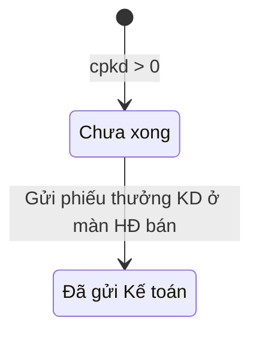

# 06 — Module Báo cáo (key `baocao`)

> Nguồn phân tích: mã client của màn `?page=baocao` (HTML + JS tải về). Mọi số liệu là **ví dụ giả định**. Nội dung không thấy trực tiếp trong code được gắn **[Suy luận]**. Server (`getBaoCao`) trả về dữ liệu đã tính sẵn. Một số công thức dưới đây được đối chiếu bằng cách kiểm tra quan hệ giữa các trường trong dữ liệu preload; những chỗ đó ghi rõ "đối chiếu dữ liệu".

---

## 1. Mục đích & phạm vi

- Màn báo cáo tổng hợp **chỉ xem** (không nhập liệu) về hợp đồng bán, gồm 5 tab:
  1. Doanh thu (Thực hiện / Tiềm năng).
  2. Lợi nhuận HĐ.
  3. Tiến độ thanh toán.
  4. Tiến độ giao hàng.
  5. Thưởng KD & Phí QL.
- Phạm vi dữ liệu:
  - Tab Doanh thu, Lợi nhuận, Thưởng KD: lọc theo **năm ký** (`nam`).
  - Tab Tiến độ thanh toán và Giao hàng: chỉ **HĐ đang thực hiện** (nhãn "HĐ đang thực hiện" thay cho bộ chọn năm).
- Gồm cả 2 kênh **Oxy** và **Phú Tài**. HĐ Phú Tài có pill tím "PT".
- Bấm 1 dòng thì mở HĐ gốc để xem chi tiết (drill-down).

## 2. Vai trò & quyền liên quan

| Mã quyền (`APP_BOOT.user.perm`) | Cờ server `perms` | Tab hiển thị | Phạm vi `sc` |
|---|---|---|---|
| `bc_doanhthu` | `doanhThu` | Doanh thu | `all` / `own` |
| `bc_loinhuan` | `loiNhuan` | Lợi nhuận HĐ **và** Thưởng KD & Phí QL | `null` (không chia phạm vi) |
| `bc_tdtt` | `tdtt` | Tiến độ thanh toán | `all` / `own` |
| `bc_giaohang` | `giaoHang` | Tiến độ giao hàng | `all` / `own` |

- `scope.{doanhThu, tdtt, giaoHang}`:
  - `own`: hiện pill vàng **"Phạm vi: HĐ của mình"**. [Suy luận] Server chỉ trả HĐ mà người dùng là sale.
  - `all`: không hiện pill.
- Tab Lợi nhuận và Thưởng KD **không có phạm vi own**. Có quyền thì xem tất cả.
- Chỉ những tab có quyền mới được vẽ. Tab mặc định là tab đầu tiên có quyền, hoặc tab truyền vào qua `initialTab` / `onAppOpen({tab})`.

## 3. Danh sách màn hình / tab

### 3.0. Khung chung

- **Thanh tab** (sticky, cố định khi cuộn) + **hàng bộ lọc** gồm:
  - Ô tìm kiếm "Tìm số HĐ, khách hàng, sale..." và nút ×.
  - Chọn **Năm**: lấy từ `namDs`, chỉ hiện ở tab Doanh thu / Lợi nhuận / Thưởng KD. Đổi năm thì gọi lại server, hiện "Đang tải năm …".
  - Chọn **Kênh**: Mọi kênh / Oxy / Phú Tài.
  - Chọn **Sale**: danh sách gộp từ mọi tab. Trường sale có thể chứa nhiều người, cách nhau bởi dấu phẩy.
- Tìm kiếm, kênh, sale lọc **phía client**, áp cho mọi tab. Một HĐ nhiều sale khớp khi có 1 sale trùng.
- Tất cả bảng dùng kiểu "xl" (cố định cột đầu / tiêu đề), chiều cao `100vh − 330px`.
- **Drill-down**: bấm dòng thì mở màn `hdban` theo id. Riêng tab Lợi nhuận, dòng có `phuTai = true` thì mở màn `phutai`.

### 3.1. Tab Doanh thu → sub-tab **Thực hiện**

- **Mục đích**: doanh thu HĐ đã ký trong năm (giai đoạn Đang thực hiện / Kết thúc).
- **KPI**:

| Thẻ | Giá trị | Dòng phụ |
|---|---|---|
| Doanh thu ký {năm} (chưa VAT) | Σ `giaTri` | "N HĐ đang thực hiện / kết thúc" |
| Sau VAT | Σ `sauVAT` | — |
| Khách đã thanh toán | Σ `daTT` | — |

- **Biểu đồ cột 12 tháng**: T1…T12. Giá trị = Σ `giaTri` theo `thang` (tháng của ngày ký). Nhãn trên cột hiển thị đơn vị "tr" (triệu): giá trị ≥ 100 triệu làm tròn số nguyên, nhỏ hơn thì lấy 1 chữ số thập phân với dấu phẩy. Chiều cao cột = giá trị / max × 120px.
- **Bảng** (sắp ngày ký giảm dần): Số HĐ · Khách hàng | Sale | Ngày ký | Giai đoạn | Giá trị (chưa VAT) | Sau VAT | Đã thu.
- **Dòng tổng (tfoot)**: "N HĐ" + Σ 3 cột tiền.

### 3.2. Tab Doanh thu → sub-tab **Tiềm năng**

- **Mục đích**: pipeline báo giá / chờ HĐ, phân theo đánh giá khả thi.
- **KPI**:

| Thẻ | Giá trị | Dòng phụ |
|---|---|---|
| Tiềm năng (Khả thi) | Σ `giaTri` các dòng khaThi = "Khả thi" | "N báo giá / chờ HĐ — chỉ tính Khả thi" |
| Chưa rõ (không cộng) | Σ `giaTri` | "N báo giá" |
| Không khả thi (không cộng) | Σ `giaTri` | "N báo giá" |

- **Bảng** (sắp **ngày dự kiến ký** tăng dần, trống xếp cuối): Số HĐ · Khách hàng | Sale | Giai đoạn | Khả thi (pill xanh / đỏ / vàng) | Dự kiến ký | Giá trị.
- Không có biểu đồ. Không lọc theo năm ở client.

### 3.3. Tab **Lợi nhuận HĐ**

- **KPI**:

| Thẻ | Giá trị | Dòng phụ |
|---|---|---|
| Giá bán (HĐ đã xác định giá vốn) | Σ `giaBan` các dòng `ln ≠ null` | "x / y HĐ ký năm {năm}" |
| Lợi nhuận gộp | Σ `ln` (màu đỏ nếu âm) | "biên" = ΣLN / ΣGiá bán (1 chữ số thập phân) |
| Chưa xác định (viền cảnh báo nếu > 0) | số HĐ có `ln = null` | "thiếu giá vốn (HĐ mua chưa có đơn giá) / HĐ Phú Tài chưa có giá mua" |

- **Bảng**: Số HĐ · Khách hàng | Ngày ký | Giá bán | Giá vốn | CP giao hàng | Phí QL | CPKD / Hoa hồng | Chia Phú Tài | LN gộp | Biên.
  - Giá vốn null: pill vàng "Chưa xác định". Tooltip liệt kê các mặt hàng thiếu giá (`thieu[]`).
  - Giá vốn có dòng tính bình quân: thêm dòng phụ "có dòng bình quân".
  - LN âm: chữ đỏ.
- **Ghi chú công thức** dưới bảng (xem mục 6).

### 3.4. Tab **Tiến độ thanh toán**

- **Sắp xếp**: số tiền quá hạn giảm dần, sau đó tỉ lệ đã thanh toán tăng dần.
- **KPI**:

| Thẻ | Giá trị |
|---|---|
| Giá trị HĐ đang thực hiện | Σ `sauVAT` (dòng phụ: "N HĐ" + pill phạm vi) |
| Đã thu | Σ `daTT` |
| Còn phải thu | Σ `conPhaiThu` |
| Quá hạn thanh toán (thẻ cảnh báo) | Σ `quaHan` |

- **Bảng**: Số HĐ · Khách hàng | Sale | Sau VAT | Thanh toán (thanh % xanh) | Hoá đơn | Còn phải thu | Hạn.
  - Cột Hoá đơn: thanh % màu vàng theo `tiLeHD`. Nếu `khongXuatHD` (HĐ Phú Tài) thì ghi "Phú Tài xuất".
  - Cột Hạn: nếu có quá hạn thì pill đỏ "Quá hạn {số tiền}"; nếu không thì hiện hạn tới gần nhất `hanToi`; không có thì "—".

### 3.5. Tab **Tiến độ giao hàng**

- **Sắp xếp**: quá hạn trước, sau đó tỉ lệ giao tăng dần.
- **KPI**:

| Thẻ | Giá trị |
|---|---|
| HĐ đang thực hiện | số dòng (+ pill phạm vi) |
| Đã giao đủ | số dòng `tiLeGiao ≥ 1` |
| Chờ Kho cấp hàng | số dòng `choCap > 0`, "HĐ có đợt đang chờ xuất kho" |
| Quá hạn giao (thẻ cảnh báo) | số dòng `quaHan = true` |

- **Bảng**: Số HĐ · Khách hàng | Sale | SL cần | Đã cấp (+ "n đợt chờ cấp") | Đã giao | Tiến độ (thanh %) | Hạn giao (pill đỏ "Quá hạn dd/mm/yyyy" hoặc ngày).

### 3.6. Tab **Thưởng KD & Phí QL**

- **KPI**:

| Thẻ | Giá trị | Dòng phụ |
|---|---|---|
| Chênh lệch giá (HĐ − thực hiện) | Σ `chenhLech` | "N HĐ ký năm {năm}" |
| Phí quản lý | Σ `phiQL` | — |
| Thưởng KD / Chi phí KD | Σ `cpkd` | — |
| Thưởng KD / CPKD chưa chi xong (cảnh báo nếu có) | Σ `cpkd` các dòng `cpkd > 0` và chưa gửi KT | "N HĐ" |

- **Bảng "Theo sale"** (trong card): Sale | Số HĐ | Chênh lệch | Phí QL | Thưởng KD / CPKD. Sắp theo tên sale. HĐ nhiều sale được **cộng toàn bộ vào mỗi sale**, nên tổng các sale có thể lớn hơn tổng chung.
- **Bảng chi tiết**: Số HĐ · Khách hàng (+ "đã hiệu chỉnh tay") | Sale | Giá thực hiện ("chưa có" nếu trống) | Giá HĐ | Chênh lệch | Phí QL | Thưởng KD / CPKD | Phân bổ / chi.
  - Cột Phân bổ / chi: `cpkd ≤ 0` thì "—". Đã gửi thì pill xanh "Đã gửi Kế toán". Chưa thì pill đỏ "Chưa xong". Kèm người nhận nếu có.
- Trạng thái rỗng: "Không có HĐ có chênh lệch."

## 4. Chi tiết chỉ tiêu báo cáo

### 4.1. Doanh thu – Thực hiện (`doanhThu.thucHien[]`)

| Chỉ tiêu | Kiểu | Bắt buộc | Tự tính/nguồn | Ghi chú |
|---|---|---|---|---|
| soHD, ten, sale, kenh, giaiDoan, ngayKy | Text/Ngày | — | HĐ bán | |
| giaTri | Tiền | — | Giá trị HĐ chưa VAT | |
| sauVAT | Tiền | — | Server | [Suy luận] = giaTri × (1+VAT%) (tỉ lệ khác nhau theo HĐ) |
| daTT | Tiền | — | Tổng đợt khách đã trả | |
| thang | Số 1–12 | — | Tháng của ngayKy | Đối chiếu dữ liệu: khớp 100% |

### 4.2. Doanh thu – Tiềm năng (`doanhThu.tiemNang[]`)

| Chỉ tiêu | Kiểu | Bắt buộc | Tự tính/nguồn | Ghi chú |
|---|---|---|---|---|
| khaThi | Danh sách | — | HĐ bán | Khả thi / Chưa rõ / Không khả thi |
| ngayDuKienKy | Ngày | — | HĐ bán | Có thể trống |
| giaTri | Tiền | — | HĐ bán | |
| giaiDoan | Text | — | | [Suy luận] Báo giá / Chờ hợp đồng |

### 4.3. Lợi nhuận (`loiNhuan[]`)

| Chỉ tiêu | Kiểu | Bắt buộc | Tự tính/nguồn | Ghi chú |
|---|---|---|---|---|
| giaBan | Tiền | — | HĐ bán chưa VAT | |
| giaVon | Tiền / null | — | Server | null = chưa xác định |
| thieu[] | Danh sách text | — | Server | Các mặt hàng thiếu giá |
| binhQuan | Bool | — | Server | Có dòng giá vốn tính bình quân |
| cpGiao | Tiền | — | Chi phí giao hàng của HĐ | |
| phiQL | Tiền | — | Phí quản lý (xem 6.4) | |
| cpkd | Tiền | — | Thưởng KD / CPKD / hoa hồng | |
| chiaPT | Tiền | — | Chỉ HĐ Phú Tài | Đối chiếu dữ liệu: = PT thu + thuế TNDN |
| ln | Tiền / null | — | Server | |
| bien | Tỷ lệ / null | — | ln / giaBan | Đối chiếu dữ liệu: khớp |
| phuTai | Bool | — | | Quyết định drill-down sang màn Phú Tài |

### 4.4. Tiến độ thanh toán (`tdtt[]`)

| Chỉ tiêu | Kiểu | Bắt buộc | Tự tính/nguồn | Ghi chú |
|---|---|---|---|---|
| sauVAT | Tiền | — | | |
| daTT | Tiền | — | | |
| tiLeTT | Tỷ lệ | — | daTT / sauVAT | Đối chiếu dữ liệu |
| tiLeHD | Tỷ lệ | — | Tỉ lệ đã xuất hoá đơn | [Suy luận] giá trị HĐ đơn / sauVAT |
| khongXuatHD | Bool | — | true với kênh Phú Tài | |
| conPhaiThu | Tiền | — | sauVAT − daTT | Đối chiếu dữ liệu |
| quaHan | Tiền | — | Server | [Suy luận] Σ đề nghị chưa trả của các đợt đã quá hạn |
| hanToi | Ngày | — | Server | [Suy luận] Hạn đợt chưa trả gần nhất |

### 4.5. Tiến độ giao hàng (`giaoHang[]`)

| Chỉ tiêu | Kiểu | Bắt buộc | Tự tính/nguồn | Ghi chú |
|---|---|---|---|---|
| slCan | Số | — | Tổng SL hàng của HĐ | |
| slDaCap | Số | — | SL kho đã cấp | |
| slDaGiao | Số | — | SL đã giao | |
| tiLeGiao | Tỷ lệ | — | slDaGiao / slCan | Đối chiếu dữ liệu |
| hanGiao | Ngày | — | HĐ bán | |
| quaHan | Bool | — | Server | [Suy luận] hôm nay > hanGiao và chưa giao đủ |
| soDot | Số | — | Số đợt giao | Không hiển thị |
| choCap | Số | — | Số đợt chờ kho cấp | |

### 4.6. Thưởng KD & Phí QL (`cpkd[]`)

| Chỉ tiêu | Kiểu | Bắt buộc | Tự tính/nguồn | Ghi chú |
|---|---|---|---|---|
| giaThucHien | Tiền / trống | — | HĐ bán | "chưa có" nếu trống |
| giaHopDong | Tiền | — | HĐ bán | |
| chenhLech | Tiền | — | giaHopDong − giaThucHien | Đối chiếu dữ liệu |
| phiQL | Tiền | — | Công thức bậc (6.4) hoặc hiệu chỉnh tay | |
| cpkd | Tiền | — | max(0, chenhLech − phiQL) hoặc hiệu chỉnh tay | |
| daHieuChinh | Bool | — | | "đã hiệu chỉnh tay" |
| cpkdGui | Bool | — | | Đã gửi Kế toán |
| cpkdNguoiNhan | Text | — | | |
| cpkdNgayChi, phiQLGhiNhan | — | — | | Có trong dữ liệu, **không hiển thị** |

## 5. Luồng trạng thái

Báo cáo không có trạng thái riêng. Các trạng thái hiển thị đều lấy từ module nguồn:

- Giai đoạn HĐ: Báo giá → Chờ hợp đồng → Đang thực hiện → Kết thúc.
- Khả thi: Khả thi / Chưa rõ / Không khả thi.
- Thưởng KD: Chưa xong → Đã gửi Kế toán.



## 6. Công thức tính

### 6.1. Doanh thu

```
DoanhThuKy(năm)  = Σ giaTri  (HĐ Đang thực hiện/Kết thúc, ký trong năm, sau bộ lọc)
DoanhThuThang[i] = Σ giaTri  where thang = i
TiemNang         = Σ giaTri  where khaThi = "Khả thi"   (Chưa rõ / Không khả thi hiển thị riêng, không cộng)
```

### 6.2. Lợi nhuận HĐ (ghi chú trong app + đối chiếu dữ liệu)

```
HĐ kênh Oxy:      LN gộp = Giá bán − Giá vốn − CP giao hàng − Phí QL − CPKD
HĐ kênh Phú Tài:  LN = Oxy thực nhận
                     = Giá bán − Giá vốn − CP giao hàng − Phí QL − CPKD − Chia Phú Tài   (đối chiếu dữ liệu)
                  Chia Phú Tài = PT thu (10% chênh lệch) + Thuế TNDN (20% chênh lệch)
Biên            = LN / Giá bán
Giá vốn         = SL × (đơn giá mua + chi phí phát sinh HĐ mua phân bổ) của HĐ mua liên kết;
                  không có HĐ mua liên kết thì lấy bình quân các HĐ mua cùng mã hàng.
LN = null (Chưa xác định) khi thiếu giá vốn, hoặc HĐ Phú Tài chưa có giá mua.
KPI: ΣGiá bán và ΣLN chỉ tính các HĐ có LN ≠ null.
```

[Suy luận] Với HĐ Phú Tài:
- Cột Giá vốn = giá mua + CP có hoá đơn.
- Cột CPKD = hoa hồng + CP không hoá đơn.
- Lý do: trong dữ liệu mẫu hoa hồng = 0 nên chưa tách được.

### 6.3. Tiến độ thanh toán / giao hàng

```
conPhaiThu = sauVAT − daTT;   tiLeTT = daTT / sauVAT
tiLeGiao   = slDaGiao / slCan;  Đã giao đủ ⇔ tiLeGiao ≥ 1
```

### 6.4. Phí QL & Thưởng KD

Công thức lấy từ hàm `phiQL()` ở màn HĐ bán; tham số mặc định đọc từ `S.dm.phiQL`.

```
chenhLech = giaHopDong − giaThucHien     (kênh Phú Tài hoặc chưa có giá thực hiện → 0)
cap       = giaThucHien × nguong          (nguong mặc định 20%)
phiQL     = ROUND( min(chenhLech, cap) × tl1 + max(0, chenhLech − cap) × tl2 )   (tl1 = 25%, tl2 = 50%; chenhLech ≤ 0 → 0)
cpkd      = max(0, chenhLech − phiQL)
Nếu "đã hiệu chỉnh tay": phiQL, cpkd lấy giá trị nhập tay.
```

**Ví dụ giả định**: giá thực hiện 100.000.000, giá HĐ 130.000.000.

| Bước | Giá trị |
|---|---|
| Chênh lệch | 30.000.000 |
| cap = 100.000.000 × 20% | 20.000.000 |
| Phí QL = 20.000.000 × 25% + 10.000.000 × 50% | 10.000.000 |
| CPKD = 30.000.000 − 10.000.000 | 20.000.000 |

```
KPI "chưa chi xong" = Σ cpkd where cpkd > 0 AND cpkdGui = false
```

## 7. Quy tắc nghiệp vụ, ràng buộc, hành động tự động

1. Báo cáo **chỉ đọc**. Mọi chỉnh sửa thực hiện ở màn nguồn (HĐ bán / Phú Tài).
2. Tab hiển thị theo quyền. Tab "Thưởng KD & Phí QL" dùng chung quyền với Lợi nhuận.
3. Đổi năm thì **gọi lại server** `getBaoCao({nam})`. Tìm kiếm / kênh / sale lọc tại client, không gọi server.
4. Tab TĐTT / Giao hàng không lọc theo năm, chỉ lấy HĐ đang thực hiện.
5. Tiềm năng chỉ cộng nhóm "Khả thi".
6. HĐ thiếu giá vốn không được cộng vào KPI lợi nhuận, mà được đếm riêng là "Chưa xác định".
7. Nút làm mới của khung app (`onAppRefresh`) tải lại toàn bộ báo cáo.
8. Dữ liệu năm mặc định được preload sẵn trong trang, nên lần đầu mở không phải chờ.

## 8. Liên kết module khác

| Module | Liên kết |
|---|---|
| Hợp đồng bán | Nguồn chính: giá trị, VAT, đợt thanh toán, hoá đơn, đợt giao, khả thi, giá thực hiện / giá HĐ, phí QL, thưởng KD. Drill-down mở `hdban`. Nút "Ghi nhận sổ Phí quản lý" (`ghiNhanPhiQL`) nằm ở màn HĐ bán. |
| Hợp đồng mua | Giá vốn = đơn giá + chi phí phân bổ của HĐ mua liên kết, hoặc bình quân. |
| Phú Tài | LN = Oxy thực nhận, cột Chia Phú Tài. Drill-down mở `phutai`. |
| Kho | Đã cấp / chờ cấp hàng ở tab Giao hàng. |
| Kế toán | Trạng thái "Đã gửi Kế toán" của thưởng KD. |
| Cài đặt thông số | [Suy luận] Tham số phí QL (ngưỡng 20%, 25%, 50%) và tỷ lệ Phú Tài lưu ở `CaiDat_ThongSo` (`getCaiDatThongSo`). |

## 9. Hàm server → mục đích

| Hàm | Mục đích |
|---|---|
| `getBaoCao({nam?})` | Trả về `{perms, nam, namDs[], scope, doanhThu{thucHien[], tiemNang[]}, loiNhuan[], tdtt[], giaoHang[], cpkd[]}`. Không truyền năm thì lấy năm mặc định. |
| `ghiNhanPhiQL(idHdb)` | Không gọi từ màn báo cáo. Gọi ở HĐ bán để ghi nhận phí QL vào sổ Phí quản lý (sinh ra cờ `phiQLGhiNhan` trong dữ liệu báo cáo). |
| `getCaiDatThongSo` | Không gọi từ màn báo cáo. [Suy luận] Cung cấp tham số tính. |
| `listPhuTai`, `getPhuTaiChiTiet` | Không gọi từ màn báo cáo. Dùng ở màn Phú Tài. |

## 10. Khác biệt so với spec rev.md

| # | Spec rev.md | App thực tế |
|---|---|---|
| 1 | Không có module Báo cáo riêng (spec ghi "5 module" nhưng chỉ liệt kê 4) | Có màn **Báo cáo** riêng với 5 tab |
| 2 | Công nợ phải thu = GT HĐ sau VAT − đã thanh toán (báo cáo ở Kế toán) | Tab Tiến độ thanh toán: Còn phải thu = sauVAT − daTT, có thêm quá hạn, tỉ lệ hoá đơn. **Không có** báo cáo công nợ phải trả NCC trong màn này — có ở Kế toán › Công nợ (KT-20) |
| 3 | Thuế TNDN 25% trên chênh lệch; "<20% thu 25%, >20% thu 50%" | Gọi là **Phí QL**, tính **lũy tiến**: phần chênh lệch ≤ 20% giá thực hiện chịu 25%, phần vượt chịu 50%. Phần còn lại là Thưởng KD / CPKD |
| 4 | LN gộp tạm tính ở tab 4 HĐ bán, chưa có công thức | LN gộp = Giá bán − Giá vốn − CP giao − Phí QL − CPKD (− Chia PT). Giá vốn đích danh theo HĐ mua liên kết, nếu không có thì bình quân |
| 5 | Không có doanh thu tiềm năng, tiến độ giao hàng, báo cáo theo sale | App có đủ |
| 6 | Dashboard trang chủ chưa chốt | Màn báo cáo có thẻ KPI + biểu đồ cột tháng. [Suy luận] Đây không phải dashboard trang chủ |
| 7 | Tồn kho, số dư quỹ Phú Tài là báo cáo tự tính | Không có trong màn Báo cáo |

## 11. Ghi chú thiết kế UI

- **Bố cục**: thanh tab + hàng bộ lọc (sticky) → hàng thẻ KPI (stat-row, 3–4 thẻ; thẻ cảnh báo dùng class `warn`) → card biểu đồ / tổng hợp → bảng rộng.
- **Biểu đồ**: chỉ có 1 biểu đồ cột 12 tháng (CSS grid, cao 150px, cột rộng 70%, nhãn giá trị "x tr" trên đầu cột, trục T1–T12). Đề xuất [Suy luận]:
  - Biểu đồ chồng kênh Oxy / Phú Tài.
  - Đường doanh thu năm trước.
  - Phễu tiềm năng theo khả thi.
- **Thanh tiến độ (pbar)**: thanh ngang 7px, xanh (done) cho thanh toán / giao hàng, vàng (amber) cho hoá đơn, kèm % in đậm bên phải.
- **Pill**: tím "PT" (kênh Phú Tài); xanh / đỏ / vàng cho khả thi; đỏ "Quá hạn …"; xanh "Đã gửi Kế toán"; đỏ "Chưa xong"; vàng "Chưa xác định", "Phạm vi: HĐ của mình".
- **Số âm**: chữ đỏ (`.neg`). Tiền định dạng VN. Tỷ lệ dùng dấu phẩy thập phân.
- Mỗi dòng bảng bấm được (con trỏ click). Bảng Doanh thu thực hiện có dòng tổng cuối bảng.
- Đề xuất bổ sung [Suy luận]:
  - Xuất Excel / in.
  - Lọc theo quý / tháng (spec HT-06 yêu cầu Năm / Quý / Tháng; app hiện chỉ lọc theo năm).
  - Dòng tổng cho các bảng còn lại.
