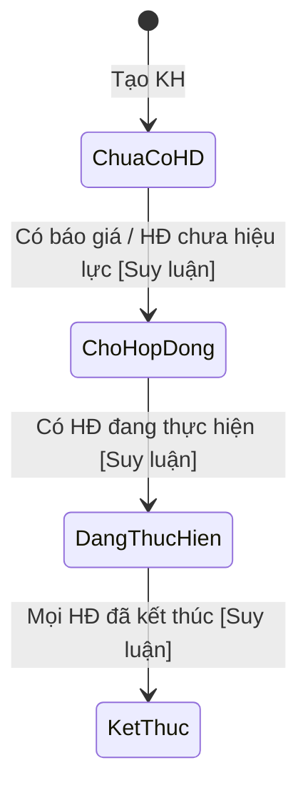
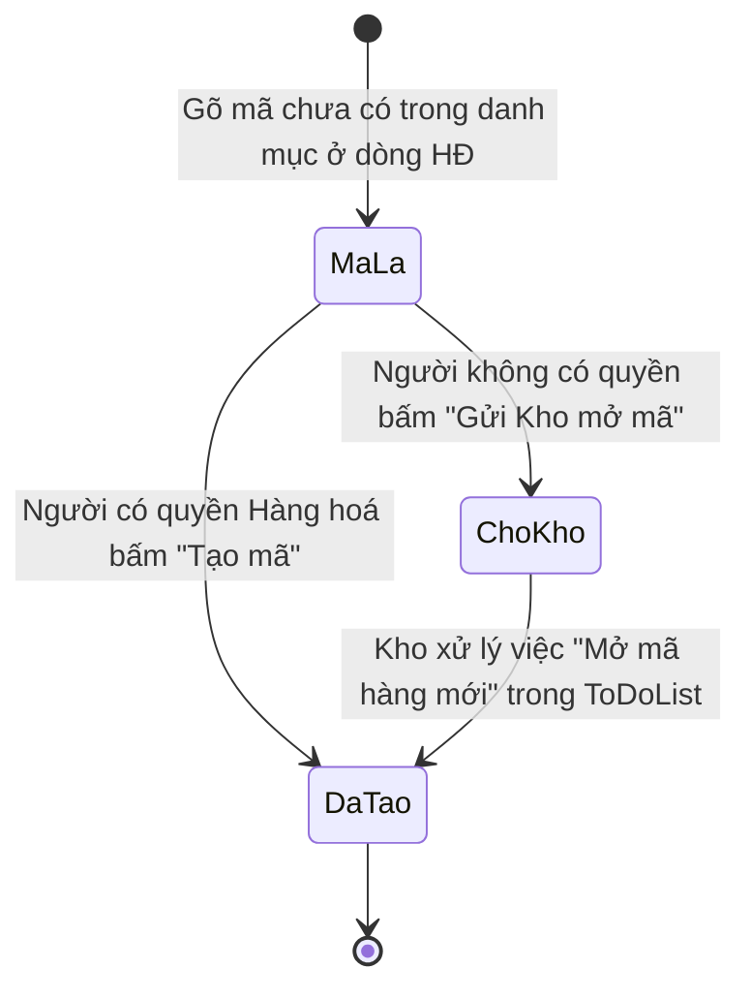

# 07 — Danh mục: Khách hàng / Nhà cung cấp / Hàng hoá

> Nguồn: `danhmuc.html` (màn "👥 Khách hàng / NCC"), cấu trúc dữ liệu `getDanhMucData`, popup "Mở mã hàng mới" trong `hdban.html`. Ví dụ là giả định. Suy luận gắn nhãn **[Suy luận]**.

## 1. Mục đích & phạm vi
Quản lý 3 danh mục dùng chung để chọn khi lập hợp đồng:
- **Khách hàng (KH)** — có tra cứu MST, phát hiện trùng, người liên hệ, Sale phụ trách, tình trạng tự tính.
- **Nhà cung cấp (NCC)** — có ngoại tệ thường dùng.
- **Hàng hoá (HH)** — mã hàng gốc, loại sản phẩm, vật liệu bình, ĐVT, xuất xứ, nồng độ mặc định.

## 2. Vai trò & quyền liên quan
| Khóa | Ý nghĩa | Mặc định (xem 00) |
|---|---|---|
| `khachhang` (có Phạm vi) | Xem/Sửa KH | GĐ/Admin: Sửa tất cả · Sale: Sửa của mình · Kế toán: Xem tất cả · Kho, Mua hàng: không |
| `ncc` | Xem/Sửa NCC | GĐ/Admin/Kế toán/Mua hàng: Sửa · Sale: Xem · Kho: không |
| `hanghoa` | Xem/Tạo mã hàng | GĐ/Admin/Kho/Mua hàng: Sửa · Sale/Kế toán: Xem |
| `hethong_duyetxoa` | Xoá KH/NCC ngay (không qua chờ duyệt) | GĐ, Admin |

Server trả `canKH`, `canNCC`, `canHH` (quyền sửa) và chỉ trả danh sách những tab người dùng được xem; tab không có dữ liệu thì không hiện. [Suy luận] Với phạm vi "Của mình", Sale chỉ nhận về KH mình phụ trách.

## 3. Màn hình / tab
Thanh tab dính: **Khách hàng N** · **Nhà cung cấp N** · **Hàng hoá N** (N = số dòng). Mở thẳng tab/bản ghi qua tham số `tab`, `id`.

Thanh lọc:
- Ô tìm: KH/NCC "Tìm tên / viết tắt / MST..."; HH "Tìm mã / mô tả / loại..." (tìm trong tên, viết tắt, MST, mã hàng, mô tả, loại SP; không phân biệt hoa thường).
- Tab HH thêm select "Mọi loại sản phẩm" (Khí chuẩn · Khí Công nghiệp · Dung dịch chuẩn · Thiết bị — danh sách do server trả).
- Nút phải: **+ Thêm mới** (KH/NCC) / **+ Tạo mã mới** (HH) — chỉ khi có quyền sửa.

Bảng (phân trang 50 dòng, bấm dòng mở popup):

| Tab | Cột |
|---|---|
| KH | Tên khách hàng (đậm, dưới là địa chỉ) · Viết tắt · MST · Sale phụ trách · Số HĐ (phải) · Tình trạng (pill accent nếu có HĐ) |
| NCC | Nhà cung cấp (+ địa chỉ) · Viết tắt · MST · Người liên hệ ("tên — điện thoại") · Ngoại tệ (trống = VNĐ) · Số HĐ mua |
| HH | Mã hàng hoá (gốc) · Loại sản phẩm · Mô tả · Vật liệu bình · ĐV · Xuất xứ · Nồng độ mặc định |

Rỗng: "Không có dòng nào khớp."

Popup (cỡ md, tiêu đề "Thêm / Sửa / Xem khách hàng | nhà cung cấp | mã hàng hoá"; "Xem" khi không có quyền sửa → mọi ô khóa):
- Nút: **Xoá** (đỏ, chỉ KH/NCC đã có, khi có quyền) · **Đóng** · **Lưu** (khi có quyền).
- KH có bảng "Người liên hệ" + link "+ Thêm người liên hệ", và vùng ghi chú MST dưới ô MST.

Popup phụ:
- Xác nhận xoá: "Xoá "<tên>"?".
- Trùng: "Có thể đã có trong danh mục" — "<tên>" (— trùng MST) (giống X%). Nút **Mở bản có sẵn** · **Đây là đối tượng khác — vẫn lưu** · **Huỷ**.

## 4. Chi tiết form

### 4.1 Khách hàng
| Trường | Kiểu nhập | Bắt buộc | Tự tính/nguồn | Ghi chú |
|---|---|---|---|---|
| Mã KH | — (không hiển thị trên form) | — | Server sinh | Dạng `KH` + 4 chữ số, VD `KH0001` |
| Tên khách hàng | text (2 cột) | [Suy luận] Có | Tự điền theo MST nếu đang trống | VD "Công ty TNHH ABC" |
| Viết tắt | text | Không | — | Dùng khi tìm & chấm trùng |
| Mã số thuế | text, nút "Tra MST" | Không | — | Gõ đủ 10 hoặc 13 số → tự tra sau 0,45s |
| Địa chỉ | text (2 cột) | Không | Tự điền theo MST nếu đang trống/"rác" (< 8 ký tự hoặc không có chữ) | |
| Email xuất hoá đơn | text | Không | — | |
| Điện thoại | text | Không | — | |
| Sale phụ trách | text + gợi ý (datalist danh sách Sale) | Không | `sales` từ server | |
| Ghi chú | text | Không | — | |
| Người liên hệ | bảng nhiều dòng: Họ tên · Chức vụ · Điện thoại · Email | Không | — | Dòng không có Họ tên bị bỏ khi lưu |
| Số HĐ | — | — | Tự đếm | Hiển thị ở danh sách |
| Tình trạng | — | — | Tự tính | Giá trị quan sát: Chưa có HĐ · Chờ hợp đồng · Đang thực hiện · Kết thúc |
| Ngày tạo, Người tạo | — | — | Server ghi | |

Vùng ghi chú MST (sau khi tra):
- Tên khớp (bỏ dấu, bỏ ký tự đặc biệt) → "✓ Tra được: <tên>".
- Tên khác → "Tên theo MST: <tên> — **Dùng tên này**".
- Địa chỉ khác → nút **Dùng địa chỉ theo MST**.
- Đã có KH khác trùng → "Đã có trong danh mục: <tên> (trùng MST) — **Mở bản có sẵn**".
- Lỗi: "Nhập MST đủ 10 hoặc 13 số." / "⚠️ Không tra được MST." / "⚠️ Không tra được (…) — nhập tay."

### 4.2 Nhà cung cấp
| Trường | Kiểu nhập | Bắt buộc | Tự tính/nguồn | Ghi chú |
|---|---|---|---|---|
| Mã NCC | — | — | Server sinh | `NCC` + 4 chữ số |
| Tên nhà cung cấp | text (2 cột) | [Suy luận] Có | — | |
| Viết tắt | text | Không | — | |
| Mã số thuế | text | Không | — | NCC không có tra MST tự động |
| Địa chỉ | text (2 cột) | Không | — | |
| Người liên hệ | text (1 người) | Không | — | Khác KH: chỉ 1 ô văn bản |
| Điện thoại / Email | text | Không | — | |
| Ngoại tệ thường dùng | select: (trống) · RMB · USD · EUR | Không | — | Trống hiển thị "VNĐ" |
| Ghi chú | text (2 cột) | Không | — | |
| Số HĐ mua | — | — | Tự đếm | |

### 4.3 Hàng hoá
| Trường | Kiểu nhập | Bắt buộc | Tự tính/nguồn | Ghi chú |
|---|---|---|---|---|
| Mã hàng hoá (gốc) | text (2 cột) | Có | — | **Khoá sau khi tạo** (không đổi được mã) |
| Loại sản phẩm | select | Có | `loaiSP` server; mặc định Khí chuẩn | Khí chuẩn · Khí Công nghiệp · Dung dịch chuẩn · Thiết bị |
| Vật liệu bình | select: (trống) · Nhôm · Thép | Không | — | |
| Mô tả | text (2 cột) | Không | — | Tên hàng |
| Đơn vị tính | text + gợi ý Bình/Cái/Chai/Bộ | Không | Mặc định "Bình" | |
| Xuất xứ / hãng | text | Không | — | |
| Nồng độ mặc định | text | Không | — | VD "30ppm" |
| Ghi chú | text | Không | — | |
| loai1…loai12, maPhu1…maPhu11 | — (không hiển thị) | — | Server | [Suy luận] Thuộc tính phân loại tách từ mã và các mã phụ/mã cũ dùng để chuẩn hoá, khớp mã |

### 4.4 Popup "Mở mã hàng mới" (từ dòng hàng trong HĐ bán)
| Trường | Kiểu nhập | Bắt buộc | Tự tính/nguồn | Ghi chú |
|---|---|---|---|---|
| Mã hàng hoá | text | Có ("Nhập mã hàng") | Mã đang gõ ở dòng HĐ | |
| Loại sản phẩm | select | — | Tự chọn "Khí chuẩn" nếu mã bắt đầu `KC-`/`KC ` | |
| ĐV | text + gợi ý | — | ĐVT dòng HĐ, mặc định Bình | |
| Mô tả / tên hàng | text | — | Tên hàng dòng HĐ | |
| Nồng độ | text | — | Nồng độ dòng HĐ | |

## 5. Luồng trạng thái

### 5.1 Tình trạng khách hàng (tự tính)

### 5.2 Mở mã hàng mới

## 6. Quy tắc sinh mã
| Đối tượng | Quy tắc |
|---|---|
| Mã KH | `KH` + số thứ tự 4 chữ số (server sinh) |
| Mã NCC | `NCC` + số thứ tự 4 chữ số |
| Mã hàng (do người dùng nhập) | Mẫu quan sát: `<Tiền tố loại>-<thành phần/tên>-<thể tích>`; tiền tố `KC` = Khí chuẩn, `DC` = Dung dịch chuẩn, `TB` = Thiết bị; thể tích dạng `10L`, `500ml`… VD giả định: `KC-CO2-40L`, `DC-PH7-500ml`, `TB-REG-01` |
| Đuôi bình nhôm | "Khí chuẩn tự gắn đuôi -AL (bình nhôm)" — do server áp khi tạo mã |
| Trùng mã | So khớp không phân biệt hoa thường; trùng → dùng lại mã có sẵn, toast "Mã đã có — dùng lại mã <mã>" |
| Trùng KH/NCC | Server chấm % giống (tên/viết tắt/MST) và cờ trùng MST |
| Hiển thị mã ở màn khác | **Kho**: tồn tách theo mã gốc × nồng độ × kho, nhóm theo mã gốc; so khớp mã + nồng độ không phân biệt hoa thường (xem 03_Kho.md §7.1). **HĐ bán/mua**: ô mã chọn từ danh mục, tự điền Tên/ĐV/Nồng độ; dán Excel ở HĐ mua chuẩn hoá mã theo danh mục (02_HopDongMua.md). Màn Kho/HĐ không có quy tắc mã riêng — chỉ dùng lại quy tắc ở đây |
| Chuẩn hoá & gộp mã | `chuanHoaKhiN2`, `chuanHoaMaHonHop`, `gopMaHangTrung` — không có nút ở Danh mục, Kho hay HĐ; [Suy luận] chạy tay phía server, kết quả thấy gián tiếp qua danh mục/tồn kho |

## 7. Quy tắc nghiệp vụ & ràng buộc
1. Không có quyền sửa → popup chỉ xem, không có nút Lưu/Xoá; không có nút Thêm.
2. Hàng hoá **không có nút Xoá** trên giao diện; mã không sửa được sau khi tạo.
3. Xoá KH/NCC đi qua `yeuCauXoa`: người có quyền Duyệt xoá xoá ngay ("Đã xoá"), người khác tạo yêu cầu ("Đã gửi yêu cầu xoá").
4. Lưu KH/NCC: nếu server phát hiện có thể trùng → hỏi; chọn "vẫn lưu" gửi lại với `boQuaTrung = true`.
5. Tra MST: server tra trước; nếu server yêu cầu tra bằng trình duyệt, trình duyệt gọi dịch vụ tra cứu doanh nghiệp công khai rồi gửi kết quả lại cho server. Chỉ tự điền tên khi tên đang trống, địa chỉ khi đang trống/không hợp lệ.
6. Kết quả tra cũ bị bỏ qua nếu người dùng đã gõ MST khác (chống ghi đè lẫn).
7. Mở mã từ HĐ: người không có quyền Hàng hoá vẫn được lưu HĐ với mã đó; Kho nhận việc `ma_hang_moi`.
8. Danh mục KH có thông báo/việc `kh_thieu_mst` "Khách hàng chưa có MST" cho bộ phận Kinh doanh.
9. Không có validate bắt buộc phía client; lỗi từ server hiện trong vùng lỗi popup.

## 8. Liên kết module khác
| Module | Liên kết |
|---|---|
| HĐ bán | Chọn KH; Số HĐ & Tình trạng KH tính từ HĐ bán; mở mã hàng mới từ dòng hàng |
| HĐ mua | Chọn NCC; ngoại tệ thường dùng; đếm Số HĐ mua |
| Kho | Mã hàng dùng cho phiếu kho/tồn; việc "Mở mã hàng mới", "Nồng độ ghi lệch" |
| ToDoList | `ma_hang_moi`, `kh_thieu_mst` |
| Duyệt xoá | Loại `KhachHang`, `NhaCungCap` |

## 9. Hàm server → mục đích
| Hàm | Mục đích |
|---|---|
| `getDanhMucData` | `{kh[], ncc[], hh[], canKH, canNCC, canHH, loaiSP[], sales[]}` |
| `getDanhMuc` | [Suy luận] Danh mục rút gọn cho màn khác — không thấy gọi ở màn này |
| `saveKhachHang(obj)` | Thêm/sửa KH → `{trung?}` hoặc OK |
| `saveNhaCungCap(obj)` | Thêm/sửa NCC |
| `saveHangHoa(obj)` | Thêm/sửa HH (`laMoi`) → `{row, daCo}` |
| `timKhachTrung`, `timNccTrung` | [Suy luận] Tìm KH/NCC trùng — server dùng nội bộ, client không gọi trực tiếp |
| `traCuuMST(mst, gợi ý, kết quả trình duyệt)` | Tra MST → `{found, ten, diaChi, trung[], message, thuTrinhDuyet}` |
| `moMaHangMoi(obj)` | Tạo mã ngay (`taoNgay`, `daCo`) hoặc gửi Kho (`daGui`) |
| `chuanHoaKhiN2`, `chuanHoaMaHonHop` | [Suy luận] Công cụ chuẩn hoá mã khí N2 / mã hỗn hợp — chạy tay phía server |
| `gopMaHangTrung` | [Suy luận] Gộp các mã hàng trùng — chạy tay phía server |
| `yeuCauXoa` | Xoá / yêu cầu xoá KH, NCC |

## 10. Khác biệt so với spec rev.md
| Chủ đề | Spec | App |
|---|---|---|
| Danh mục KH/NCC | Không có; HĐ ghi tên/MST trực tiếp | Có danh mục riêng, mã tự sinh, chống trùng, tra MST |
| Danh mục hàng | DM_LoaiHang + biến thể, chưa chốt | "Hàng hoá" với mã gốc, 4 loại SP, vật liệu bình, ĐVT, nồng độ mặc định |
| Ngoại tệ | Chỉ ở HĐ mua (VNĐ/USD/RMB) | NCC có ngoại tệ thường dùng RMB/USD/EUR |
| Phạm vi Sale | "Sales xem được Khách hàng" | Sale sửa được KH của mình |

## 11. Ghi chú thiết kế UI
- Theo quy ước chung (xem 00 §11). Bảng danh sách cao `100vh − 150px`.
- Tên KH/NCC in đậm, địa chỉ dòng phụ xám nhỏ; MST font số.
- Popup md dùng lưới 2 cột; ghi chú MST: xanh (✓ khớp), cam (lỗi), nút nhỏ.
- Bảng người liên hệ dạng bảng sửa trực tiếp.
