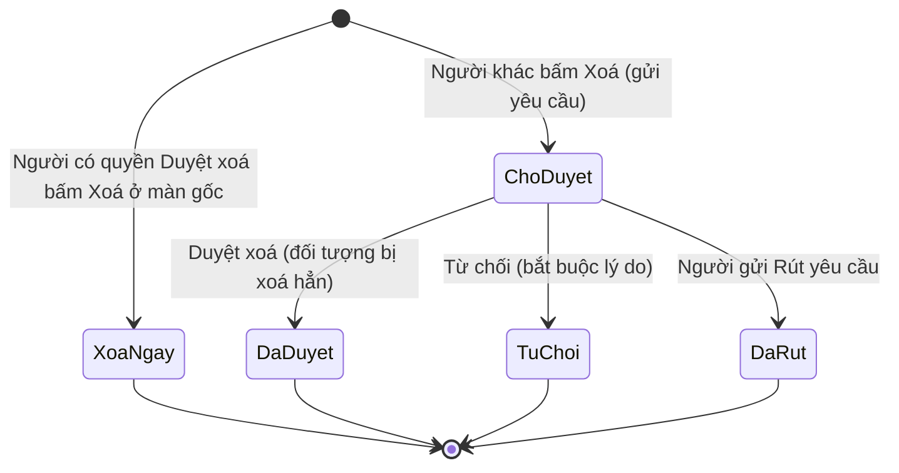

# 08 — Duyệt xoá

> Nguồn: `duyetxoa.html`, các lời gọi `yeuCauXoa` trong HĐ bán, HĐ mua, Kho, Kế toán, Danh mục. Ví dụ giả định. Suy luận gắn nhãn **[Suy luận]**.

## 1. Mục đích & phạm vi
Kiểm soát việc xoá dữ liệu: người không có quyền duyệt chỉ gửi **yêu cầu xoá**; người có quyền duyệt xoá ngay hoặc duyệt/từ chối yêu cầu của người khác. Màn "🗑️ Duyệt xoá" liệt kê các yêu cầu.

## 2. Vai trò & quyền liên quan
| Khóa | Ý nghĩa | Mặc định |
|---|---|---|
| `hethong_duyetxoa` | Duyệt / từ chối yêu cầu; tự xoá ngay không cần yêu cầu | Giám đốc, Admin (Owner toàn quyền) |
| Quyền sửa của đối tượng (vd `hdb_tao`, `hdb_hoso`, `kho_phieu`, `khachhang`…) | Được bấm nút xoá ở màn gốc | Theo ma trận 00 |

Server trả `canApprove`. Không có quyền duyệt → chỉ thấy yêu cầu của chính mình, kèm dòng "Bạn chỉ thấy yêu cầu của mình."

## 3. Màn hình / tab
Thanh tab: **Chờ duyệt N** · **Đã xử lý N**.

Bảng (cao `100vh − 140px`):

| Cột | Nội dung |
|---|---|
| Ngày gửi | `dd/mm/yyyy hh:mm` |
| Người gửi | Họ tên |
| Loại | Pill nhãn loại (bảng dưới) |
| Đối tượng xoá | HoSo: "📄 <tên file>"; Dong: "<bảng>: <tên>"; khác: tên hiển thị |
| Nằm ở | Số HĐ + tên khách (dòng phụ) hoặc "—"; link **Mở HĐ** / **Mở Kho** |
| Kết quả (chỉ tab Đã xử lý) | Pill "Đã duyệt" (xanh) / "Từ chối" (cam) + "người duyệt · thời gian — lý do" |
| Hành động (tab Chờ duyệt) | **Duyệt xoá** (đỏ) + **Từ chối** (nếu có quyền) · **Rút yêu cầu** (nếu là người gửi) |

Rỗng: "Không có yêu cầu nào."

Loại đối tượng:

| Mã | Nhãn | Gửi từ |
|---|---|---|
| `HopDongBan` | Hợp đồng bán | Chi tiết HĐ bán (tên hiển thị "Số HĐ/Báo giá — Khách") |
| `HopDongMua` | Hợp đồng mua | Chi tiết HĐ mua |
| `PhieuNhapKho` / `PhieuXuatKho` | Phiếu nhập kho / Phiếu xuất kho | Kho |
| `KhachHang` / `NhaCungCap` | Khách hàng / Nhà cung cấp | Danh mục |
| `HoSo` | File hồ sơ | Hồ sơ HĐ bán/mua, phiếu kho, phiếu kế toán |
| `Dong` | Dòng dữ liệu | Dòng con trong HĐ (vd "Đợt 1" thanh toán, "Lần 1" hoá đơn, dòng chi phí) |
| `PhieuKeToan` | *(không có nhãn — hiện nguyên mã)* | Kế toán (màn Kế toán gọi là "huỷ" phiếu) |

Popup:
- Duyệt: "Duyệt xoá?" — "Xoá hẳn đối tượng này. Không hoàn tác được." → **Duyệt xoá** (đỏ).
- Từ chối: "Lý do từ chối" (ô nhiều dòng, bắt buộc) → **Từ chối**.

## 4. Chi tiết form
| Trường | Kiểu nhập | Bắt buộc | Tự tính/nguồn | Ghi chú |
|---|---|---|---|---|
| Lý do từ chối | textarea | Có ("Vui lòng nhập nội dung.") | — | Hiện ở cột Kết quả |
| (Yêu cầu) loai | — | Có | Màn gốc | Xem bảng loại |
| doiTuongId | — | Có | Màn gốc | Id bản ghi |
| fieldKey | — | Với `Dong` | Tên sheet/bảng con | |
| fileUrl | — | Với `HoSo` | Đường dẫn file | |
| tenHienThi | — | Có | Màn gốc ghép | VD "HĐ-001/2026 — Công ty ABC" |
| nguoiYeuCau, thoiGianYeuCau | — | — | Server | |
| trangThai | — | — | Server | Chờ duyệt / Đã duyệt / Từ chối |
| nguoiDuyet, thoiGianDuyet, lyDoTuChoi | — | — | Server | |
| page, hdId, soHD, tenKhachHang | — | — | Server | Dùng cho cột "Nằm ở" và link mở |

## 5. Luồng trạng thái

[Suy luận] Trạng thái sau khi rút không thấy ở dữ liệu mẫu (có thể bị xoá khỏi danh sách hoặc ghi trạng thái riêng).

## 6. Quy tắc sinh mã
Không có mã nghiệp vụ; id yêu cầu do server sinh.

## 7. Quy tắc nghiệp vụ & ràng buộc
1. `yeuCauXoa` trả `deleted = true` khi người gọi có quyền duyệt (xoá ngay), ngược lại tạo yêu cầu; nếu đã có yêu cầu chờ cho cùng đối tượng → `existed = true` ("Đã có yêu cầu xoá đang chờ duyệt").
2. Trong lúc chờ, màn gốc đánh dấu đối tượng "chờ xoá" (vd file hồ sơ `choXoa`, phiếu kế toán "Chờ duyệt huỷ").
3. Duyệt xoá là thao tác **không hoàn tác**.
4. Từ chối bắt buộc nhập lý do.
5. Chỉ người gửi mới rút được yêu cầu của mình, và chỉ khi còn Chờ duyệt.
6. Người không có quyền duyệt chỉ xem được yêu cầu của mình.
7. Mỗi lần xoá ghi nhật ký HĐ mục "Xoá" [Suy luận theo `MUC_LABEL.xoa`].

## 8. Liên kết module khác
HĐ bán, HĐ mua, Kho, Kế toán, Danh mục gửi yêu cầu; link "Mở HĐ"/"Mở Kho" điều hướng về màn gốc (`page`, `hdId`).

## 9. Hàm server → mục đích
| Hàm | Mục đích |
|---|---|
| `yeuCauXoa({loai, doiTuongId, fieldKey?, fileUrl?, tenHienThi})` | Xoá ngay / tạo yêu cầu → `{deleted, existed}` |
| `listYeuCauXoa` | `{rows[], canApprove, me}` |
| `duyetYeuCauXoa(id)` | Duyệt & xoá → danh sách mới |
| `tuChoiYeuCauXoa(id, lý do)` | Từ chối → danh sách mới |
| `rutYeuCauXoa(id)` | Rút yêu cầu → danh sách mới |

## 10. Khác biệt so với spec rev.md
| Spec | App |
|---|---|
| "Request → Approve, không xóa thẳng" | Người có quyền Duyệt xoá **xoá thẳng**; chỉ người khác mới qua yêu cầu |
| Không nêu ai duyệt | Khóa `hethong_duyetxoa` — mặc định Giám đốc, Admin |
| Không nêu loại đối tượng | 9 loại, gồm cả file hồ sơ và từng dòng con |
| Không nêu từ chối/rút | Có từ chối (bắt buộc lý do) và rút yêu cầu |

Lỗ hổng giao diện quan sát được: loại `PhieuKeToan` thiếu nhãn tiếng Việt trong bảng.

## 11. Ghi chú thiết kế UI
Theo quy ước chung (00 §11): tab bo tròn có số đếm, bảng sọc, pill loại xám, pill kết quả xanh/cam, nút Duyệt xoá kiểu `btn-danger`.
