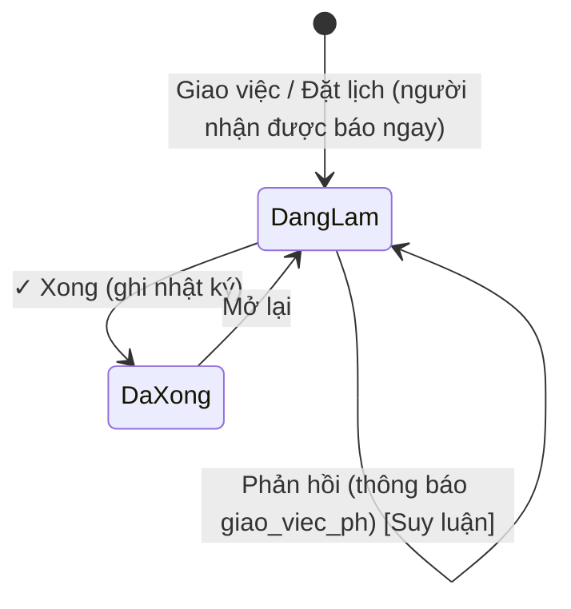

# 09 — ToDoList (Việc cần làm · Giao việc · Đặt lịch)

> Nguồn: `todo.html`, cấu trúc `getTodoList`, khối "📅 Đặt lịch / Giao việc" trong `hdban.html`. Ví dụ giả định. Suy luận gắn nhãn **[Suy luận]**.

## 1. Mục đích & phạm vi
Một danh sách hợp nhất mọi việc người dùng cần xử lý:
- **Việc hệ thống tự sinh** từ dữ liệu nghiệp vụ (hạn thanh toán, giao hàng, hoá đơn, dữ liệu cần bổ sung…), bấm "Xử lý →" để nhảy tới đúng chỗ.
- **Việc giao / lịch hẹn** do người dùng tạo: giao cho 1 hoặc nhiều người, gắn hợp đồng, đặt hạn, trao đổi dạng hội thoại, đánh dấu hoàn thành.

Không thấy chức năng "góp ý" riêng; phần trao đổi là **phản hồi** trong từng việc giao.

## 2. Vai trò & quyền liên quan
| Khóa | Ý nghĩa | Mặc định |
|---|---|---|
| `todo` (có Phạm vi) | Xem: thấy ToDoList; Sửa: được Giao việc / Đặt lịch | Sale: Sửa (Của mình); các vai trò khác: Sửa (Tất cả) |
| Cài đặt thông báo (00) | Vai trò nào nhận loại việc nào | Owner cấu hình |

Pill "Phạm vi: Tất cả / Của mình" hiển thị theo `scope`. Trong chi tiết việc, server trả `quyen.binhLuan` (được phản hồi) và `quyen.xong` (được đánh dấu xong/mở lại). Việc do **Giám đốc giao** được đánh dấu ưu tiên (`uuTien`).

## 3. Màn hình
### 3.1 Thanh lọc (dính trên)
- Ô tìm "Tìm việc / Số HĐ / khách hàng..." (tìm trong tiêu đề, số HĐ, khách, người phụ trách, người tạo).
- Select "Mọi loại việc" — chỉ liệt kê loại có việc (kèm số đếm), lọc theo bộ phận đang chọn.
- Công tắc **Việc / lịch đã xong** (chuyển sang danh sách đã xong).
- Pill phạm vi.
- Nút **📌 Giao việc / Đặt lịch** (khi có quyền sửa).
- Chip bộ phận (màu riêng, có số đếm): Tất cả · Kinh doanh · Kế toán · Kho · Mua hàng · Lịch hẹn — chỉ hiện bộ phận có việc hoặc bộ phận của tôi. Chọn chip sẽ xoá lọc loại.

### 3.2 Bảng việc
Dòng đầu: "**N** việc" + tag "⭐ N việc Giám đốc giao".

| Cột | Nội dung |
|---|---|
| Hạn | `dd.mm.yy` + giờ; quá hạn: chữ đỏ nhấp nháy + "quá hạn N ngày" |
| Việc cần làm | Tag "⭐ Giám đốc giao" · tiêu đề đậm · "💬 N" số phản hồi · dòng phụ · "giao bởi X" · (đã xong) "✓ xong thời gian — người" · hạn chi tiết "⏰ dd.mm.yy hh:mm · quá hạn N ngày / hôm nay / ngày mai / còn N ngày" · số tiền |
| Liên quan | Số HĐ + tên khách, hoặc "—" |
| Bộ phận · Loại | Pill bộ phận màu + tên loại |
| Phụ trách | Người phụ trách |
| Hành động | Việc giao: **💬 Mở** + **✓ Xong** / **Mở lại**; việc hệ thống: **Xử lý →** |

Dòng có viền trái 4px theo màu bộ phận; việc Giám đốc giao nền vàng nhấp nháy nhẹ. Rỗng: "🎉 Không có việc nào."

Sắp xếp: chưa xong → ưu tiên trước, rồi theo ngày + giờ tăng dần (không hạn xuống cuối); đã xong → thời điểm xong mới nhất trước.

### 3.3 Popup "📌 Giao việc / Đặt lịch" (md)
- Dòng chip: 👤 người nhận (xanh) / "👤 Việc của tôi"; # HĐ (tím); ⏰ hạn (vàng) hoặc "Hạn: hôm nay (gõ /in để hẹn giờ)". Mỗi chip có ✕ bỏ.
- Ô nội dung lớn với gợi ý nổi:
  - `@` → danh sách nhân viên (tên + vai trò), lọc không dấu, tối đa 10, chọn nhiều người.
  - `#` → HĐ đang thực hiện (số HĐ + khách + sale), tối đa 12.
  - `/in` (hoặc `/hen`, `/hẹn`, `/h`…) → hạn nhanh: Hôm nay 17:00 · Sáng mai 08:00 · Chiều mai 14:00 · Thứ Sáu tuần này 17:00 · Thứ Hai tuần sau 08:00 · Chọn ngày giờ khác… (mở ô ngày + giờ + nút **Đặt hạn**).
  - Gõ thẳng: `/in 15/10 9h`, `/in 15/10/2026 14:30`, `/in mai 8h`, `nay`, `kia`.
  - Phím: ↑/↓ chọn, Enter/Tab xác nhận, Esc đóng gợi ý, Ctrl+Enter gửi.
- Dòng hướng dẫn: "Không @ ai = việc của mình. Có #HĐ thì việc hiện ở khối Đặt lịch / Giao việc của HĐ đó."
- Nút **Huỷ** / **📌 Giao việc**.

### 3.4 Popup chi tiết việc (md)
- Tiêu đề: "📌 Việc được giao" / "📌 Việc đặt lịch" (✓ khi đã xong).
- Nội dung (tô màu @người, #HĐ).
- Bảng thông tin: Giao bởi (+ thời gian) · Người nhận · Hạn · Hợp đồng (link mở HĐ bán) · Trạng thái ("Đang làm" / "✓ Đã hoàn thành thời gian — người").
- Luồng hội thoại: tin của tôi canh phải nền accent-soft, người khác canh trái; dòng hệ thống ở giữa; "Chưa có phản hồi".
- Ô phản hồi (Enter gửi, Shift+Enter xuống dòng) + **Gửi** — khi có quyền bình luận.
- Nút: **Đóng** · **✓ Đánh dấu đã hoàn thành** / **↺ Mở lại việc** (khi có quyền).

## 4. Chi tiết form

### 4.1 Giao việc / Đặt lịch
| Trường | Kiểu nhập | Bắt buộc | Tự tính/nguồn | Ghi chú |
|---|---|---|---|---|
| Nội dung | textarea có gợi ý @ # /in | Có ("Nhập nội dung việc.") | — | VD "@Trần B gọi lại khách #HĐ-012 /in mai 9h" |
| Người nhận (`nguoiPhuTrach`) | chọn qua @, nhiều người | Không | `gvDanhMuc().nv` | Trống = chính người tạo |
| Hợp đồng (`doiTuongId`) | chọn qua #, 1 HĐ | Không | `gvDanhMuc().hd` (HĐ đang thực hiện) | Mở từ HĐ bán: điền sẵn `#<số HĐ>` |
| Hạn ngày (`ngay`) | /in, gõ tắt hoặc ô ngày | Không | Mặc định hôm nay | Ngày không năm đã qua > 1 ngày → năm sau |
| Hạn giờ (`gio`) | /in hoặc ô giờ | Không | — | `hh:mm` |

### 4.2 Phản hồi
| Trường | Kiểu nhập | Bắt buộc | Tự tính/nguồn | Ghi chú |
|---|---|---|---|---|
| Phản hồi | textarea | Có (rỗng thì không gửi) | — | Hiện ngay "⏳ đang gửi" → "vừa gửi"; lỗi: viền đỏ + "⚠ chưa gửi được" và trả nội dung về ô |

### 4.3 Dữ liệu 1 việc (danh sách)
`id, loai, kind (todo/done), title, sub, soTien, ngay, gio, tab, focus, hdId, soHD, tenKhachHang, nguoiPhuTrach, nguoiTao, target{page,id,tab,focus}, boPhan, lichId (việc giao), soPH, uuTien, xongLuc, nguoiXong`.

## 5. Luồng trạng thái

Việc hệ thống: không có trạng thái do người dùng đổi — [Suy luận] tự biến mất khi điều kiện gốc được xử lý.

## 6. Công thức / quy tắc
| Nội dung | Quy tắc |
|---|---|
| Số ngày còn | `ngày hạn − hôm nay`: < 0 "quá hạn N ngày" (đỏ) · 0 "hôm nay" · 1 "ngày mai" (cam) · khác "còn N ngày" |
| Hạn nhanh | Thứ Sáu tuần này = hôm nay + ((5 − thứ) + 7) mod 7; Thứ Hai tuần sau = hôm nay + (((8 − thứ) mod 7) hoặc 7) |
| Gõ tắt hạn | `d/m[/yy|yyyy] [h[:mm|hmm|gmm]]`; `nay|mai|kia [giờ]`; năm 2 số + 2000 |
| Tiêu đề tạm | Khi vừa gửi hiện "⏳ <nội dung>" cho tới khi server trả danh sách mới |

### Loại việc (`types`) & bộ phận
| Bộ phận (màu) | Loại |
|---|---|
| Kinh doanh `kd` (xanh dương) | `hd_cho_chuyen` HĐ chờ chuyển giai đoạn · `tt_du_kien` Hạn khách thanh toán · `kh_da_tt` Khách hàng đã thanh toán · `kh_thieu_mst` Khách hàng chưa có MST · `bs_gia_hdb` Bổ sung: giá HĐ bán |
| Kế toán `kt` (đỏ) | `xuat_hoa_don` Xuất hoá đơn · `cpkd_cho_chi` Thưởng KD / Chi phí KD chờ chi · `tt_ncc` Hạn thanh toán NCC · `kt_cho_xu_ly` Phiếu thu / chi chờ kế toán xác nhận · `bs_tt_khach` Bổ sung: khách thanh toán · `bs_tt_ncc` Bổ sung: thanh toán NCC · `bs_phu_tai` Bổ sung: HĐ Phú Tài · `bs_ke_toan` Bổ sung: kế toán |
| Kho `kho` (hồng) | `han_giao` Sắp đến hạn giao hàng · `cho_cap_hang` Đề nghị cấp hàng chờ xuất kho · `bao_hang_ve` Hàng về chờ nhập kho · `bs_giao_hang` Bổ sung: giao hàng · `bs_kho` Bổ sung: kho · `nong_do_lech` Nồng độ ghi lệch · `ma_hang_moi` Mở mã hàng mới |
| Mua hàng `mua` (cam) | `de_nghi_mua` Đề nghị mua hàng · `bs_hdm` Bổ sung: Hợp đồng mua · `hang_sap_ve` Hàng sắp về / quá ngày về |
| Lịch hẹn `chung` (xám) | `dat_lich` Đặt lịch / giao việc · `giao_viec_ph` Phản hồi việc được giao |

## 7. Quy tắc nghiệp vụ & ràng buộc
1. Không có quyền sửa `todo` → không thấy nút giao việc; gọi soạn việc sẽ báo "Bạn chưa có quyền giao việc / đặt lịch."
2. Giao cho người khác → toast "Đã giao việc — người nhận được báo ngay"; chỉ cho mình → "Đã đặt lịch".
3. Gửi lỗi → bỏ việc tạm, báo lỗi và **mở lại ô soạn với nội dung cũ** để gửi lại.
4. Xong/Mở lại cập nhật ngay trên màn (lạc quan), sau đó đồng bộ server; lỗi thì nạp lại.
5. Hoàn thành việc được ghi vào nhật ký ("Đã hoàn thành — ghi vào nhật ký").
6. Việc gắn #HĐ hiển thị thêm ở khối "📅 Đặt lịch / Giao việc" của HĐ bán đó (khối này chỉ cho tạo mới khi HĐ chưa ở giai đoạn cuối).
7. Mở ToDoList với `id = moi-<hdId>` → mở ô soạn có sẵn #HĐ; với id việc → mở chi tiết việc.
8. "Xử lý →" mở màn đích, bản ghi, tab và tô sáng ô cần sửa (`focus`).

## 8. Liên kết module khác
| Module | Liên kết |
|---|---|
| HĐ bán | Gắn #HĐ; khối Đặt lịch/Giao việc trong HĐ; nút "Giao việc / Đặt lịch cho HĐ này" |
| HĐ mua, Kho, Kế toán, Phú Tài, Danh mục | Nguồn sinh việc tự động; "Xử lý →" điều hướng tới |
| Chuông thông báo | Cùng nguồn dữ liệu việc; nhóm "Việc cần làm" |
| Cài đặt thông báo | Quyết định ai nhận loại việc nào |

## 9. Hàm server → mục đích
| Hàm | Mục đích |
|---|---|
| `getTodoList({})` | `{items[], daXong[], types[], boPhan[], boPhanCuaToi[], staff[], hdOptions[], scope}` |
| `saveLichHen({ngay, gio, nguoiPhuTrach[], doiTuongId, noiDung})` | Tạo việc giao / lịch hẹn → trả danh sách mới |
| `danhDauLichXong` | [Suy luận] Hàm cũ đánh dấu lịch xong — client hiện dùng `gvXong` |
| `gvDanhMuc` | Danh sách nhân viên `nv[{ten, vaiTro}]` và HĐ `hd[{id, soHD, kh, vt, sale}]` cho gợi ý |
| `gvChiTiet(id)` | `{viec, me, quyen{binhLuan, xong}, nhan[], hd, phanHoi[]}` |
| `gvBinhLuan(id, nội dung)` | Gửi phản hồi |
| `gvXong(id, xong)` | Đánh dấu xong / mở lại |

## 10. Khác biệt so với spec rev.md
Spec không có ToDoList, giao việc, lịch hẹn hay danh sách việc tự sinh — toàn bộ là chức năng **mới trong app**. Spec có dự kiến "dashboard trang chủ" (chưa chốt layout) nhưng app **không làm dashboard**; ToDoList + chuông là nơi tổng hợp việc theo vai trò (xem 00 §10).

## 11. Ghi chú thiết kế UI
- Màu bộ phận: Kinh doanh #2563eb · Kế toán #dc2626 · Kho #db2777 · Mua hàng #ea580c · Lịch hẹn #64748b (pill nền 13%, viền 35%).
- Tag Giám đốc giao: nền #fef3c7, chữ #a16207; dòng nền vàng nhấp nháy 1,6s (tắt khi người dùng chọn giảm chuyển động).
- Chip trong ô soạn: người (xanh nhạt), HĐ (tím nhạt), hạn (vàng nhạt).
- Hội thoại dạng bong bóng, cao tối đa 44vh, tự cuộn xuống cuối.
- Còn lại theo quy ước chung (00 §11).
